# How the CW decoder works

This document describes the algorithm in `cw_engine`, starting with the
overall picture and adding detail level by level. Each level covers the
same pipeline as the one before it, at a finer grain. File and class names
point into `src/engine/`. Numbers are the defaults of the v3 preset at the
decoder's 250 Hz channel rate, unless the text says otherwise.

- [Level 0: the skimmer in one picture](#level-0-the-skimmer-in-one-picture)
- [Level 1: one channel's decoder](#level-1-one-channels-decoder)
- [Level 2: the channel's life cycle](#level-2-the-channels-life-cycle)
- [Level 3: the stages](#level-3-the-stages)
  - [3.1 Channelizer](#31-channelizer)
  - [3.2 Envelope](#32-envelope)
  - [3.3 Squelch and keying duty (v2 view)](#33-squelch-and-keying-duty-v2-view)
  - [3.4 v3 front end: carrier detector, matched filter, calibrated LLR](#34-v3-front-end-carrier-detector-matched-filter-calibrated-llr)
  - [3.5 Dead air and the pause](#35-dead-air-and-the-pause)
  - [3.6 Dit bootstrap](#36-dit-bootstrap)
  - [3.7 Pre-roll replay](#37-pre-roll-replay)
  - [3.8 Soft discriminator (v2 LLR)](#38-soft-discriminator-v2-llr)
  - [3.9 Semi-Markov Viterbi lattice](#39-semi-markov-viterbi-lattice)
  - [3.10 Commit, live emission and the over break](#310-commit-live-emission-and-the-over-break)
  - [3.11 Element clock and its re-lock](#311-element-clock-and-its-re-lock)
  - [3.12 Fist model](#312-fist-model)
  - [3.13 Character assembly](#313-character-assembly)
  - [3.14 Watchdogs and the carrier rule](#314-watchdogs-and-the-carrier-rule)
  - [3.15 Word re-read against MASTER.SCP](#315-word-re-read-against-masterscp)
  - [3.16 Call reader (keyword spotting)](#316-call-reader-keyword-spotting)
  - [3.17 Output and the callsign extractor](#317-output-and-the-callsign-extractor)
- [Level 4: one sample through `process()`](#level-4-one-sample-through-process)
- [v2 and v3 side by side](#v2-and-v3-side-by-side)
- [Constants at a glance](#constants-at-a-glance)
- [Level 5: where the decoder can improve](#level-5-where-the-decoder-can-improve)
  - [5.1 Status against v3](#51-status-against-v3)
  - [5.2 The decoder as one factor graph](#52-the-decoder-as-one-factor-graph)
  - [5.3 Evidence](#53-evidence)
    - [5.3.6 Measured: the filter chain](#536-measured-the-filter-chain-and-where-the-speed-dependent-loss-is)
  - [5.4 The channel: Watterson fading](#54-the-channel-watterson-fading)
  - [5.5 Decision: posteriors instead of one path](#55-decision-posteriors-instead-of-one-path)
  - [5.6 Callsigns: a posterior, not a count](#56-callsigns-a-posterior-not-a-count)
  - [5.7 Impulse noise](#57-impulse-noise)
  - [5.8 Where small networks fit](#58-where-small-networks-fit)
  - [5.9 How to measure](#59-how-to-measure)
  - [5.10 Suggested order](#510-suggested-order)
  - [5.11 Sources](#511-sources)
- [Experiments: proposed diffs](#experiments-proposed-diffs)
  - [E0: the bench, `experiments/cw_bench`](#e0-the-bench-experimentscw_bench)
  - [E1: `experiments/matched-alive-and-flat-passband.diff`](#e1-experimentsmatched-alive-and-flat-passbanddiff)
  - [E2: `experiments/acquire-settle-and-witness.diff`](#e2-experimentsacquire-settle-and-witnessdiff)
  - [E3: `experiments/view-at-word-space.diff`](#e3-experimentsview-at-word-spacediff)

---

## Level 0: the skimmer in one picture

A wideband IQ stream is split into many narrow channels. Each channel has
its own decoder, which turns Morse keying into text. A callsign extractor
reads that text and decides which callsigns are trustworthy enough to spot.

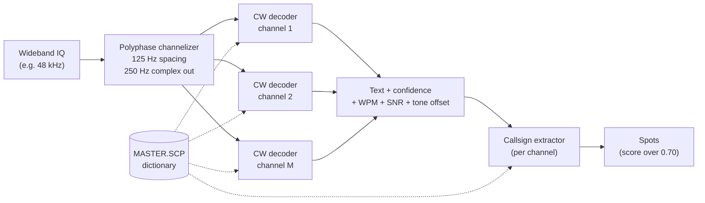

The core idea of the decoder: **it never makes a hard on/off decision per
sample**. Each sample becomes a soft mark-or-space log-likelihood ratio
(LLR). A semi-Markov Viterbi search then finds the most likely sequence of
dits, dahs and spaces, with duration priors tied to an adaptive dit clock.
A faded element is weak evidence, not missing evidence.

The engine holds the channelizer, the decoders and the extractor. The
pipeline that arbitrates ghosts between channels, measures the band noise
floor and feeds spots belongs to the skimmer module.

---

## Level 1: one channel's decoder

One `CwState` (`decode_cw_viterbi.cpp`) runs per channel. It takes blocks of
250 Hz complex baseband with the tone inside ±62.5 Hz, and returns text.

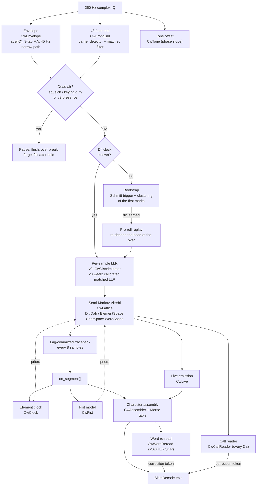

There are three layers:

1. **Observation.** This layer turns IQ into a per-sample number that says
   how mark-like the sample is. v2 uses a heuristic on the envelope. v3 adds
   a carrier-locked matched filter with calibrated likelihoods for weak
   signals.
2. **Decision.** A Viterbi lattice over variable-length segments decides
   the element sequence. Its duration priors adapt to the operator's speed
   (the clock) and spacing (the fist).
3. **Language.** Morse codes become characters. Finished words can be
   re-scored against a callsign dictionary on the original audio evidence.
   v3 also searches the audio directly for callsigns that the text hints
   at.

v2 and v3 are **one implementation with two presets**
(`decode_cw_config.h`). v3 = v2 + front end + call reader + three clock
fixes (`v3.robust_clock`). Strong stations in v3 still go through v2's
view, because v2 was tuned on strong live air and remains the reference
there. The v3 changes apply only in the *weak view*, below 8 dB SNR in
500 Hz.

---

## Level 2: the channel's life cycle

A channel moves through a small set of modes. The flags that drive them are
`m_paused`, `m_carrier`, `m_lattice.active()` and `m_clock.dit()`.

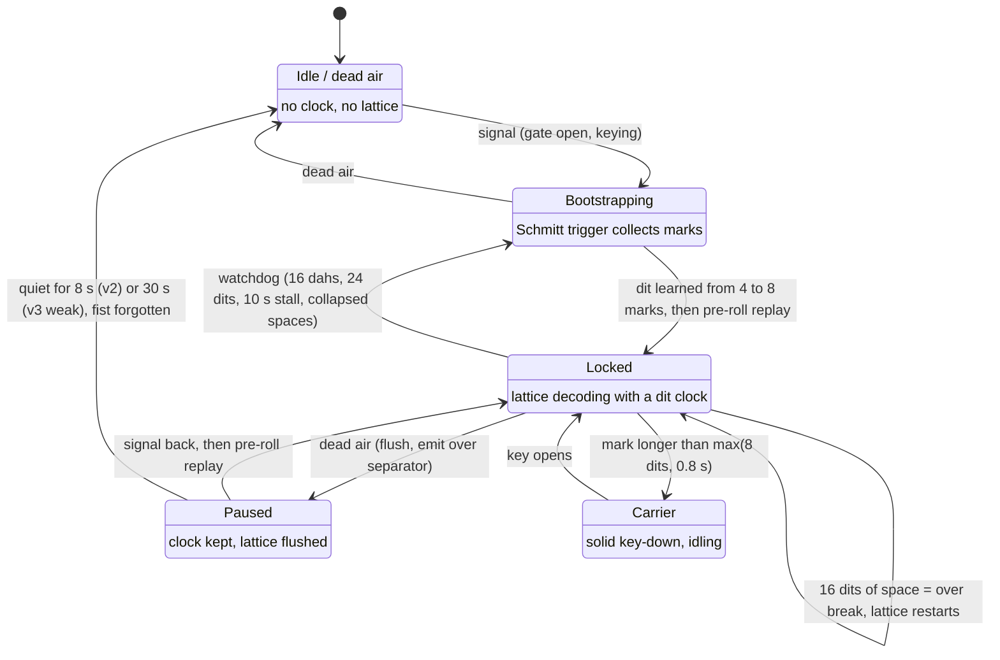

Three rules matter here:

- **Dead air does not always pause the channel.** A *solid* channel has a
  clock, at least 8 committed marks and element error under 0.35. If its
  discriminator still sees µ_mark over 3 × µ_space, the channel rides out
  a QSB trough instead of pausing. This avoids splitting a callsign in
  half during a fade.
- **Every wake-up replays the pre-roll.** The squelch and the bootstrap
  both use up the start of an over. A ring of recent samples lets that
  start be decoded anyway.
- **The fist is forgotten after a hold.** After a long quiet the next
  signal is probably a different operator, so the clock, the spacing model
  and the edge smear are reset.

---

## Level 3: the stages

### 3.1 Channelizer

`channelizer.cpp`, `SkimChannelizer`

A **2×-oversampled polyphase filter bank**:

| | |
|---|---|
| Channels | M = in_rate / 125 Hz (must be even) |
| Hop | H = M/2 input frames |
| Output rate | 2 × 125 = 250 Hz complex per channel |
| Prototype | K·M taps, K = 8 per branch, Blackman-Harris 4-term windowed sinc (WDSP `fir_bandpass`), cutoff ±62.5 Hz, DC gain 1 |
| Transform | unnormalised backward M-point FFT (fftw3f) |

At each hop the newest K·M input frames are folded branch-wise,
`acc[m] = Σ_k hist[P−1−(kM+m)]·h[kM+m]`. One FFT then evaluates every
channel at once. Hopping by M/2 rotates channel c by e^{jπc} per hop, so
odd channels are negated on odd hops. Without that fix, odd channels would
sit at ±125 Hz instead of near DC.

The channels overlap by half. A tone between two channel centres shows up
in both, which is why the decoder exposes `level()` and `tone_offset_hz()`
for ghost arbitration, and why v3's carrier detector claims a carrier only
when the carrier is in the channel's own ±¼ of the band.

Each channel buffers about 8 s (4096 frames) in a ring. FFTW planning takes
core's `dsp::buffer::fftwMutex()`.

### 3.2 Envelope

`cw_envelope.h`, `CwEnvelope`

For each sample:

- `mag = |IQ|`
- `env` = the 3-tap moving average of `mag`. The squelch, the keying-duty
  test and v2's bootstrap read this raw-channel envelope.
- `soft_env` = the soft path's envelope. With `SKIM_Vn_NARROW` = 45 Hz (the
  default), the IQ is **derotated by the tracked tone offset**, then
  low-passed by a 2nd-order Butterworth at 45 Hz, then the magnitude is
  taken and 3-tap averaged. The channel is 125 Hz wide, but a 25–35 WPM
  signal needs about a third of that. The narrow path lets in less noise
  and less splatter from neighbouring channels.

The tone offset (`cw_tone.h`) comes from the **phase slope** between
consecutive samples, `atan2(Im(x·x̄₋₁), Re(x·x̄₋₁))·rate/2π`. It is averaged
by an EMA with gain 0.01 and measured only on *solid* mark samples: above
55 % of the mark/space span and more than 3× the floor. Borderline samples
would pull the estimate towards the channel centre. In v3's weak view the
tone offset is taken from the carrier detector's AFC instead.

### 3.3 Squelch and keying duty (v2 view)

`cw_levels.h`, `CwLevels`

These are v1's level trackers, run on `env`:

| Tracker | Rule |
|---|---|
| `env_hi` | instant attack, 0.8 s release (peak) |
| `env_lo` | 0.3 s EMA of the samples below the midpoint (floor) |
| `gate_open` | opens when env_hi > 4 × env_lo, closes below 2.6 × (hysteresis) |
| `keying` | 0.7 s EMA of "sample in the top 30 % of the span". On above 15 %, off below 7 % |

The squelch alone opens on any carrier or noise burst. The keying-duty
test opens only on something that switches on and off.

### 3.4 v3 front end: carrier detector, matched filter, calibrated LLR

`cw_frontend.h`, `CwFrontEnd`

The front end has five parts. It is the main v3 change and exists for
weak stations that v2's heuristic loses.

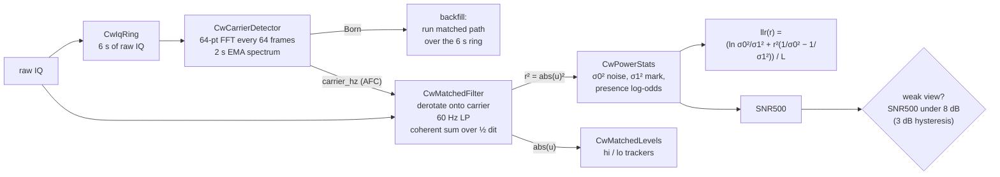

**Carrier detector.** Every 64 frames (256 ms), the detector takes a
Hann-windowed 64-point FFT of the last 64 raw frames, a home-grown radix-2
FFT with no planner. The power goes into a 2 s EMA spectrum. Within
±70 Hz it finds the strongest bin and compares it with a floor. The floor
is the larger of:

- the median of the search span (refreshed every 4th hop), and
- the band's noise floor from `set_floor()`, scaled to the bin's ENBW.

A peak whose bin lies outside the channel's own ±¼ of the band is ignored,
because it belongs to the neighbouring channel. A prominence of at least
6 dB held for 1 s makes the channel a **candidate**. The carrier frequency
is refined by a parabola through the log spectrum around the peak, then
smoothed by a 1 s EMA (the AFC). Without a detection for 3 s the candidate
is lost.

**Backfill.** The detector needs about a second to decide on a candidate.
When a candidate is born, the matched path runs over the whole raw IQ ring.
This fills the matched pre-roll ring so the over can be decoded from its
first mark.

**Matched filter.** This is the optimum receiver for on-off keying in
white noise, approximately:

1. Derotate the IQ by the AFC carrier with a phasor, renormalised every
   256 frames.
2. Low-pass at 60 Hz (2nd-order Butterworth, complex).
3. Take a coherent running sum over L frames, where
   **L = round(½ × unbiased dit)**, clamped to 2..10. The unbiased dit
   is (dit + element_space)/2. Using the mark-biased dit alone would feed back on
   itself: a longer sum makes longer marks, which make a slower clock,
   which makes a longer sum, until the clock sits at its floor.
4. Output r² = |sum/L|².

**Power statistics.**

- σ0² (noise) is re-measured every 0.5 s over a 4 s ring of r². The start
  is the 10th percentile divided by 0.1054 (the exponential distribution's
  −ln 0.9). This is refined four times as the mean of the samples under
  3 × mean, divided by 0.843 (the truncated exponential's mean ratio). The
  result is clamped to [0.7, 1.5] × the band floor's prediction, so a
  channel that is full of signal cannot teach itself a high floor.
- σ1² (key-down power) is the mean of the samples within 6 dB of a peak
  that decays over 2 s. It is held through spaces and past the end of an
  over.
- The **calibrated LLR** treats both hypotheses as exponential in r²:

  ```
  s1  = max(σ1², 2·σ0²)
  s0  = max(σ0², s1/9)                 (caps σ1²/σ0² at 9)
  x   = min(r², 4·s1)
  llr = clamp( (ln(s0/s1) + x·(1/s0 − 1/s1)) / L , ±4 )
  ```

  Dividing by L compensates for the correlation the moving average
  introduces: L frames are roughly one independent sample. Capping the
  ratio at 9 puts the zero crossing at half the key-down amplitude,
  exactly where the half-dit sum crosses a rectangular edge, so marks and
  spaces keep their true lengths.
- The **presence** statistic is a 1 s EMA of the log-odds of "keyed
  carrier, 45 % duty" against "noise only". It drops below zero within
  about a second of the last mark. It works like a soft, calibrated
  squelch.
- **SNR500** = 10·log10((σ1² − σ0²)/σ0²) + 10·log10((rate/L)/500). This
  is the scale CW Skimmer Server reports in.

**Weak and strong view.** When a candidate is born, the view is chosen
from SNR500: weak if it is under 8 + 1.5 dB. Later the view changes only
between overs (when the lattice is inactive or paused): weak below 8 dB,
strong above 11 dB. Switching mid-over would put two likelihood scales in
one word. In the weak view the lattice reads the calibrated LLR, and the
bootstrap and pre-roll read the matched amplitude. In the strong view
everything is v2.

### 3.5 Dead air and the pause

`CwState::dead_air_now()`, `dead_air()`

```
solid    = dit > 0  and  marks_committed ≥ 8  and  timing_error < 0.35
mu_alive = lattice active  and  µ_mark > 3·µ_space

v2 view: dead = (gate shut and not (solid and mu_alive))
                or (no keying duty and not solid)
v3 weak: dead = fe_quiet and not (solid and mu_alive)
         fe_quiet = not a candidate
                    or presence < 0 for longer than a quiet bar
                    or SNR500 < −4 dB
         quiet bar = solid ? max(16 dits, 1 s) : 0.3 s
```

On the **first** dead sample of a channel that has a clock or bootstrap
marks, the channel:

- flushes the lattice (commits everything, emits the character in flight),
- emits the over separator `"· "`,
- clears the assembly and the clock's re-lock rings,
- fences the pre-roll so a later replay cannot decode the same audio
  again.

After 8 s of quiet (30 s in the v3 weak view) the fist is forgotten: the
dit, the bootstrap marks, `marks_committed`, the re-lock rings, the spacing
centres and the edge smear are all reset.

### 3.6 Dit bootstrap

`cw_schmitt.h`, `CwSchmitt`, `CwBootstrap`

The lattice's duration priors are meaningless without a timing anchor. So
until a dit is known, the channel runs v1's key detector:

- **Schmitt trigger** on `env` (v2) or the matched amplitude (v3 weak): key
  on above lo + 0.55·(hi − lo), off below lo + 0.30·(hi − lo).
- **Glitch fold:** a run shorter than 3 samples is folded back into the
  run before it.
- **Clustering** over the first marks:
  - Once there are at least 4 marks with max ≥ 2 × min (dits and dahs
    are both present), dit = the mean of the marks below (min + max)/2.
  - With 8 marks of one kind, dit = the shortest.
  - The dit is clamped to 0.022–0.30 s, about 55–4 WPM (dit = 1.2/WPM s).

As soon as a dit exists, `lattice_start()` seeds the lattice and the
pre-roll replay decodes the marks the bootstrap just used up.

### 3.7 Pre-roll replay

`cw_preroll.h`, `CwPreroll`, `CwState::preroll_replay()`

Every sample goes into a ring regardless of gate state: the soft-path
envelope, plus the matched amplitude in v3. The ring holds 2 s in v2 and
6 s in v3 (power of two, at most 4096). The squelch needs about 0.3 s to
open, and the bootstrap uses 4–8 marks. Without the replay, "YOTA" was
logged as "OTA": Y is exactly the 4 marks the bootstrap used up.

When the channel wakes with a clock (bootstrap done, or resume from
pause), `find_head()` searches the ring, back only as far as the last
fence:

1. **Onset:** the first above-threshold run of at least 0.55 dit that
   follows at least max(2 dits, 0.1 s) of quiet. The threshold is 45 % of
   the span. Two dits of quiet means a replay can start only at a
   character or word boundary, never mid-character.
2. **Strength test:** the mean level of the onset run must be at least
   5.6 × the mean of the quiet before it (v3 weak: 2.5 ×). A torn head on
   a weak signal is worse than a missing one, because it can produce a
   wrong callsign.
3. **Break test:** 14 dits of quiet anywhere after the onset means the
   span is QRM plus a real break, not the head of one over, so there is
   no replay.

If a head is found, the samples from 2 dits before the onset to now are
pushed through `soft_step()`, the same function that live samples go
through.

### 3.8 Soft discriminator (v2 LLR)

`cw_discriminator.h`, `CwDiscriminator`

Two level trackers on the soft envelope `soft_env`:

- **µ_mark:** a fast decaying peak (instant attack, 0.35 s release) with
  a floor of 1.5 × µ_space. In a QSB trough it drops within one fade edge,
  so faded marks stay above the midpoint and keep positive evidence.
- **µ_space:** a 0.25 s EMA, updated **only** from clearly space-like
  samples, those below µ_s + 0.25·(µ_m − µ_s). If the mark samples at a
  fade's edge got in, they would drag the midpoint up under the whole
  trough.

The LLR averages two views, each clamped to ±2.5:

```
span view:     x = (soft_env − mid)/(µ_m − µ_s)         span = clamp(5·x)
Rayleigh view: z = soft_env / (µ_s/1.2533)       (z = soft_env/σ_noise)
               ray = z ≤ 1 ? −2.5 : clamp(3.3·(z²/2 − ln z − 2.89))
llr = (1 − w)·span + w·ray,   w = 0.5
```

- The **span** view follows QSB, but it cannot tell a −18 dB notch inside
  a dash from a real space.
- The **Rayleigh** view asks whether the sample could be pure noise. It
  crosses zero at z ≈ 2.8, which Rayleigh noise exceeds only about 2 % of
  the time. A notch bottoms out at z ≈ 5 ("not noise"), while a real space
  sits on the noise floor.
- The **average** lets a sub-dit notch pass with about zero evidence, so
  the duration priors carry the dash through. Real spaces keep full
  negative weight.

Options:

- `RAYFADE` fades w as µ_m/µ_s rises. On strong, smeared signals the
  Rayleigh view lengthens marks.
- `RAYSMEAR` limits that fade to signals whose edges are measurably
  smeared, using the EMA of (dit − element_space)/(dit + element_space).
- `RAYCAP` stops the Rayleigh view from turning negative span evidence
  into positive evidence.
- `EDGE_WEAK` turns the edge model on (§3.9) while µ_m/µ_s is below a
  threshold.

### 3.9 Semi-Markov Viterbi lattice

`cw_lattice.h`, `CwLattice`, `CwSegmentPriors`

This is the decision core. The hidden state is a **sequence of segments**
with explicit durations, not a per-sample state. Marks and spaces
alternate by construction:

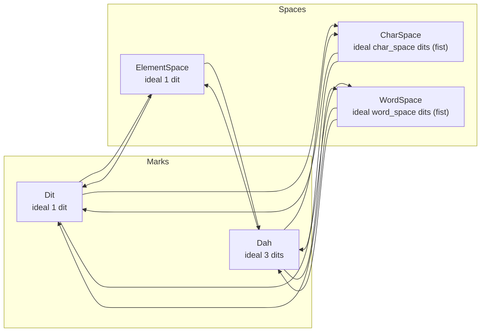

**Evidence.** Each sample's LLR goes into a cumulative ring
`llr_sum[t] = llr_sum[t−1] + llr(t)` (2048 samples, about 8 s). A segment over
(t−d, t] scores `llr_sum[t] − llr_sum[t−d]` if it is a mark, and the negative of
that if it is a space. This takes O(1) per hypothesis.

**Duration prior.** A log-normal shape plus a per-segment cost:

```
duration_prior(type, d) = −α_type · ln²( d / ideal_length(type) ) − 0.5
```

| Segment | Ideal | α | Search window (T = dit) |
|---|---|---|---|
| Dit | 1 T | 10 | 0.6 – 2.6 T |
| Dah | 3 T | 10 | 1.6 – 5.0 T (`DAHMAX`) |
| ElementSpace | 1 T | 10 | 0.7 – 2.6 T (0.5 T while timing_error > 0.2) |
| CharSpace | char_space·T (fist, starts at 3) | 6 | 1.6 – 1.833·char_space·T |
| WordSpace | word_space·T (fist, starts at 7) | 2.5 | 0.571·word_space·T – 17 T |

- α is tight for elements (keying is the rigid part of a fist) and loose
  for word spaces (operators pause).
- The −0.5 cost makes every boundary pay for itself in evidence, which
  stops chatter.
- **The dit and dah windows overlap on purpose.** A hard cutoff at a
  stale clock would misfile every element after a speed change. Inside
  the overlap, the priors decide, and they move with the clock.
- **The ElementSpace floor of 0.7 dit** stops a short dropout inside a dash from
  being read as an element space, which would turn the dash into two dits.
  The floor loosens to 0.5 while the clock is visibly wrong, so the
  lattice can re-lock after a speed change.
- The **edge model** (`EDGE`, or `EDGE_WEAK` on weak channels) accounts
  for soft keying edges, which make marks longer and spaces shorter by the
  same δ. Ideals become k·tu ± δ, where tu = (dit + element_space)/2 and
  δ = (dit − element_space)/2, clamped to ±0.4 tu.

**Recursion** (one `step()` per sample). `best_mark_end[t]` is the best score of a
path whose last segment is a mark ending at t. `best_space_end[t]` is the same for a
space:

```
best_mark_end[t] = max over type in {Dit, Dah}, d in search_window(type):
            best_space_end[t−d] + (llr_sum[t] − llr_sum[t−d]) + duration_prior(type, d)
best_space_end[t] = max over type in {ElementSpace, CharSpace, WordSpace}, d in search_window(type):
            best_mark_end[t−d] − (llr_sum[t] − llr_sum[t−d]) + duration_prior(type, d)
```

Back-pointers store (d, type) for each t. The seed at `lattice_start()`
allows either a mark or a space first (`Boundary::Either`), because a
restart may land mid-pause. The prior is memoised per (type, d), with a
generation stamp that changes whenever the clock or the fist moves.
Without the memo, `log()` took a third of the CPU time.

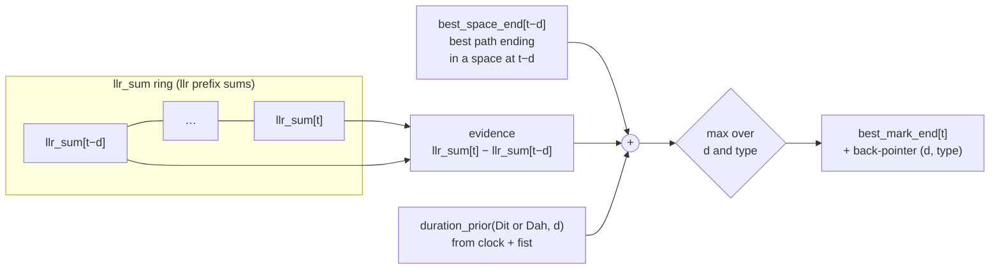

**Head.** `best_head(t)` finds the best *current* hypothesis: some boundary τ
in the last 17 dits plus an in-progress segment (τ, t], scored with no
duration penalty. It tells whether a mark or a space is running now, and
since when.

### 3.10 Commit, live emission and the over break

`CwLattice::commit()`, `CwState::lattice_commit()`, `live_emit()`, `cw_live.h`

Every 8 samples:

1. **Lagged commit.** Trace back from the head to the last committed
   boundary, and commit, oldest first, every segment that **ended more
   than a lag ago**. The lag is 4 dits on a healthy signal
   (µ_m > 0.6 env_hi and timing_error < 0.2) and 8 dits otherwise. In a fade,
   the evidence that rescues a drowned element arrives late, so the
   decoder waits. On a clean signal the lattice never revises that far
   back, and a short lag halves the text latency. Each committed segment
   goes to `on_segment()`. Scores are renormalised once they exceed 1e5,
   to keep float precision.
2. **Live emission.** If the head says a space has been running since the
   last commit point, the character in flight is finished. It does not
   need to wait for a closing mark, which the last character of an over
   never gets.
   - The character is emitted after 0.867 × char_space dits of space (2.6 dits at
     the default char_space of 3).
   - The word space is emitted after 1.2 × √(char_space·word_space) dits (5.5 dits at
     3/7).
   - `CwLive` remembers what it already emitted, so the later CharSpace/WordSpace
     commit does not emit it again.
3. **Over break.** After 16 dits of space, the lattice is flushed, the
   word is closed, `"· "` is emitted, and the lattice restarts. The
   re-lock rings are cleared, because the next over may come from the
   other operator in the QSO.

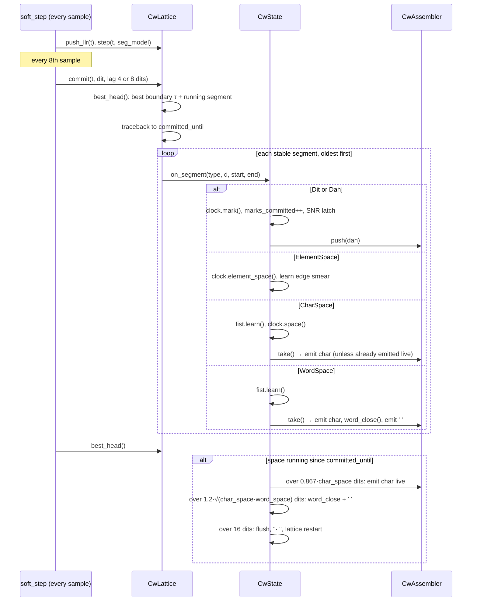

### 3.11 Element clock and its re-lock

`cw_clock.h`, `CwClock`

Each committed **mark** updates:

- `timing_error ← timing_error + 0.1·(|d − ideal|/ideal − timing_error)`, the
  timing-error EMA, starting at 0.2. It feeds the confidence, the commit
  lag, the ElementSpace floor, the solid test and the lone-E/T rule.
- `dit ← dit + a·((dah ? d/3 : d) − dit)`, with a = 0.15, or 0.30 while
  timing_error > 0.2. Commits arrive a lag behind, so a speed change needs the
  faster gain.
- the dah and dit streak counters, used by the watchdog.

Each **ElementSpace** updates `element_space` (EMA 0.2). The reported speed uses the
**unbiased dit** (dit + element_space)/2, because soft edges bias marks long and
spaces short by the same amount: WPM = 1.2·rate / unbiased.

**Re-lock.** An EMA glides, but a QSO turnaround is a step change. Worse,
past the 2-dit class boundary, misread marks pull the EMA the wrong way in
a self-consistent way. So the clock keeps rings of the last 6 raw mark and
space durations, and re-runs the clustering on every committed mark:

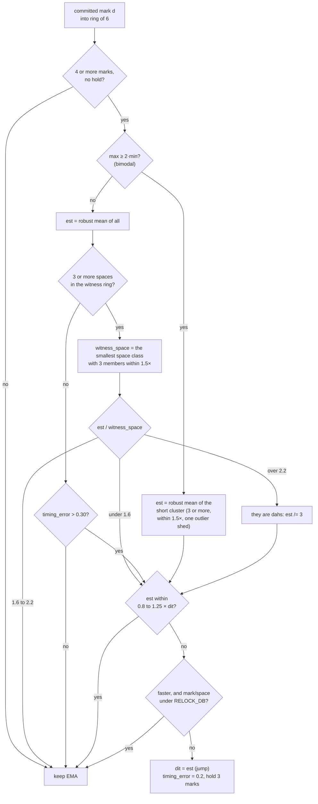

A unimodal ring is ambiguous: perfect dahs at the old speed look the same
as dits at a third of it. The element-space witness breaks the tie, because
element spaces run 1:1 with dits and 1:3 with dahs. The optional
`RELOCK_DB` refuses a jump to a *faster* clock on weak signals, where
noise splits marks in two and the halves form a convincing "faster"
cluster.

### 3.12 Fist model

`cw_fist.h`, `CwFist`

Operators key elements consistently but space loosely: character spaces
range from 2.5 to more than 5 dits, word spaces from 5 to 11. A fixed
boundary misreads somebody. For example, a stretched "CQ" came out as
"C Q", the CQ marker was never matched, and the station was never spotted.

- The ring holds the last 24 committed spaces of at least 1.6 dits (CharSpace or
  WordSpace), as ln(dits).
- Every 4 spaces, once 10 are collected, run **2-means in the log domain**,
  seeded from the 25th and 75th percentiles. The seeds do not come from
  the lattice's own labels, because those would reinforce themselves.
- A fit is accepted if both clusters have at least 3 members and
  word/char ≥ 1.55. The centres are blended in with gain 0.25 and clamped:
  char_space to 2.4–4.8, word_space to max(5, 1.6·char_space)–11.
- char_space and word_space move the lattice's CharSpace/WordSpace ideals and windows and the live
  emission thresholds. They reset together with the clock.

### 3.13 Character assembly

`cw_morse.h`, `cw_morse.cpp`

A character is a bit code under a leading 1, dit = 0 and dah = 1:
"A" (.-) = 0b101. At most 7 elements; an eighth element drops the
character. `take()` looks the code up in the table (A–Z, 0–9, `/ ? = + . ,
- @`) and applies:

- the **lone-E/T rule:** a single-element character is suppressed while
  the clock is untrusted (fewer than 4 marks, or timing_error > 0.45). This is
  what random noise produces.
- `NEAREST` (optional): an invalid code is read as the *unique* character
  one element away. First the decoder tries dropping one element (a
  sloppy key adds one), then flipping one dit or dah.

### 3.14 Watchdogs and the carrier rule

`CwState::clock_watchdog()`, `carrier_watch()`

| Trigger | Meaning | Action |
|---|---|---|
| 16 dahs in a row | clock a class too fast: slow dits read as dahs, self-consistently | forget clock, re-bootstrap |
| 24 dits in a row | clock a class too slow | same |
| no mark committed for 10 s while live (v3) | clock run to its floor; nothing commits | same |
| element_space < 0.35 dit after 8 marks (v3 weak) | noise glues marks; spaces collapsed | drop element_space, re-bootstrap |
| mark run > max(8 dits, 0.8 s) | carrier, not keying | stop lattice, drop the character, idle until the key opens |

The 0.8 s floor in the carrier rule matters: after a drop from 35 to
12 WPM, every new dah is about 8 old dits long. With the 8-dit rule alone,
the whole slow transmission would be read as carrier, and the clock would
never relearn. A re-bootstrap fences the pre-roll so that the badly
clocked span is not decoded a second time.

### 3.15 Word re-read against MASTER.SCP

`cw_reread.h`, `cw_reread.cpp`, `CwWordReread`

The lattice decides each element on its own, and the extractor only sees
letters. Evidence such as "one more dah was there" is lost in between.
When a word closes (word space, over break or pause), the word is re-read
on the **same LLR ring**:

1. The word qualifies if it has at least 3 characters, includes both
   letters and digits, and is not already a known call.
2. `dict.near(word)` returns up to 24 MASTER.SCP calls **within two edits**
   (Levenshtein), using a one-deletion index plus the common shapes of a
   misread.
3. The span runs from 2 dits before the first mark (not into the previous
   word) to B, the end of the word space.
4. **Free reading** `sf`: the best unconstrained one-word reading of the
   span (any marks with ElementSpace/CharSpace between them, free space around).
   `ev = sf/N` is the evidence per sample. If it is below `min_evidence` = 2.0 (0.25 in the
   weak view, where LLRs are calibrated nats), the word is treated as
   noise and never turned into a call.
5. **Forced alignment** of each candidate (`forced()`): the call's exact
   segment sequence (from `call_segments()`, Dit/Dah with ElementSpace inside a
   character and CharSpace between characters) is aligned by the same
   semi-Markov DP, with the lattice's windows and priors and free space
   before and after.
6. **Take** the best candidate if
   `max(sf, s_raw) − s1 ≤ max_deficit (5)` and `s1 − s2 ≥ min_margin (3)`. The audio may
   dispute the call only slightly, and the call must be clearly ahead of
   the runner-up.

The correction is written as `raw␁CALL␂` (`kFixOpen`/`kFixClose`). The
extractor takes `CALL`. The pane and the log call `strip_fix()` and show
what was actually heard. Only dictionary calls are ever written in; an
unknown call is never invented.

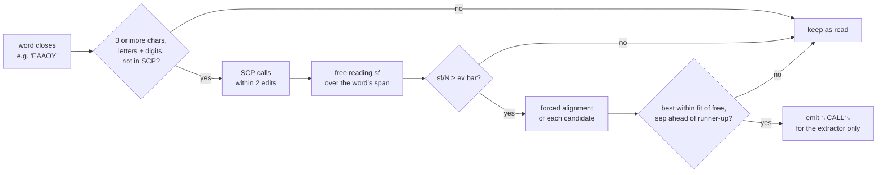

### 3.16 Call reader (keyword spotting)

`cw_callreader.h`, `cw_callreader.cpp`, `CwCallReader`, `CwCallAlignment` in `cw_align.cpp`. v3 only.

Every 3 s on a locked channel, the last **6 s of the lattice's own LLR**
are searched for callsigns that the decoded text hints at. This catches
calls that the text tore apart, glued together or misread by more than
the re-read can fix.

1. **Candidates**, at most 16, come from the text tokens whose audio lies
   in the window:
   - tokens that are SCP calls,
   - SCP calls within 2 edits of a token,
   - SCP calls near 2–3 adjacent tokens joined (torn calls),
   - SCP calls of 4–8 characters inside a long token (glued calls),
   - calls this channel confirmed in the last 300 s.
2. **Resampling:** the LLR is integrated into slots of ⅓ dit, so the
   search cost does not depend on speed.
3. **Free reading** forwards (P) and backwards (S) over the window. A
   silence longer than a word space is allowed inside. A call may only start
   after silence or a word space, never after a character space (otherwise
   K1HC would match inside OK1HCG). A call must sit at least 4 dits from
   both window edges, so the window cannot cut OK1HRA down to OK1HR.
4. **Score** = forced alignment of the call between P and S, minus the
   free reading F, which makes it ≤ 0. Character spaces inside the call may
   stretch to 8 dits.
5. **Control:** the winner must beat every other candidate *and* up to 8
   SCP neighbours of itself by at least `min_margin` = 3, and must be within
   `min_score` = −5 of F.
6. **Confirmation:** the call must win in 2 windows that share no audio,
   or win once by a wide margin (≥ −2 with a margin of ≥ 5). A call is
   sent at most every 20 s.
7. **CQ context:** a `CQ`/`TEST`/`QRZ` token in the text, or a forced
   alignment of "CQ" or "TEST" within −3 of F, marks the channel as calling
   for 12 s. The fix phrase then becomes `␁CQ␂ ␁CALL␂`.

The phrase is emitted at the next word boundary, when no word is in
flight.

### 3.17 Output and the callsign extractor

`process()` returns, per block:

| Field | Value |
|---|---|
| `text` | decoded characters, `"· "` over breaks, `␁…␂` corrections |
| `confidence` | clamp(1 − 1.5·timing_error, 0, 1) |
| `speed` | 1.2·rate / unbiased dit (WPM) |
| `freq_offset_hz` | tone offset (phase slope, or v3's AFC) |
| `snr_db` | SNR latched at the last mark commit: SNR500 (v3) or 20·log10(env_hi/env_lo) |

The **extractor** (`callsign.cpp`, `SkimCallsignExtractor`) tokenises that
text and checks structure against the ITU allocation tables. Four shapes
are accepted:

- a single-letter prefix series,
- a two-letter prefix (not Q),
- a letter+digit prefix from a per-letter table, which is what rejects
  garbage such as "T1BR",
- a digit-first prefix.

Portable designators (`/P`, `F/`) are handled. Candidates are scored
additively:

```
0.55 structurally valid with an allocated prefix
+0.25 after DE      +0.10 in CQ context     +0.20 heard twice (+0.05 at 3)
+0.15 in MASTER.SCP +0.25 followed by an exchange ("5NN")     cap 1.0
```

A call must reach 0.70 before it can be spotted. The feed policy also
counts `hearings()`, because a single garbled copy with DE and CQ around
it already scores 0.90.

---

## Level 4: one sample through `process()`

This is the exact order of operations inside the per-sample loop of
`CwState::process()`:

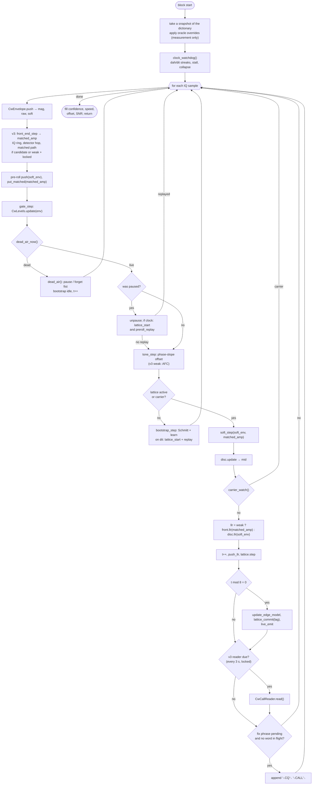

Each sample advances the sample clock `m_t` exactly once, whether it goes
to dead air, the bootstrap, the carrier or the lattice. The commit
cadence, lags and spans all count in these samples.

---

## v2 and v3 side by side

| Concern | v2 (`cw_preset_v2`) | v3 strong view (SNR500 ≥ 8 dB) | v3 weak view |
|---|---|---|---|
| Soft envelope | 45 Hz narrow envelope | same | matched amplitude (½-dit coherent sum on the AFC carrier) |
| Per-sample LLR | span + Rayleigh heuristic, ±2.5 | same | calibrated exponential LLR / L, ±4 |
| Gate | envelope squelch + keying duty | same | carrier candidate + presence log-odds + SNR500 ≥ −4 dB |
| Bootstrap input | `env` with env_hi/env_lo | same | matched amplitude with matched hi/lo |
| Pre-roll | 2 s, 5.6× head bar | 512 samples, 5.6× | 6 s, 2.5× |
| Tone offset | phase slope | phase slope | detector AFC |
| Fist hold | 8 s | 8 s | 30 s |
| Re-read ev bar | 2.0 | 2.0 | 0.25 |
| Clock fixes | – | no lattice without a clock, 10 s stall watchdog, carrier cleared with the fist | same + collapsed-space watchdog |
| Call reader | – | yes | yes |

---

## Constants at a glance

| Constant | Value | Where |
|---|---|---|
| Channel rate | 250 Hz complex, 125 Hz spacing | channelizer |
| Narrow envelope | 45 Hz Butterworth after derotation | `CwEnvelope` |
| Squelch | open 4×, close 2.6× | `CwLevels` |
| Keying duty | on 15 %, off 7 % (top 30 % of span, 0.7 s) | `CwLevels` |
| Detector | 64-pt FFT / 256 ms, ±70 Hz, 6 dB for 1 s, lost after 3 s | `CwCarrierDetector` |
| Matched sum | L = ½ unbiased dit, 2..10 frames, 60 Hz LP | `CwMatchedFilter` |
| Weak view | SNR500 under 8 dB, back above 11 dB | `CwFrontEnd` |
| Bootstrap | 8 marks, dit 0.022–0.30 s | `CwBootstrap` |
| Discriminator | µ_m 0.35 s release, µ_s 0.25 s, LLR ±2.5 | `CwDiscriminator` |
| Lattice ring | 2048 samples (about 8 s) | `CwLatticeRings` |
| Segment cost | 0.5 per segment | `CwSegmentPriors` |
| Commit | every 8 samples, lag 4 or 8 dits | `CwState` |
| Live char / word | 0.867·char_space, 1.2·√(char_space·word_space) dits | `CwLive` |
| Over break | 16 dits | `CwState` |
| Clock EMA | 0.15 (0.30 while timing_error > 0.2) | `CwClock` |
| Re-lock | ring 6, jump outside 0.8–1.25×, hold 3 | `CwClock` |
| Fist | ring 24, refit every 4, word/char ≥ 1.55, gain 0.25 | `CwFist` |
| Re-read | max_deficit 5, min_margin 3, min_evidence 2.0 (weak 0.25), within 2 edits | `CwRescoreConfig` |
| Call reader | every 3 s, 6 s window, ⅓-dit slots, min_score −5, min_margin 3 | `CwCallReader` |
| Spot threshold | 0.70 | `SkimCallsignExtractor` |

---

## Level 5: where the decoder can improve

The hints below follow one principle, VE3NEA's advice as AG1LE quotes it
([Towards Bayesian Morse Decoder](http://ag1le.blogspot.com/2013/01/towards-bayesian-morse-decoder.html), 2013):
do not decide at each sample whether the key is down. Pass a probability on
through every later stage, up to word and callsign recognition. The decoder
already follows it in the middle: the lattice never sees a hard decision.
The hard decisions that remain sit at both ends:

- at the input: the envelope squelch, the Schmitt bootstrap, and an LLR
  whose scale has no fixed meaning in the v2 view;
- at the output: one best path, a per-block confidence, and callsign scores
  built from counted hearings.

Each hint states what the code does now, what would change, where in the
code it would land, and how to check it. Nothing here has been built or
measured in this engine. Quoted gains come from simple simulations and are
illustrative.

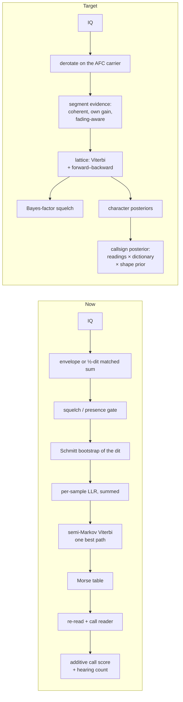

A cheap energy check can still choose which channels run the lattice. The
point of the target is that it no longer decides *what* gets decoded.

### 5.1 Status against v3

Several of the analysis's proposals are already in v3's weak view (§3.4).
Others exist in part.

| Idea | Status | Where |
|---|---|---|
| Calibrated per-sample LLR in nats | **done** in the weak view (exponential power model, σ0² vs σ1²) | `CwPowerStats::llr` |
| Divide the summed LLR by the samples per independent sample | **done** in the weak view (÷ L) | `CwPowerStats::llr` |
| Unbiased noise floor, cross-channel floor | **done** in the weak view (10th percentile refined as a truncated exponential, clamped to the band floor) | `CwPowerStats::noise_refresh`, `set_floor()` |
| Use the phase: coherent sum on the derotated tone | **partial**: a fixed sum over ½ dit, not over each hypothesised mark | `CwMatchedFilter::power` |
| Soft, calibrated squelch | **partial**: the presence log-odds (keyed-carrier mixture vs noise) | `CwPowerStats::update`, `dead_air_now()` |
| Keyword spotting of callsigns in the audio | **partial**: forced alignment against the free reading, confirmed by counting windows | `CwCallReader::read` |
| Calibrated LLR in the strong (v2) view | open | `CwDiscriminator::llr` |
| Weak-view pause judged on the matched path | proposed, measured (§5.3.6), off | `dead_air_now()`, `CwWeakViewConfig::matched_alive` |
| Flat channel passband to the channel edge | proposed, measured (§5.3.6) | `SkimChannelizer::create_ex(…, 85, 12)` |
| Speed-matched linear filters | measured: no gain left (§5.3.6) | `CwMatchedFilter`, `CwEnvelope` |
| Per-element amplitude, gain tracker, Doppler spread | open | — |
| Forward–backward, character and callsign posteriors | open | — |
| Impulse marking | open | — |

The weak view uses the exponential (Rayleigh-fading) model, so a notch
sample already costs at most ln(σ1²/σ0²)/L ≤ ln 9/L nats. That bounded
penalty is the fading-mixture protection of §5.3.3, built into the model.
The strong view gets the same protection from its hand-tuned Rayleigh view.

### 5.2 The decoder as one factor graph

Viterbi is max-product message passing on a chain, and forward–backward is
the same recursion with sum-product. Both are exact whenever the model
factors so that the past and the future are separated by a small state:
eliminate the past, keep the separator, go on. The cost grows with the size
of that separator state (in general, the treewidth of the factor graph), not
with the length of the signal. That is the frame for the hints below.
Everything in this Level stays exact dynamic programming or closed form, and
none of it needs Monte Carlo.

**Chained hard decisions are an approximation.** If one stage passes only
its winning path to the next, a hypothesis that is locally a little worse
but globally much better is lost. In this decoder:

- the bootstrap's dit → the lattice;
- the committed path → `CwClock`, `CwFist` and the trackers;
- the best path → the Morse table → the text → the extractor.

Each link is one such chain. The exact way to combine stages is to pass a
message over **all** states at the boundary (a max-marginal or a marginal),
not the winner. The word re-read (§3.15) and the call reader (§3.16) already
do this in part: they go back to the lattice's own `llr_sum` instead of
trusting the text. The posteriors of §5.5 and the callsign posterior of
§5.6 do it fully.

**What sits in the state, and what is fed back from outside.** The
lattice's state is (mark or space, segment type, time since the last
boundary). The clock, the fist centres and the gain level are estimated
outside it, from committed decisions, and fed back as fixed parameters.
That is decision-directed estimation. It is cheap, but it is why the clock
needs the re-lock, the space witness and four watchdogs (§3.11, §3.14).

Moving a variable into the state makes the inference exact for it, at the
price of a larger state:

| Variable moved into the state | How | State growth | Remedy |
|---|---|---|---|
| Previous segment type (gap-type transition priors) | augmented state (current type, previous type) | 5 → at most 25, fewer since marks and spaces alternate | none needed |
| Speed | a small bank of dit hypotheses (×0.7 / ×1 / ×1.4) | × 3 | only on active channels |
| Morse-tree node (only valid characters) | augmented state with the node of the ~64-node code tree | × 64 on mark/ElementSpace states | beam search: keep the best few nodes per slot |
| Gain belief (§5.4) | one Gaussian (μ, V) per lattice node | O(1) per node | per-survivor processing, below |

An order-k dependency over N states costs N^k states, so beyond the first
two rows prune with a beam instead of enumerating.

**Discrete keying plus a Gaussian gain is a switching state-space model.**
The keying and segment state is discrete, and the channel gain is
continuous and roughly Gaussian (§5.4). The deterministic way to handle that
is to integrate the Gaussian part analytically: a Kalman filter per discrete
hypothesis (Rao-Blackwellisation), with dynamic programming over the
discrete part. The exact form keeps one Gaussian per discrete history,
which grows exponentially; this is Bell's growing set of Kalman filters. The
standard deterministic approximations merge or select:

- per-survivor processing keeps the Gaussian of each node's best
  predecessor (W4 in §5.4);
- generalised pseudo-Bayes (GPB) and the interacting multiple model (IMM)
  merge the Gaussians that enter a state into one by moment matching.

Merging suits the sum-product pass, selection the max-product pass.

**One recursion, two semirings.** The max-product and sum-product passes
differ only in max versus log-sum-exp. Writing the recursion of
`CwLattice::step` once, over a semiring parameter, gives Viterbi and the
forward pass of §5.5 from the same code. The duration windows and the
memoised priors are shared, and so are the per-survivor beliefs, which use
selection in one pass and merging in the other.

**Soft feedback instead of hard.** The variables that stay outside the
state can still learn from posteriors rather than from the single committed
path:

- the clock from expected mark durations;
- the fist from expected space durations;
- the noise and gain from posterior-weighted samples.

That is one EM step per commit, and it removes most of the bias that
decision-directed estimation adds in weak or faded copy.

Deterministic alternatives, by the structure of the model:

| Model structure | Inference |
|---|---|
| chain / HMM, semi-Markov segments | Viterbi, forward–backward (this lattice) |
| higher-order chain | augmented-state Viterbi |
| large discrete state | beam-search Viterbi |
| tree, small treewidth | max-/sum-product, junction tree / variable elimination |
| loopy factor graph (e.g. channels coupled through clicks and impulses) | loopy belief propagation |
| continuous, roughly Gaussian | Kalman / EKF / UKF |
| hybrid discrete + Gaussian | switching Kalman, Rao-Blackwellised (per-survivor, GPB, IMM) |
| smooth but intractable posterior | variational inference |
| arbitrary posterior | Monte Carlo (avoided here) |

### 5.3 Evidence

#### 5.3.1 A calibrated LLR for the strong view

**Now.** `CwDiscriminator::llr` averages a span view and a Rayleigh
"surprise" view, using the hand constants 5, 2.5, 3.3 and 2.89. The
Rayleigh view is −ln p₀ shifted to zero at z ≈ 2.8. It never asks how
likely the sample is as a mark, so it is half of a likelihood ratio, and its
scale means nothing: +1 is not e:1 odds. A simulation of the averaged score
finds it negative on average even on true weak marks. In this engine that
matters only above the weak-view threshold, because below it v3 switches to
`CwPowerStats::llr`.

**Change.** Use a Rice-vs-Rayleigh LLR on the envelope,
`LLR(m) = ln I₀(A·m/s²) − A²/2s²`, with two measured quantities:

- the noise spread s: the median of key-up envelopes / 1.1774, or the band
  floor from `set_floor()`;
- the amplitude A ≈ √(µ_mark² − 2s²), which removes most of the noise bias.

Add the fading mixture of §5.3.3 for notches, and divide by the effective
samples per independent sample. That is about 2–3 for the 3-tap moving
average plus the 45 Hz narrow biquad, and it can be computed from the two
filters rather than tuned.

**Risk.** v2's view was tuned on strong live air, and the README keeps it
as the reference there. Put the change behind a `CwLlrConfig` switch and
A/B it on recorded strong stations first.

#### 5.3.2 Score each element against its own amplitude

**Now.** One global µ_mark (0.35 s release) or σ1² (2 s held peak) serves
every hypothesis. Both lag a fast fade.

**Change.** When the lattice scores "a mark over (t−d, t]", estimate  from
those samples alone. Keep running sums of the envelope and its square next
to `llr_sum`; each candidate is then still O(1). The evidence stops being a
prefix sum of per-sample LLRs and becomes a per-segment function. That is
the semi-Markov model's natural form.

**Hook.** `CwLatticeRings` (two more `double[kSize]` rings) and the
mark-candidate loop of `CwLattice::step`.

#### 5.3.3 A fading mixture for notches

Flutter cuts 15–20 dB holes into a dash for a few samples. Under a
fixed-amplitude Rice model, such a sample at a strong signal scores about
−150 nats and splits the dash. The principled form says what the decoder
believes: with the key down, the amplitude is usually A but may dip anywhere
below it.

```
p₁(m) = (1 − ε)·Rice(m; A) + ε·mean over a in [0, A] of Rice(m; a)
```

This keeps a notch to a few nats. The 0.7-dit floor of the ElementSpace
window (`CwSegmentPriors::search_window`) then keeps the dash whole. Keep a
small ε even after the channel model of §5.4, because it costs nothing when
the model fits.

#### 5.3.4 Coherent evidence: only as long as the channel stays coherent

**Now.** v3 derotates onto the AFC carrier and sums coherently over
L = ½ unbiased dit (2..10 frames, at most 40 ms). It then turns each sample
into an LLR and sums those incoherently along the segment. The coherent span
is short enough that the channel's phase barely moves inside it.

**Why a longer coherent sum is not free.** Summing the derotated samples of
a whole mark, `S = Σ z`, adds the tone's contributions in phase only while
the tone's phase is constant. On a VHF line-of-sight path, a steady carrier
in Gaussian noise, that holds for any element length. A good AFC keeps it.
On HF it does not:

- **The ionosphere moves.** Every propagation path has its own Doppler
  shift and spread. Inside a 125 Hz channel the paths' delays (0.5–7 ms)
  only smear the key edges, so they collapse into one complex gain g(t)
  (§5.4). But that gain rotates and fades with the paths' Doppler shifts
  and spreads: its half-correlation time is 0.375/B, which is 3.75 s at
  0.1 Hz, 0.38 s at 1 Hz, and 38 ms at 10 Hz.
- **Two paths with different shifts beat.** Their sum's phase jumps by up
  to π through each notch, which recurs every 1/|ν₁ − ν₂| seconds. A
  coherent sum across a notch cancels itself.
- **A frequency error is a phase ramp.** A sum over T loses sinc²(Δf·T): a
  300 ms dah 2 Hz off is past its first null.

A coherent sum longer than the coherence time does not just stop gaining;
it loses against shorter sums combined by energy, because the signal
averages itself away while the noise does not.

**Measured** (one-element detection, the mean C/N0 for AUC 0.90, dB-Hz,
lower is better; complex Gaussian gain with a Gaussian Doppler spectrum,
4000 trials; positive = better than v3;
`experiments/cw_bench/coherent_fading.py` reproduces it):

| Channel | dit 48 ms (25 WPM), v3 | whole / blocks / genie | dah 300 ms (12 WPM), v3 | whole / blocks / genie |
|---|---|---|---|---|
| steady carrier (VHF line of sight) | 19.5 | +1.2 / +1.3 / +4.1 | 12.9 | +2.5 / +2.6 / +5.5 |
| steady, AFC 2 Hz off | 19.6 | +1.2 / +1.1 / +4.2 | 13.1 | −3.1 / −3.2 / +5.7 |
| flat 0.1 Hz (ITU quiet) | 23.3 | +1.1 / +1.2 / +2.3 | 17.0 | +2.6 / +2.7 / +3.8 |
| flat 0.5 Hz (ITU moderate) | 23.5 | +1.2 / +1.4 / +2.5 | 16.9 | +2.5 / +2.5 / +4.4 |
| flat 1 Hz (ITU disturbed) | 23.3 | +1.2 / +0.8 / +2.3 | 16.3 | +1.6 / +1.4 / +4.6 |
| flat 3 Hz | 23.3 | +1.1 / +1.0 / +2.6 | 15.0 | −1.2 / +0.2 / +5.2 |
| two paths ±0.5 Hz, 0.1 Hz each (beating) | 23.3 | +0.9 / +1.1 / +2.4 | 16.3 | +1.4 / +1.4 / +4.7 |
| flat 10 Hz (high latitude) | 22.7 | −0.3 / 0.0 / +3.8 | 14.1 | −6.2 / −1.2 / +5.8 |

The "v3" columns are v3's own threshold in dB-Hz. The others give
the change from it, in dB (positive = better):

- *whole*: one coherent sum over the element;
- *blocks*: coherent blocks of min(T, 0.213/B), the span with |ρ| ≥ 0.8,
  combined by energy;
- *genie*: see below.

The noise of each figure is about ±0.2 dB. With a frequency error the
blocks equal the whole sum, because the spread is zero: the remedy there is
the AFC, not the block length. Fading itself costs v3 3.5–4 dB on a dit
against the steady carrier, at the same mean SNR.

The genie knows the true channel gain, phase and amplitude, and correlates
against it, `Re(Σ z·g*)`. It is the ceiling of perfect channel compensation,
not something a decoder can reach. A real tracker estimates g from noisy
marks and pays for that estimate.

**What follows.**

- **Without compensation, length must follow the channel, not the
  element.** A coherent block may be as long as the gain stays correlated:
  |ρ| ≥ 0.8 holds for 0.213/B (213 ms at 1 Hz, 21 ms at 10 Hz), and less
  across a beating notch. Longer elements are split into such blocks,
  combined by energy. That needs the Doppler spread measured per signal
  (§5.4, W1), and when in doubt the shorter block.
- **Compensation comes first.** To integrate beyond the coherence time, the
  channel's phase and amplitude must be tracked and removed before the sum:
  the Kalman gain tracker and its per-survivor belief (§5.4, W2–W4).
  There the evidence becomes `2·Re(μ*·S)/σ²` against the predicted gain μ,
  plus a term for what the prediction missed. That is the estimator–
  correlator, and it reduces to the coherent sum only when the gain is
  known and constant. So the order is: measure the spread, track the gain,
  then lengthen the coherent span. Never a fixed whole-element sum.
- **The AFC is part of the channel estimate.** Its error must stay well
  under 1/(2T) for the longest block. The detector's AFC is a 1 s EMA of a
  parabola through a 3.9 Hz-bin spectrum. On HF its frequency also carries
  the paths' mean Doppler shift, which moves. Measure its error on the
  bench (`--fade` with shifted paths) before relying on it.
- **Expected gain on HF.** From the table: with the length matched to the measured spread, and no
  compensation:
  - about +1 dB on dits up to a few hertz of spread, nothing at 10 Hz;
  - +2.5 dB on long elements in quiet and moderate conditions, +1.4 dB at
    1 Hz and with two beating paths, nothing at 3 Hz;
  - at 10 Hz even 21 ms blocks lose 1.2 dB to v3's overlapping 40 ms sums.
    The 0.8-correlation rule is conservative there: past the coherence
    time, the energy detector (§5.4) is the right form, and v3's sums
    already approximate it.

  Errors come mostly from dits and short spaces, so expect around 1 dB of
  CER threshold on mid-latitude paths, and more at slow speeds where the
  elements are long. A whole-element sum without the spread estimate would
  lose up to 6 dB on fast fading and 3 dB to a 2 Hz AFC error. The genie's
  +2.3…+5.8 dB bounds what channel tracking could add on top. A tracker
  reaches only part of it: it must estimate the gain from the same noisy
  marks.

**Cost.** A complex prefix ring (2048 doubles, 32 KB per active channel)
for the block sums, on top of today's roughly 105 KB of `CwLatticeRings`
(the memo alone is 61.5 KB). The tracker of §5.4 adds the per-node belief.

#### 5.3.5 Learn only from what the lattice settled

The level trackers and noise estimates learn from every sample, whatever it
turns out to be. Prefer statistics updated in `on_segment()` from committed
marks and spaces. That is decision-directed estimation on settled
decisions, and it is the starting point of the gain tracker in §5.4.

#### 5.3.6 Measured: the filter chain, and where the speed-dependent loss is

Measured with the real `SkimChannelizer` and the real v2/v3 decoders on
synthetic CW: 8 kHz wideband IQ in complex white noise, 5 ms raised-cosine
edges, 3 % timing jitter, 12 random callsign-and-traffic words per run, and
10 seeds per point. Figures are the SNR500 at which the character error rate
(CER) falls to 10 %; their noise is about ±0.3 dB. The gates (§3, `cw_test`)
feed the decoder at 250 Hz without the channelizer, so they do not see this
chain.

**The chain.**

| Stage | Shape | Noise bandwidth (complex) | Adapts to speed |
|---|---|---|---|
| Channel prototype: windowed sinc, 8 taps a branch (64 ms), BH4 over N − 1, cutoff ±62.5 Hz | flat to ±30 Hz, −0.9 dB at 40 Hz, −2.3 at 50, −6.0 at 62.5, −39 at 100, > 100 dB down at 125 Hz | 106 Hz | no |
| v2 soft envelope: derotate, 2nd-order Butterworth 45 Hz, \|·\|, 3-tap MA | | 82 Hz after the channel filter | no |
| v3 weak view: derotate, Butterworth 60 Hz, coherent sum over L = round(½ unbiased dit), 2..10 | | rate/L: 25 Hz (≤ 15 WPM) to 83 Hz | yes |
| matched filter for a dit, for comparison | | 1/T: 10 Hz (12 WPM), 21 Hz (25), 29 Hz (35) | — |

**What the linear filters are worth.**

- *Bandwidth matched to the speed: nearly nothing left.*
  - v3's ½-dit sum is the measured optimum. ¼ dit is slightly worse, ¾ dit
    0.3–1.6 dB worse, and a full dit fails at fast speeds because it smears
    the element spaces shut. Raising the 10-frame cap changes nothing, and a
    30 or 100 Hz pre-filter lands within ±0.3 dB of 60 Hz.
  - v2's narrow cutoff anywhere from 15 to 60 Hz lands within ±0.6 dB of
    45 Hz. Below 30 Hz it breaks 25–35 WPM copy for the same reason.
  - Longer coherent sums are the remaining filter-side lever, but only
    within the channel's coherence time (§5.3.4). On a steady carrier a
    whole-element sum gains 1.2 dB on a dit and 2.5 dB on a slow dah. Under
    HF fading the length must follow the measured Doppler spread: about
    1 dB on dits, up to 2.5 dB on long elements in quiet and moderate
    conditions, and a loss on fast fading if the sum is not shortened.
- *Keying shape: under 0.15 dB.* A rectangular integrate-and-dump against
  the exact raised-cosine pulse loses 0.02–0.15 dB (5–10 ms edges, 12–45 WPM).
- *Centre: the channel edge.* The narrow paths follow the tone, but the
  prototype rolls off towards the channel edge. 25 WPM, v3:

  | Tone offset from the channel centre | 0 Hz | 40 Hz | 50 Hz | 55 Hz | 62.5 Hz |
  |---|---|---|---|---|---|
  | default prototype | −0.1 | 0.5 | 0.9 | 2.0 | 3.8 |
  | `create_ex(…, 85, 12)`: flat to ±62.5 Hz (−0.2 dB), still > 100 dB down at 125 Hz | 0.3 | 0.8 | 0.5 | 0.4 | 0.5 |

  The flat prototype is worth about 0.5–1 dB averaged over random offsets,
  and 2–3 dB for the sixth of the signals that sit more than 55 Hz from a
  channel centre. It costs 1.5× the polyphase work and shows each signal
  more strongly in the neighbouring channel, where ghost arbitration and the
  detector's own-quarter rule (§3.4) must keep it out. v2's squelch,
  keying-duty test and bootstrap read the raw channel envelope (`raw`), so
  the v2 view loses 1.8 dB to the wider noise bandwidth. On the narrow
  envelope instead, the v2 view gains 0.4–0.6 dB.

**Where the speed-dependent loss is.** A matched decoder needs
10·log10(35/12) = 4.6 dB less SNR at 12 WPM than at 35 WPM. v3's thresholds
are nearly flat across speed:

| WPM | 12 | 18 | 25 | 35 |
|---|---|---|---|---|
| v3 now | 0.0 | −0.5 | −0.2 | +1.0 |
| v3, proposed `matched_alive` on, clock learned on a +10 dB preamble | −4.3 | −2.5 | −1.4 | ≈ +0.5 |
| headroom | 4.3 | 2.0 | 1.2 | ≈ 0.5 |

With both effects removed, the thresholds scale by 4.8 dB from 35 to
12 WPM, as matched detection predicts. Two decisions keep them flat today:

1. **The pause rule.** `dead_air_now()` keeps a solid weak-view channel
   alive only while `µ_mark > 3·µ_space` on v2's 45 Hz soft envelope. That
   is a fixed bandwidth, independent of speed, and its mark/space ratio is
   1.2–1.9 at −3 dB SNR500. A solid channel at the cliff paused about 20
   times a minute, and each pause flushed the lattice and tore the words.
   A proposed switch, `CwWeakViewConfig::matched_alive`
   (`SKIM_V3_MATCHED_ALIVE`, not in the tree yet), judges it on the matched
   path instead: presence seen within an over break. On its own
   it moves the 18 WPM threshold 0.9 dB, and takes 12 WPM at −3 dB from 80 %
   to 46 % CER. In the gates all 67 checks pass and the weak ladder improves
   (total distance 1056 → 1036; at SNR500 ≤ 3 dB 980 → 946), but one QSB
   rung gets worse (6 dB: 37 → 51). It stays off until replays decide.
2. **Clock acquisition at the head of an over.** At the cliff the bootstrap
   learns a wrong dit (9.4 samples for 24), relocks, trips the
   collapsed-spaces watchdog, and reads dahs as strings of T. Once locked,
   12 WPM copies cleanly at −3 dB. Learning the clock from the matched
   amplitude with the duration priors, or the speed bank of §5.5, attacks
   this.

Two more findings from the same runs:

- At 35 WPM both decoders showed a 9 % CER floor at any SNR. It is a
  startup transient, and the sweep, which creates the channelizer and the
  decoder 0.5 s before the keying, provokes it:
  - the channelizer's history starts at zero, so its first 64 ms of output
    ramp up from nothing;
  - `CwLevels` seeds `env_lo` from that first sample (about 0), and learns
    the real floor only from below-midpoint samples with a 0.3 s time
    constant;
  - meanwhile the instant-attack `env_hi` follows the noise peaks, so
    hi/lo passes the 4× squelch on pure noise, and the dit bootstrap takes
    noise runs as its first marks (50 and 21 samples, against 8.6 for a
    35 WPM dit).

  The clustering then learns a dit 2.25× too slow (19.3 samples). At that
  clock a true dit (0.45 dit) is below the Dit window's 0.6-dit floor, so
  the lattice glues elements and gaps. The re-lock ring sees only glued
  marks, DITs and DAHs alternate so the streak watchdogs never fire, and
  the v2 preset has no stall watchdog. The wrong clock lasts until 8 s of
  quiet forget the fist, and the over comes out as `5IFHHND`. Slower speeds
  recover because the noise runs' length scale is fixed by the channel's
  noise bandwidth and lies close to their true dit. With a 12 s noise
  lead-in (past the fist hold), every bootstrap lands at 6.7–8.7 samples
  and the 35 WPM floor falls to 3 %. In a skimmer it strikes once per
  channel start (launch, band change, retune) when keying follows within
  the fist hold. The threshold comparisons above share the 0.5 s lead-in,
  so they hold; only the absolute floor is the transient's.

  Three fixes were measured. The two kept are in
  `experiments/acquire-settle-and-witness.diff`, each behind a default-off
  switch:
  - *`CwAcquireConfig::settle_s` = 0.5*: the squelch stays shut for the
    first 0.5 s while the floor learns from every sample. At SNR500 14 dB it
    takes CER from 3.5–10.3 % to 0.4–1.5 % at 25/35 WPM, with no failed
    overs, whatever the lead-in. At low SNR it is neutral at 10 % CER
    (±0.2 dB). In v3 it costs 0.3–0.5 dB at 3 % and 0.5–1.4 dB at 1 % CER
    (30 overs a point): with the startup noise gone, a marginal squelch at
    the onset lets the bootstrap learn a too-fast clock from flicker runs,
    and the head of the over reads as strings of T. The noise runs had
    masked this by pulling the estimate the other way. The 4-mark bootstrap
    is fragile at low SNR either way.
  - *`CwAcquireConfig::witness`*: on a strong channel the bootstrap's
    trigger keeps running, and when its shortest tight class of marks sits
    under 0.6 dit the clock jumps to it. Alone it takes 35 WPM from 5.1 to
    1.8 % and from 10.3 to 6.2 % CER; it never engages at low SNR.
  - *A tight bootstrap cluster* (the shortest class of ≥3 marks within
    1.5×) was rejected. Alone it is worse: noise runs at this bandwidth come
    out about 14 samples long and form a tight class of their own (35 WPM
    5.1 → 13.4 %). With `settle_s` it recovers the 12 WPM 1 % tail, but
    costs 1.3 dB at 35 WPM.

  With both switches on, all 67 gate checks pass and the weak ladder is
  unchanged. The gates feed the decoder at 250 Hz without the channelizer,
  so they barely exercise either fix.
- Loosening the acquisition bars (`SKIM_V3_MIN_DB` −10, `SKIM_V3_DET_DB`
  4 or 3) helps deep below threshold (12 WPM at −2 dB: 76 % → 25 % CER) but
  hardly moves the 10 % point.

### 5.4 The channel: Watterson fading

`FADING_TRACKER.md`, next to this file, turns this section into a staged
plan (K0–K6): what to track, the model order, how to feed the filter
without pilots, and the prior work.

On HF the amplitude is a random process with measured statistics, not a
number. Watterson, Juroshek and Bensema (IEEE Trans. Comm. Tech., 1970)
model it as a few propagation paths. Each path has an independent complex
Gaussian gain with a Gaussian Doppler spectrum of spread B = 2σ_f. ITU-R
F.1487 fixes the standard sets:

| Condition | Delay | Spread B | Half-correlation time |
|---|---|---|---|
| Mid-latitude quiet | 0.5 ms | 0.1 Hz | 3.75 s |
| Mid-latitude moderate | 1 ms | 0.5 Hz | 0.75 s |
| Mid-latitude disturbed | 2 ms | 1 Hz | 0.38 s |
| Low-latitude disturbed | 6 ms | 10 Hz | 38 ms |
| High-latitude moderate | 3 ms | 10 Hz | 38 ms |
| High-latitude disturbed | 7 ms | 30 Hz | 13 ms |

Inside a 125 Hz channel the path delays only smear each key edge by up to
two samples, so all paths collapse into **one complex Gaussian gain** g_t
with autocorrelation

```
ρ(Δ) = Σ_i p_i · e^(j2πν_iΔ) · exp(−2π² σ_i² Δ²),     T½ = 0.375 / B   (one path)
```

A dit at 20 WPM is 60 ms, and the commit window is 4–8 dits. So:

- at 0.1–0.5 Hz the gain is constant over a callsign;
- at 1 Hz it is constant over a dah, but not across the commit window;
- at 10 Hz it changes within a dit.

The optimal mark evidence under this model is the estimator–correlator.
It has two closed-form limits:

```
slow (segment shorter than the coherence time):  S = Σ z_k
    LLR_seg = P·|S|² / (σ²(σ² + dP)) − ln(1 + dP/σ²)
fast (coherence shorter than a sample):
    LLR_seg = Σ|z_k|² · P / (σ²(σ² + P)) − d·ln(1 + P/σ²)
```

The slow limit is §5.3.4. The fast limit is an energy detector, which is
what v3's per-sample exponential LLR computes, with L-sample smoothing.

**Memory across marks.** The gain is continuous through key-up gaps.
Carry a Gaussian belief h ~ CN(μ, V) from mark to mark. The next mark's
evidence and the updated belief are closed-form:

```
LLR_seg = (2·Re(μ*·S) − d·|μ|²)/σ² + V·|S − dμ|² / (σ²(σ² + dV)) − ln(1 + dV/σ²)
after the mark:   V' = V·σ²/(σ² + dV)      μ' = μ + V·(S − dμ)/(σ² + dV)
across L samples: μ ← a^L·μ   V ← a^(2L)·V + P(1 − a^(2L))   a = 2^(−T/T½)
```

The belief μ replaces µ_mark's fixed 0.35 s release with a decay set by the
measured Doppler spread. V does the fading mixture's job: the less certain
the prediction, the less a sample far below it is punished.

Steps, each behind a switch:

1. **W0, simulator in the gates.** `cw_test` fades with a sine on the
   amplitude (`gen_iq`: 10 dB at 0.4 Hz, 16 dB at 0.31 Hz) and adds flutter
   notches. Add a Watterson generator: complex white noise through a
   Gaussian filter of impulse-response width σ_t = √2/(2πB), normalised to
   unit power, with optional shifted second and third paths, and the ITU-R
   sets as named cases. VE3NEA's public
   [DeepCW](https://github.com/VE3NEA/DeepCW) generator uses the same
   single-path model (its `RayleighFading` class), and CW Skimmer's
   character error rates were published with it at 0.1, 0.3, 1 and 3 Hz
   (see §5.9). Using the same model makes the numbers comparable. Per its
   notebooks, the generator also draws text from character and word-length
   statistics of CW Skimmer decodes, and models four keying styles (hand
   key, bug, paddle, computer) with log-normal element and space durations
   per style and an on/off imbalance. It trains over SNR −16…+50 dB,
   8–50 WPM, 0.1–3 Hz Doppler and ±30 Hz pitch error (a secondhand reading
   of the notebooks; check against the repository). The gates can take the
   same ranges and styles; `gen_env_fist` covers only jitter today.
2. **W1, per-signal channel parameters**, updated in `on_segment()` from
   committed key-down samples:
   - σ² from the band floor;
   - P as a long average of |z|² − σ²;
   - B from lag products r_k = mean(z_t·z*_(t−k)) at k = 1, 2, 4 … 128
     samples, fitted as −ln|ρ| = 2π²σ_f²(kT)² where 0.2 ≤ |ρ| ≤ 0.95, clamped
     to 0.05–30 Hz;
   - the tone offset from the phase of r_k at a longer lag, refining
     `CwTone`'s k = 1 estimate (the longer lag is unambiguous only below
     1/(2kT)).

   Two paths beating show up as an |ρ| that dips and recovers. Then widen
   the effective spread or fit an AR(2), and when in doubt assume shorter
   coherence.
3. **W2, a Kalman gain tracker** in place of µ_mark: predict
   μ⁻ = aμ, V⁻ = a²V + P(1 − a²); update on committed key-down samples,
   K = V⁻/(V⁻ + σ²). It also gives the squelch and the SNR report a level,
   and a principled carrier test (V settling over a long run).
4. **W3, segment evidence by regime.** Keep `Sc(t)` and an energy sum
   `E(t)` beside `llr_sum`. In `CwLattice::step`:
   - score coherently while d·T < 0.213/B;
   - otherwise in blocks of 0.213/(B·T) samples, chained through the
     belief;
   - use the energy form once the coherence time is under two samples
     (B ≳ 27 Hz).

   The same B also sets `CwMatchedFilter`'s sum length, which is fixed at
   ½ dit today whatever the spread.
5. **W4, per-survivor belief.** Each ring slot stores the (μ, V) of its best
   predecessor path (Raheli, Polydoros and Tzou, 1995). This is O(1) per
   candidate, but about 80 KB more per active channel. For several paths,
   merge the slow paths into (μ, V) and treat the fast ones as extra scatter
   variance D inside each segment.
6. **Where the model is wrong.**
   - Two beating paths make periodic notches that a narrow Gaussian prior
     calls impossible; keep the outlier ε.
   - Chirp and drift look like fast fading; the block regime absorbs them.
   - Atmospheric noise is impulsive, not Gaussian (§5.7).
   - The delay spread adds to the mark-long/space-short bias that
     `unbiased_dit()` already cancels.

   The duration priors, the dit clock and the fist are not affected: fading
   changes how much each sample says, not when the key moves.

### 5.5 Decision: posteriors instead of one path

- **Forward–backward.** Replace max by log-sum-exp in a twin of
  `CwLattice::step`, run it forward and back over the commit window, and
  every boundary and segment gets a posterior. That costs about twice
  Viterbi. It gives per-character confidence (low-confidence text can be
  shown grey). Today `SkimDecode::confidence` is one number per block,
  1 − 1.5·timing_error.
- **A Bayes-factor squelch.** Compare the best path with the all-space path
  over the last few seconds. The all-space score of (τ, t] is just
  −(llr_sum[t] − llr_sum[τ]) plus the WordSpace prior, so the factor costs
  one subtraction from `CwLattice::best_head`. VE3NEA's RTTY decoder
  [Gritty](http://www.dxatlas.com/Gritty/) squelches on error probability in
  the same spirit. It could replace the envelope squelch and keying duty of
  the strong view (§3.3), and shrink the head the pre-roll replay has to
  recover (§3.7). The bootstrap still needs a clock first.
- **Two passes: fast text, then a delayed re-decode.** Live emission
  (§3.10) already gives early text, and the commit lag and the word re-read
  give a better answer a little later. A second pass can go further: rerun
  forward–backward with the stronger priors of §5.6 over a buffer of a few
  seconds, once a word or an over closes. The display already has an
  interface for rewriting text in place: `SkimPaneOp` (`Open` / `Set` /
  `Close`) rewrites the open over region. The rule of `take_aux_text()`
  still applies: a rewrite may correct the pane, but it reaches the
  extractor only as a correction token with its own evidence (§3.15).
- **Speed, grammar and commit.** The research notes
  (`doc/research/skimmer-for-linux.md`, "Ideas suggested by the prior art")
  propose:
  - a small parallel speed bank in place of the re-lock and the watchdogs;
  - gap-type transition priors and Morse-tree validity;
  - a survivor-convergence commit in place of the fixed 4/8-dit lag.

  A skimmer can afford longer smoothing than a live reader, so forward–
  backward and the W-steps can use a wider window than the commit lag.
- **Learn the hand constants.** The forward algorithm is differentiable.
  With a sequence loss, −ln P(correct text | audio), on the simulator the
  hand constants become fitted parameters, with no network involved:
  - the α values and the 0.5 segment cost;
  - the fist seeds and clamps;
  - the span and Rayleigh constants;
  - `CwRescoreConfig` and `CwCallReaderConfig`.

### 5.6 Callsigns: a posterior, not a count

[BAYESIAN_DECODING.md](BAYESIAN_DECODING.md) plans the work from the
per-sample evidence up to this posterior, step by step, with an
introduction to the statistics and references.

**Now.** The word re-read and the call reader already compute likelihood
margins against the free reading, `max_deficit` / `min_margin` and
`min_score` / `min_margin`. But the call reader turns them into a count
(`Confirmed::reads ≥ 2`, or one read by a wide margin). The extractor adds
fixed increments (0.55 + 0.25 DE + 0.10 CQ + 0.20 repeated …), and the feed
counts `hearings()`.

**Change.**

- Treat each reading as a likelihood over strings, and multiply aligned
  repeated readings: sum the margins in `Confirmed::best_score` across
  windows that share no audio, instead of counting them.
- Add a prior: in MASTER.SCP, or failing that a valid shape. The public
  CW Skimmer rule (VE3NEA via N4ZR, RBN-OPS 2019) is one or two letters, or
  a digit and one or two letters, then 1–4 digits, then 1–6 letters.
  `SkimCallsign::is_valid` encodes the ITU tables more strictly.
- Spot when the posterior passes a threshold.

**Calibrate.** The spot gate is a tabular problem with collectable labels:
was the call spotted by other RBN skimmers in the same minute and band, and
is it in the published contest logs? Gradient-boosted trees or logistic
regression with Platt/isotonic calibration fit it better than fixed
increments. Their features include:

- readings and posterior;
- SNR, and the stability of speed and frequency;
- MASTER.SCP presence and shape class;
- CQ/TEST context and edit distance to known calls;
- time on frequency;
- the share of the reading that fell in impulse-marked samples (§5.7).

A calibrated gate also enforces the rule that the feed never emits an
unvalidated call.

**Beyond callsigns.** The same scoring fits the other structured tokens of
CW traffic: RST (`5NN`, with cut numbers T/N for 0/9), contest serials and
zones, Maidenhead locators, times, and prosigns. Score each candidate
reading as acoustic score + format score + language score, rather than
applying fixed rewrite rules. The format score tells `0K1ABC` from `OK1ABC`
and `5NN` from `5MN`. The extractor's `exch` flag (`<call> 5NN`) is the
first such pattern. Two cheap forms of context:

- **Session cache.** Calls and words already confirmed on this channel or
  band raise their prior for a while. `CwCallReader` keeps such a memory for
  300 s (`kHoldSeconds`) for its own candidates; the extractor and a
  character language model could share it.
- **Operating mode.** Contest, DX pile-up or ragchew changes the language
  prior: exchange syntax in a contest, free text in a ragchew. The
  CQ/TEST context the extractor already tracks is the evidence for
  choosing.

### 5.7 Impulse noise

Ignition, static crashes and power-line rasp produce:

- phantom dits: the E/T babble that the lone-E/T rule (§3.13) treats only
  as a symptom;
- a raised noise floor that suppresses weak stations;
- squelch trips.

A skimmer has an advantage here: an impulse lights up hundreds of channels
at the same output sample, and a CW station never does.

- **Mark, do not blank.** Treat hit samples as missing data. Give each one
  an impulse probability π_t, from how many channels jump together, and use
  `LLR_t ← (1 − π_t)·LLR_t`. The exact form is the mixture
  `ln[(1−π)p₁ + πq] − ln[(1−π)p₀ + πq]`. The lattice's duration priors
  bridge marked samples as they bridge a fade. Keep marked samples out of
  everything that learns: `CwClock`, `CwFist`, `CwPowerStats::noise_refresh`,
  the SNR latch, and the squelch statistic.
- **The smear.** The channelizer's prototype (`SkimChannelizerState`,
  8 taps per branch at 125 Hz) spans 64 ms, which is 16 output samples. An
  impulse at t₀ therefore affects up to 16 samples of every channel, weighted
  by the filter envelope. Detect in the wideband stream, where the impulse
  is short, and map it onto those samples.
- **Dense trains.** Ignition runs at 30–100 pulses/s. At about 40 ms of
  erasure each, marking would erase nearly everything (1 − e^(−rL)). Above
  roughly 20–30 % erased, repair the wideband stream before the channelizer
  by interpolation, for example autoregressive across the gap, or by
  subtracting an impulse estimate. **Never by zeroing**: a 0/1 gate
  multiplies every strong carrier and splatters it. The CW Skimmer manual
  warns that its blanker works best without strong signals. WDSP's
  blankers may be a starting point.
- **Heavy-tailed noise.** A Bernoulli–Gaussian or Middleton Class A model
  (ITU-R P.372 gives priors) in place of the Gaussian gives impulse samples
  little evidence even without a detector.
- **Hook.** This needs a new optional hook on `SkimDecodeChannel` that hands
  the pipeline's per-block erasure weights to `process()`. Detection belongs
  to the skimmer module, which owns the channelizer.

### 5.8 Where small networks fit

A network trained only on the simulator learns the simulator, and where the
simulator's physics is the whole truth, the closed forms above are already
optimal. Networks earn their place where the model is wrong or intractable:

- QRM, key clicks, chirp and impulses;
- speed, fist and grammar taken together;
- language.

They should sit at seams, take signals or probabilities in, and give
calibrated probabilities out, so the lattice, the posteriors and the squelch
keep working.

| Seam | Supplies | Value |
|---|---|---|
| Language prior | P(next character), P(callsign) from a character n-gram or a small model over decoded traffic, contest logs and RBN spots; rescores the character lattice of §5.5 | high |
| Evidence under mismatch | a calibrated correction to §5.4's evidence from a small 2-D convolution over the time × channel grid, wide enough in frequency to see clicks and neighbours | high |
| Impulse detector | π_t for §5.7, trained on exact simulator labels | high |
| Detection | "keyed CW here?" from a spectrogram patch, choosing where the lattice runs | medium |
| Timing prior | next-segment duration from recent ones (bugs, hand keys), as the lattice's duration log-prior | medium |

Two rules for these networks:

- **Inputs.** Make them scale-free across a 90 dB band:
  ℓ = ln(1 + |z|²/σ_c²) in each channel's own noise units. Use no per-patch
  normalisation layers, because they erase the SNR that detection needs.
  Give the tracked level and Doppler spread as side inputs.
- **Training.** Train the networks *inside* the decoder, with the sequence
  loss through the differentiable lattice, so they learn only the residual.
  A component that rewrites the decoder's text instead of feeding it
  probabilities fixes the hard cases and breaks the easy ones; that is why
  upstream's neural reader is not part of this engine.

A learned denoiser in front of the decoder is the riskiest option, because
it can delete a weak signal or invent one. If one is used, it should output
erasure weights, not a cleaned signal.

### 5.9 How to measure

`experiments/cw_bench` (target `cw_engine_bench`) implements the synthetic
parts of this: the real channelizer, Watterson fading with the ITU-R sets,
impulses, recorded-IQ beds, false characters on noise, and the
channel-start case. Its `bench.py` runs the cases and prints the tables
(see "Experiments: proposed diffs", E0).

Every change goes behind a `CwDecoderConfig` switch, as v3 did next to v2.
A change ships only if:

- the existing gates stay byte-identical with the switch off;
- with it on, the QSB, flutter, speed-change, weak-ladder and call-reader
  gates do not regress;
- replayed off-air IQ improves in an A/B comparison;
- the character error rate (CER) against SNR improves per ITU-R condition
  and on DeepCW's 0.1 / 0.3 / 1 / 3 Hz grid;
- **false characters on noise-only input do not rise.** Each hint lowers
  the detection threshold, and a spot feed must not invent callsigns.

**Test material: synthetic CW in real recordings.** Synthetic signals
give exact labels; real recordings give real noise, QRM, clicks and
impulses. Combine them where superposition is physically valid: in complex
IQ, **before** the channelizer.

```
mix_iq(t) = bed_iq(t) + α · H_watterson{ envelope(t) · e^(j2π f0 t) }
```

- The bed is a wideband IQ recording. The synthetic signal goes through the
  Watterson simulator of §5.4 alone, and the mixture runs through the real
  channelizer and decoder. The decoders take pre-AGC baseband, so no
  receiver chain has to be modelled. Mixing receiver audio after AGC and
  narrow filters would not be valid: AGC and filter ringing would not react
  to the inserted signal.
- Set α from the power **in the channel the decoder sees**: the channelizer
  output at 250 Hz, measured on the bed with nothing inserted. Report the
  result as SNR500, the scale of §3.4 and of the reference rates below.
- Randomise f0 within and between channels, including midway between two
  channel centres (ghost arbitration), and randomise the SNR, the start
  time and the speed. A decoder that always sees the inserted signal at the
  same offset or level learns to cheat.
- Insert into busy segments too. The label refers only to the inserted
  signal, and the stations already in the recording are distractors.
- Use beds from several days, bands and receivers.
- The bed without any insertion is the false-character test. Decoded text
  there that the reference decoder does not also produce is invented.

**Metrics**, each against SNR500 and per condition:

- CER and word error rate;
- callsign accuracy, and busts per hour in the extractor's output;
- word-space F1 (spacing is where decoders are weakest);
- results by WPM, pitch offset within the channel, keying style,
  interference density and Doppler spread;
- false characters per hour on beds and on pure noise;
- latency from the end of a character to its emission.

Published reference rates, CER at 24 WPM, SNR in 500 Hz (DeepCW,
`accuracy_charts.ipynb`):

| | −12 | −6 | −3 | 0 | +6 | +10 | +50 dB |
|---|---|---|---|---|---|---|---|
| CW Skimmer, paddle, 0.1 Hz | 0.74 | 0.36 | 0.19 | 0.10 | 0.04 | 0.02 | 0.01 |
| CW Skimmer, paddle, 1 Hz | 0.80 | 0.46 | 0.30 | 0.22 | 0.14 | 0.11 | 0.11 |
| DeepCW, paddle, 1 Hz | 0.78 | 0.45 | 0.31 | 0.20 | 0.07 | 0.03 | 0.01 |
| CW Skimmer, hand key, 0.1 Hz | 0.77 | 0.43 | 0.28 | 0.19 | 0.11 | 0.09 | 0.08 |
| DeepCW, hand key, 1 Hz | 0.81 | 0.51 | 0.36 | 0.26 | 0.14 | 0.09 | 0.06 |

At 1 Hz CW Skimmer keeps an 11 % error floor even at +50 dB. A floor that
does not fall with SNR points to an amplitude estimate that cannot follow
the channel, which is what §5.4 addresses. Part of it is fundamental: at a
few hertz the gain changes within a dit. How much is recoverable is what
the measurement has to show.

### 5.10 Suggested order

[PLAN.md](PLAN.md) turns this table and the companion plans into a
schedule, with switches, pass criteria and decision points.

| # | Step | Expected value | Cost |
|---|---|---|---|
| 0 | `matched_alive` on replays; flat channel passband in the skimmer's bank; clock acquisition from the matched path (§5.3.6) | up to 1 dB now; 2–4 dB at 12–18 WPM with acquisition; 0.5–1 dB average, 3 dB worst case from the passband | small to medium |
| 1 | Watterson + impulse simulator in `cw_test` (W0), CER/false-character sweeps; synthetic-in-real-IQ beds (§5.9) | enables everything else | small to medium, test-only |
| 2 | Bayes-factor squelch from `best_head` | earlier wake, less pre-roll reliance | small |
| 3 | Spread-limited coherent blocks (§5.3.4), after the Doppler-spread estimate (W1) | about 1 dB on dits, up to 2.5 dB on long elements in quiet and moderate fading | medium, 32 KB/channel |
| 4 | Channel parameters + Kalman tracker (W1, W2) | fast-fading error floor | medium |
| 5 | Forward–backward, character confidence | grey text, callsign posteriors | medium, ~2× lattice CPU |
| 6 | Callsign posterior + calibrated spot gate (§5.6) | fewer busts, earlier spots | medium, needs labels |
| 7 | Impulse marking (§5.7) | E/T babble, floor stability on low bands | medium, interface hook |
| 8 | Calibrated strong-view LLR (§5.3.1), per-survivor belief (W4) | cleaner model, uncertain net gain | medium–large |
| 9 | Networks at the seams (§5.8) | mismatch, language | large |

### 5.11 Sources

- VE3NEA's advice, quoted by AG1LE: [Towards Bayesian Morse Decoder](http://ag1le.blogspot.com/2013/01/towards-bayesian-morse-decoder.html) (2013).
- D. J. C. MacKay, *Information Theory, Inference, and Learning Algorithms*, ch. 2 and Part IV.
- C. C. Watterson, J. R. Juroshek, W. D. Bensema, "Experimental confirmation of an HF channel model", IEEE Trans. Comm. Tech. 18 (1970); ITU-R F.1487.
- R. Raheli, A. Polydoros, C.-K. Tzou, "Per-survivor processing", IEEE Trans. Comm. 43 (1995).
- S.-Z. Yu, "Hidden semi-Markov models", Artificial Intelligence 174 (2010).
- E. L. Bell, *Bayesian manual-Morse decoding* (NPS, 1977), and AG1LE's port.
- VE3NEA/DeepCW: generator, `RayleighFading`, CW Skimmer error rates.
- CW Skimmer call shape rule: RBN-OPS, N4ZR quoting VE3NEA (2019). Gritty: dxatlas.com/Gritty.
- Exact inference by message passing, junction trees, switching state-space models: D. Koller and N. Friedman, *Probabilistic Graphical Models* (2009); K. P. Murphy, *Machine Learning: A Probabilistic Perspective* (2012); Y. Bar-Shalom et al., *Estimation with Applications to Tracking and Navigation* (2001) for GPB and IMM. From memory; check before quoting.
- CTC: A. Graves et al., "Connectionist temporal classification", ICML 2006 (DeepCW's loss).
- Sequence training through a lattice: semi-Markov CRFs (Sarawagi and Cohen, 2004), lattice-free MMI (Povey et al., 2016), ViterbiNet (Shlezinger et al., 2020), KalmanNet (Revach et al., 2022). Check these before quoting.

---

## Experiments: proposed diffs

Three diffs in `experiments/` change the decoder behind default-off
switches. None is applied to the tree. Each was built from a copy of the
sources:

- with its switches off, both gates (`cw_engine_cw_test`,
  `cw_engine_call_test`) are byte-identical to the baseline;
- with them on, all 67 + 65 checks pass.

Apply one from the repository root with `git apply <diff>`. Each applies
cleanly to the current tree, and all three apply together (only line
offsets).

### E0: the bench, `experiments/cw_bench`

The measurements below were taken with a scratch harness; `cw_bench`
replaces it and reproduces 167 of its 170 overs exactly (the 3 others sit
at the −2 dB cliff, where the band floor now comes from the prototype's
exact noise bandwidth). Its README describes the signal, the channel
models and the scoring. ctest runs two gates:

- `cw_engine_bench` (`--gate quick`): clean copy, the channel edge, ITU
  "good" fading, and false characters on noise;
- `cw_engine_bench_startup` (`--gate startup`): the channel-start failure.
  It fails on the current code and is registered `WILL_FAIL`; with
  `SKIM_V3_SETTLE_S=0.5` (E2) it passes, 0 of 20 overs failed.

**Fading: the current decoders** (`bench.py fading`, payload CER at
24 WPM, 10 overs a point, 2 s noise lead-in), next to CW Skimmer's
published paddle rates from DeepCW at the same SNR500 points:

| SNR500 | −12 | −6 | −3 | 0 | +6 | +10 | +20 |
|---|---|---|---|---|---|---|---|
| v3, no fading | 0.99 | 0.99 | 0.69 | 0.02 | 0.00 | 0.00 | 0.01 |
| v3, flat 0.1 Hz | 0.97 | 0.81 | 0.68 | 0.47 | 0.24 | 0.15 | 0.03 |
| v3, flat 1 Hz | 0.98 | 0.75 | 0.65 | 0.62 | 0.56 | 0.45 | 0.15 |
| v3, ITU moderate | 0.98 | 0.81 | 0.68 | 0.54 | 0.39 | 0.30 | 0.07 |
| v3, ITU poor | 0.99 | 0.78 | 0.67 | 0.61 | 0.55 | 0.51 | 0.16 |
| v2, flat 0.1 Hz | 0.98 | 0.98 | 0.90 | 0.80 | 0.40 | 0.21 | 0.03 |
| v2, flat 1 Hz | 0.98 | 0.98 | 0.93 | 0.69 | 0.51 | 0.36 | 0.15 |
| v2, ITU moderate | 0.99 | 0.99 | 0.92 | 0.75 | 0.37 | 0.19 | 0.07 |
| CW Skimmer, paddle, 0.1 Hz | 0.74 | 0.36 | 0.19 | 0.10 | 0.04 | 0.02 | 0.01 (+50) |
| CW Skimmer, paddle, 1 Hz | 0.80 | 0.46 | 0.30 | 0.22 | 0.14 | 0.11 | 0.11 (+50) |

- **The gap is large.** At 0.1 Hz v3 needs about +6 dB for the 24 % CER
  CW Skimmer reaches near −3 dB, about 9 dB more. At 1 Hz the gap is over
  10 dB, and v3 keeps a 15 % floor at +20 dB.
- **The comparison is not like for like.** Each bench over is about 25 s,
  starts cold on a fresh channel and uses a synthetic, nearly regular fist.
  DeepCW's runs are long continuous streams. Cold starts in every fade
  (pause, bootstrap, clock) weigh more here.
- **The direction matches** VE3NEA's own reading of his data: an error
  floor that does not fall with SNR points to an amplitude and lock that
  cannot follow the channel (§5.4).
- **v3 is worse than v2 at +6 … +10 dB** under ITU moderate and 0.3 Hz
  fading (0.30 against 0.19, 0.25 against 0.14), though better below 0 dB.
  The cause is the weak/strong view, not the pause rule: E1's
  `matched_alive` and E2's `settle_s` leave the fading table unchanged. E3
  explains it and recovers most of it.

**Impulses** (`bench.py impulse`, 25 WPM, SNR500 6 dB, 5 overs; amplitude
over the wideband noise rms):

| Impulses | none | Poisson 1/s, 40 dB | 3/s | 10/s | ignition 50/s, 30 dB |
|---|---|---|---|---|---|
| v3 payload CER | 1.2 % | 6.6 % | 32 % | 69 % | 26 % |
| false characters per hour on noise | 0 | 0 | 0 | 250 | 0 |

The decoder has no impulse handling; §5.7 describes what would.

**How they were measured.** The gates feed the decoder directly at 250 Hz,
so they never see the channelizer. The measurements below come from a sweep
harness instead:

- **signal:** synthetic CW at 8 kHz wideband IQ in complex white noise
  (no fading, no QRM), 5 ms raised-cosine edges, 3 % timing jitter, and 12
  random callsign-and-traffic words after a `VVV` warm-up;
- **chain:** the real `SkimChannelizer` (125 Hz spacing), then the real
  v2 or v3 decoder on the centre channel, which gets the band floor through
  `set_floor()`;
- **score:** the character error rate (CER) as a Levenshtein distance
  against the sent text, either over the whole over or over the payload
  alone (the `VVV` excluded, free alignment start).

Unless a table says otherwise: 10 overs a point, the tone 10 Hz off the
channel centre, 0.5 s of noise before the keying. SNR is SNR500
(C/N0 − 27 dB). Thresholds are the SNR500 where CER falls to the given
level, interpolated, with about ±0.3 dB noise. §5.3.6 explains the
mechanisms behind both diffs.

### E1: `experiments/matched-alive-and-flat-passband.diff`

**What it changes.**

| Part | Change | Switch |
|---|---|---|
| Weak-view pause rule | In `dead_air_now()`, a solid weak-view channel rides out a dip while its matched path saw presence within an over break, instead of while v2's discriminator on the 45 Hz soft envelope holds µ_mark > 3·µ_space. That ratio is 1.2–1.9 at −3 dB SNR500, so solid weak copy paused about 20 times a minute. The over-break length is computed once and shared with the quiet bar. | `CwWeakViewConfig::matched_alive`, `SKIM_V3_MATCHED_ALIVE=1` |
| Flat channel passband | `SkimChannelizer::kCwFlatPassbandHz` = 85 and `kCwFlatTaps` = 12, for `create_ex(in_rate, 125, kCwFlatPassbandHz, kCwFlatTaps)`. `create()` is unchanged; the skimmer module is meant to opt in. | none (the caller's choice of geometry) |

**Measurements: the pause rule** (v3, 10 overs a point):

| SNR500 at 10 % CER | 12 WPM | 18 WPM | 25 WPM | 35 WPM |
|---|---|---|---|---|
| off | −0.03 | −0.52 | −0.20 | +0.96 |
| on | −0.04 | −1.42 | −0.33 | +0.96 |
| on*, and the clock learned on a +10 dB preamble (payload scored) | −4.3 | −2.5 | −1.4 | ≈ +0.5 |

\* The last row, and the 80 % → 46 % below, were measured with a variant
that also ignored the SNR500 floor (`min_db`) while the channel is solid.
Without the preamble, that variant and the rule in the diff agree within
0.05 dB at every speed (10 % and 20 % CER).

- Below threshold it helps more than the 10 % points show: at 12 WPM and
  −3 dB, CER goes from 80 % to 46 %.
- The last row is the decoder's locked capability once clock acquisition is
  also out of the way. It scales by 4.8 dB from 35 to 12 WPM, as matched
  detection predicts. The rest of the headroom is in acquisition (E2 and
  §5.3.6).
- Gates with `SKIM_V3_MATCHED_ALIVE=1`:
  - all 67 checks pass;
  - the weak ladder's total distance goes from 1056 to 1036, and at
    SNR500 ≤ 3 dB from 980 to 946;
  - one QSB rung is worse: 9 dB in 250 Hz (SNR500 6 dB), 37 → 51.

**Measurements: the flat passband** (25 WPM; SNR500 at 10 % CER by tone
offset from the channel centre):

| Offset | 0 Hz | 20 Hz | 40 Hz | 50 Hz | 55 Hz | 62.5 Hz |
|---|---|---|---|---|---|---|
| v3, default prototype | −0.11 | −0.15 | 0.47 | 0.93 | 1.97 | 3.79 |
| v3, `create_ex(…, 85, 12)` | 0.30 | −0.00 | 0.76 | 0.49 | 0.35 | 0.53 |
| v2, default prototype | 2.98 | 3.09 | 4.16 | 5.57 | 6.75 | fails |
| v2, `create_ex(…, 85, 12)` | 4.78 | 4.82 | 4.87 | 4.82 | 4.81 | 4.94 |

- The prototype goes from −6.0 dB to −0.19 dB at ±62.5 Hz, and stays
  more than 100 dB down at 125 Hz. Its noise bandwidth grows from 106 to
  157 Hz.
- For v3: about 0.5–1 dB averaged over random offsets, and 3.3 dB midway
  between two channels, for 0.3 dB at the centre and 1.5× the polyphase
  work.
- The v2 view loses 1.8 dB at the centre: its squelch, keying-duty test and
  bootstrap read the raw channel envelope. The geometry is meant for v3.

### E2: `experiments/acquire-settle-and-witness.diff`

**What it changes.** A new `CwAcquireConfig acquire` part of
`CwDecoderConfig`, for both decoders:

| Part | Change | Switch |
|---|---|---|
| Squelch settling | `CwLevels::init(rate, settle_s)`: for the first `settle_s` the floor `env_lo` is the running mean of every sample and the squelch stays shut. Without it, the floor starts from the channelizer's zero-history output (about 0) and the squelch opens on noise. | `CwAcquireConfig::settle_s`, `SKIM_V2_SETTLE_S` / `SKIM_V3_SETTLE_S` (seconds; 0.5 measured) |
| Slow-clock witness | `CwState::witness_step()`: on a strong channel (v2 view, peak ≥ 8× floor) a second `CwSchmitt` on the raw envelope keeps collecting mark runs while the lattice decodes. When the shortest tight class of its last 8 marks (≥3 within 1.5×) sits under 0.6 dit, the clock jumps to it and the re-lock rings are cleared. | `CwAcquireConfig::witness`, `SKIM_V2_WITNESS=1` / `SKIM_V3_WITNESS=1` |

**Measurements at high SNR** (SNR500 14 dB, whole-over CER, failed overs
of 20 in brackets; v2 and v3 are identical here, since v3 decodes a strong
channel with v2's code):

| Switch | 0.5 s lead-in, 25 / 35 WPM | 5 s lead-in | 12 s lead-in |
|---|---|---|---|
| off | 3.5 (0) / 5.1 (1) | 9.3 (0) / 10.3 (1) | 3.3 (0) / 3.1 (0) |
| `settle_s` = 0.5 | 0.4 (0) / 0.5 (0) | 0.5 (0) / 1.5 (0) | 0.5 (0) / 0.4 (0) |
| `witness` | 3.5 (0) / 1.8 (0) | 9.4 (0) / 6.2 (0) | 3.7 (0) / 3.1 (0) |
| both | 0.4 (0) / 0.5 (0) | 0.5 (0) / 1.1 (0) | 0.5 (0) / 0.4 (0) |
| tight bootstrap cluster (rejected, not in the diff) | 0.4 (0) / 13.4 (3) | 8.1 (1) / 7.1 (1) | 1.5 (0) / 1.3 (0) |

**Measurements at low SNR** (v3, payload scored, 30 overs a point):

| SNR500 at CER | 10 %: 12 / 25 / 35 WPM | 3 % | 1 % |
|---|---|---|---|
| off | −1.10 / −0.68 / 0.28 | −0.18 / −0.07 / 1.20 | 0.76 / 1.23 / 2.07 |
| `settle_s` = 0.5 | −1.13 / −0.57 / 0.46 | −0.43 / 0.43 / 1.47 | 2.18 / 2.17 / 2.57 |
| `settle_s` + tight bootstrap (rejected) | −1.15 / −0.49 / 1.54 | 0.15 / −0.08 / 2.39 | 0.84 / 2.17 / 2.84 |

- v2 (10 overs a point) is unchanged by either switch at 10 %, 3 % and 1 %
  CER.
- `witness` never engages at low SNR: its strong-channel bar keeps it off.
- Gates with both switches on (v2 and v3):
  - all 67 checks pass;
  - the weak ladder is unchanged for v3 (1056 / 980);
  - v2's ladder total moves by 10 (1743 → 1753).

**Reading.**

- **`settle_s` removes the startup failure.** That is the noise-polluted
  bootstrap, the self-consistent slow clock and the junk decoded from the
  lead-in. It is neutral at 10 % CER and costs 0.5–1.4 dB in v3's 1 % tail:
  at a marginal squelch the bootstrap now learns a too-fast clock from
  onset flicker, and the head of the over reads as strings of T. Without
  the switch, the startup noise runs hid that by pulling the estimate the
  other way.
- **`witness` repairs a wrong slow clock** on strong channels, at no cost
  elsewhere.
- **The tight bootstrap cluster was rejected.** Noise runs at this bandwidth
  are about 14 samples long and form tight classes of their own.
- **Next:** learn the clock at the onset from the matched path (§5.10, step
  0), which addresses both the 1 % tail and the speed-independent thresholds
  of §5.3.6.

### E3: `experiments/view-at-word-space.diff`

**What it changes.**

| Part | Change | Switch |
|---|---|---|
| The view mid-over | When the live word space fires (`live_emit()`), a 64-sample window opens in which `CwFrontEnd::update_view()` may run although the lattice is active. Each word is still read on one likelihood scale. Without it the view changes only between overs (§3.4). | `CwFrontEndConfig::view_at_word`, `SKIM_V3_VIEW_WORD=1` |

The view can only change on the matched path, which runs on a weak locked
channel and not on a strong one. So mid-over it moves from weak to strong,
the direction a fading signal needs.

**Why.** The carrier detector declares a candidate when a fade lets it,
and the view is chosen from the SNR500 estimate at that moment. A
trace at mean SNR500 10 dB under ITU moderate fading shows `weak view at
birth: 1.6 dB`. The channel then stays in the weak view through every later
peak. There the lattice reads the calibrated LLR, whose mark power σ1² is
the mean under a peak held with a 2 s release, so marks in the next fade
read as spaces: five over breaks in one over, where v2 had none.

Four remedies were tried:

| Remedy | Result |
|---|---|
| no weak view at all (`SKIM_V3_WEAK_DB=-50`) | v3 becomes v2, sample for sample |
| E1 `matched_alive`, E2 `settle_s` | no change in fading |
| σ1² release 0.5 s (from 2 s) | helps in fading, but CER without fading at 0 dB rises from 0.02 to 0.09: rejected |
| E3, the view at word spaces | below |

**Measurements** (`bench.py fading`, payload CER at 24 WPM, 10 overs a
point; the rows where anything moved):

| CER at SNR500 | +6 dB: v2 / v3 / v3 + E3 | +10 dB: v2 / v3 / v3 + E3 |
|---|---|---|
| ITU moderate | 0.37 / 0.39 / 0.37 | 0.19 / 0.30 / 0.25 |
| ITU poor | 0.49 / 0.55 / 0.55 | 0.34 / 0.51 / 0.41 |
| flat 0.3 Hz | 0.34 / 0.33 / 0.34 | 0.14 / 0.25 / 0.16 |
| flat 1 Hz | 0.51 / 0.56 / 0.55 | 0.36 / 0.45 / 0.36 |
| flat 3 Hz | 0.62 / 0.67 / 0.67 | 0.51 / 0.59 / 0.52 |

- **Unchanged:** every cell at 0 dB and below, where v3's weak view is
  ahead of v2; the whole table without fading; and the ladder (`bench.py
  ladder`, 12–35 WPM, 10 / 3 / 1 % CER), to the hundredth of a dB.
- **Gates:** with the switch off they are byte-identical. With it on, all
  67 checks pass, the weak ladder is unchanged, and `cw_bench --gate quick`
  passes.
- **A cruder trigger,** opening the window when a WordSpace segment commits
  (4–8 dits late, so inside the next word), measured about the same (ITU
  moderate 0.23, poor 0.38 at +10 dB). The live trigger was kept because it
  switches while the space still runs.

**What remains.** At +6 dB the view rarely clears its 11 dB strong bar, and
v3 is still 0.05 behind v2 under ITU poor and 1 Hz fading. Both decoders
remain far behind CW Skimmer in fading (E0). A view switch only chooses
between two amplitude trackers, neither of which follows a fade. The
channel model of §5.4 (W1–W2: the Doppler spread, and a Kalman gain tracker
in place of the held σ1² and the 0.35 s µ_mark) addresses that directly.
