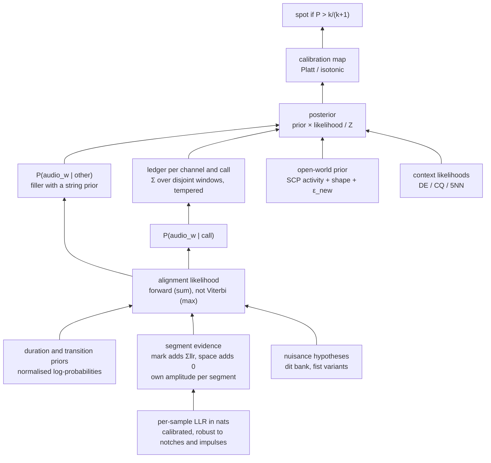
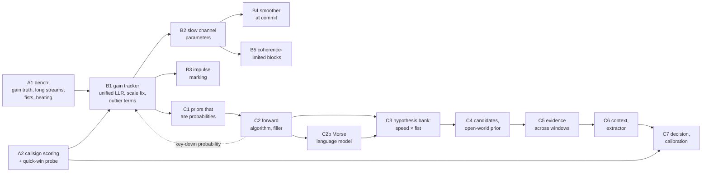

# Bayesian callsign decoding: the plan

This document plans the work from the decoder's per-sample evidence up to
the callsign posterior of [ALGORITHM.md §5.6](ALGORITHM.md#56-callsigns-a-posterior-not-a-count).
It is written for a reader who knows the decoder but not the statistics.

- **Part 1** explains the ideas the plan uses, with small worked numbers.
- **Part 2** works **top-down**: it starts from the posterior we want and
  asks what each stage below must supply. It also translates today's
  decision rules into the same terms, so the gaps are visible.
- **Part 3** works **bottom-up**: it gives the build order in three tracks,
  measurement (A), evidence (B) and decision (C). Each step says why, what
  changes, where in the code, how to check it, what it costs, and where to
  read more.
- **Part 4** sums up the effort and the milestones. **Part 5** lists the
  risks.
- [References](#references) are cited in square brackets, e.g. [Rabiner89].

Nothing here has been built. File references point into `src/engine/`.
[FADING_TRACKER.md](FADING_TRACKER.md) is the companion plan for the
evidence layer; track B of Part 3 follows it. [PLAN.md](PLAN.md) schedules
both, with switches, pass criteria and decision points.

**Why this order.** The bench (ALGORITHM.md E0, E3) puts the largest loss
in the evidence, not in the callsign logic:

- at 24 WPM, v3 needs about 9 dB more SNR than CW Skimmer's published
  rates at 0.1 Hz Doppler, and over 10 dB more at 1 Hz, and it keeps a 15 %
  CER floor at +20 dB;
- impulses at 3 per second take CER from 1.2 % to 32 %.

A callsign posterior cannot recover characters the evidence has already
lost; at 25–45 % CER an honest posterior mostly reports "unsure". And the
callsign logic tuned on that evidence (the re-read's and the call reader's
margins) probably compensates for it, so it has to be retuned once the
evidence improves. The plan therefore fixes the evidence first, and builds
the posterior on top of it.

- [Part 1: the ideas](#part-1-the-ideas)
- [Part 2: top-down, what the posterior needs](#part-2-top-down-what-the-posterior-needs)
- [Part 3: bottom-up, the build order](#part-3-bottom-up-the-build-order)
- [Part 4: effort](#part-4-effort)
- [Part 5: risks and open questions](#part-5-risks-and-open-questions)
- [References](#references)

---

## Part 1: the ideas

### 1.1 The question we actually ask

A skimmer has to answer: **"Given this audio, which callsign was sent, and
how sure are we?"** In probability notation that is

```
P(call | audio)        "the probability of the call, given the audio"
```

This is the *posterior*: what we believe after hearing the audio. A
skimmer spots a call when the posterior is high enough. Everything else in
this document is about computing that number honestly.

Today the decoder does not compute it. It computes a best reading, then
applies rules (margins, counts, score increments) that stand in for it.
The rules were tuned to work well, but their numbers have no common
meaning, so they cannot be combined, compared or calibrated.

### 1.2 Bayes' rule

Bayes' rule turns the question around, into two things we can compute:

```
                   P(audio | call) · P(call)
P(call | audio) = ---------------------------
                          P(audio)
```

- **P(call)**, the *prior*: how plausible the call is before we listen.
  A call in MASTER.SCP that worked the contest last year is plausible. A
  string such as `Q9QQQ` is not.
- **P(audio | call)**, the *likelihood*: if this call had been sent, how
  probable is the audio we got? The decoder's acoustic model answers this:
  the keying, the noise, the fading.
- **P(audio)**, the *evidence* or normaliser: the same product summed over
  **every** possible call, P(audio) = Σ_c P(audio | c)·P(c). It makes the
  posteriors add up to 1. It is also the hardest part, because "every
  possible call" includes calls we never thought of (§1.10).

**Worked example.** Two candidates fit a word: X is in MASTER.SCP, and U
is not.

| | Prior P(c) | Likelihood P(audio \| c) | Product | Posterior |
|---|---|---|---|---|
| X | 0.9 | 0.01 | 0.009 | 0.009 / 0.0108 = **0.83** |
| U | 0.1 | 0.018 | 0.0018 | 0.0018 / 0.0108 = **0.17** |
| sum | | | 0.0108 | 1 |

The audio prefers U by 1.8:1, but the prior prefers X by 9:1, so X wins at
83 %. If the audio had preferred U by 20:1 instead, U would have won at
69 %. **A prior can be beaten by evidence, but only by enough of it.** How
much is enough is a number we can set and check, not a tuned threshold.

### 1.3 Working in logarithms: nats

Likelihoods of long signals are tiny numbers, so decoders work with
logarithms. The natural log of a ratio is measured in **nats**:

| Log ratio | Odds | Like a power ratio of |
|---|---|---|
| 1 nat | 2.7 : 1 | 4.3 dB |
| 3 nats | 20 : 1 | 13 dB |
| 5 nats | 150 : 1 | 22 dB |
| 10 nats | 22 000 : 1 | 43 dB |

(One nat is 10·log10(e) = 4.34 "dB of odds". This is only an analogy for a
radio reader, but it helps with the scale.)

In logs, Bayes' rule is a sum:

```
log posterior odds (X vs U) = log prior odds + log likelihood ratio
                            = ln(P(X)/P(U)) + ln(P(audio|X)/P(audio|U))
```

The example above: ln(0.9/0.1) = 2.2 nats for X, and ln(0.01/0.018) = −0.6
nats, so X leads by 1.6 nats, which is 5:1, which is 83 %.

**This is the point of the whole plan:** once every stage speaks in nats,
evidence from different windows, priors from the dictionary and context
such as `DE` or `5NN` simply add up. Today they cannot, because their units
differ (§2.3).

### 1.4 The per-sample log-likelihood ratio (LLR)

The decoder's lowest layer already works this way. For each 250 Hz sample
it computes

```
llr(t) = ln( p(sample | key down) / p(sample | key up) )
```

Positive means "looks like a mark", negative "looks like a space", and the
size says how strongly. The lattice adds these up over a segment
(`llr_sum`) to score "this was a mark from t−d to t".

In the **weak view** this is done properly (`CwPowerStats::llr`,
`cw_frontend.h:490`). It models the matched-filter power as exponential
(the power of a signal plus Gaussian noise when the amplitude fades as
Rayleigh) under both hypotheses, with noise power σ0² and mark power σ1²:

```
llr = ln(σ0²/σ1²) + r²·(1/σ0² − 1/σ1²)
```

and divides by L, the number of samples the ½-dit moving sum makes
correlated, so that L correlated samples count as about one independent
one. The result is in nats. [VanTrees68] ch. 2 and [Proakis08] ch. 4
derive this kind of detector.

In the **strong view** (`CwDiscriminator::llr`, `cw_discriminator.h`) the
LLR is a hand-tuned blend of a span view and a Rayleigh "surprise" view,
clamped to ±2.5. It decodes well, but +1 does not mean 2.7:1 odds. It is a
score, not a likelihood ratio.

Neither view follows a fade. The weak view's σ1² is the mean under a peak
held with a 2 s release, and v2's µ_mark has a 0.35 s release, so a mark in
the next fade is scored against a level the signal no longer has, and reads
as a space. The gain tracker of FADING_TRACKER.md predicts the channel's
complex gain μ, with an uncertainty V, and scores each observation z
against that prediction:

```
llr = ln CN(z; μ, σ² + V) − ln CN(z; 0, σ²)
```

CN(z; m, v) is the complex Gaussian density with mean m and variance v.
When the gain is well known (V small), this is a matched filter against the
predicted gain. When it is unknown (V near the full signal power), it
becomes the weak view's Rayleigh-faded energy statistic. It is in nats at
every SNR, so it replaces both views and the switch between them (step B1).

### 1.5 Calibration: when a score means what it says

A score is **calibrated** when its stated odds come true. Take all samples
where the decoder says llr = +2 nats. If the score is calibrated, marks
should outnumber spaces among them by e² ≈ 7.4 : 1 (88 % marks). If they
come out 60 % marks, the score is overconfident. If they come out 99 %, it
is underconfident.

This is checked with a **reliability diagram**: bin the scores, and plot
the claimed probability against the observed frequency. A calibrated score
lies on the diagonal. The simulator knows the true key state of every
sample, so this test is cheap [Guo17].

Why it matters:

- **Adding across windows** only works if each window's score is a real
  log-likelihood. Two overconfident windows add up to a very overconfident
  total.
- **Comparing with a prior** only works if both are in nats. A prior of
  "MASTER.SCP calls are 10 nats more likely" means nothing against a score
  whose nats are really half-nats.
- **Thresholds** stop being magic. "Spot at 95 %" is a meaningful sentence
  only if 95 % is calibrated.

**A scale error the lattice has today.** The lattice scores a mark segment
as +Σllr and a space segment as −Σllr (`cw_lattice.h:252` and `:281`). A
path covers the whole span with marks and spaces, so its total is

```
Σ_marks llr − Σ_spaces llr = 2·Σ_marks llr − Σ_all llr
```

The last term is the same for every path over the same span, so it cancels
whenever two readings are compared. What is left is **twice** the log
likelihood ratio. Every margin the re-read and the call reader compare
(`max_deficit`, `min_margin`, `min_score`) is therefore in half-nats, even
in the weak view where the per-sample LLR is calibrated. The proper form is
"a mark adds Σllr, a space adds 0", which measures each path against the
all-noise reading. For Viterbi's choice of path this is only a change of
weight between the evidence and the duration priors, which tuning has
absorbed. For a posterior it is a factor-of-2 overconfidence, and it has to
be fixed first (step B1).

### 1.6 Max versus sum: Viterbi versus forward

A callsign can be keyed in many slightly different ways: a dah 2.8 or 3.2
dits long, a character space of 3 or 4 dits. Each way is an **alignment**
of the call's elements to the samples.

- **Viterbi** [Forney73] keeps only the best alignment:
  score(call) = max over alignments.
- The **forward algorithm** [Rabiner89] sums over all of them:
  P(audio | call) = Σ over alignments P(audio, alignment | call).

The likelihood that Bayes' rule needs is the **sum**. The max is a
lower bound that can rank candidates the wrong way:

> Call A has one alignment at −10 nats and twenty more at −11 nats. Call B
> has a single sharp alignment at −9 nats.
> - Max: A = −10, B = −9. **B wins by 1 nat.**
> - Sum: A = ln(e⁻¹⁰ + 20·e⁻¹¹) = −10 + ln(1 + 20/e) = −7.9; B = −9.
>   **A wins by 1.1 nats.**

A has much more total support from the audio, spread over many
alignments; the max sees only the single best one. On clean signals the
best alignment dominates and the two agree. On weak, jittery or faded
signals, where many alignments fit about equally well, they differ.

The two algorithms are the same recursion with a different "add" operation:
Viterbi uses max, the forward algorithm uses log-sum-exp,
`ln(e^a + e^b)`. This is the **semiring** view [Mohri02]: write
`CwLattice::step` once over an abstract add, and get both. The
semi-Markov form (segments with explicit durations, as this lattice has)
is covered by [Ostendorf96], [Murphy02] and [Yu10]; forward–backward for
it is in [Yu10] §3.

### 1.7 Nuisance parameters: average them, do not plug them in

The likelihood of a call depends on things we do not care about but do not
know exactly: the dit length, the operator's spacing habits (the fist),
the signal's amplitude through a fade, the noise floor. These are
**nuisance parameters**.

There are two ways to handle one:

- **Plug in** a single estimate. The decoder does this today: `CwClock`
  and `CwFist` learn from the committed path, and the lattice, the re-read
  and the call reader all use that one value.
- **Average over** it (marginalise): P(audio | call) = Σ_θ P(audio | call,
  θ)·P(θ), over a few plausible values θ.

Plugging in is cheap and fine while the estimate is right. When it is wrong
(after a speed change, at the head of an over, under a wrong bootstrap,
§3.11 and §3.14 of ALGORITHM.md), every candidate is scored under the same
wrong model, and the comparison between them is distorted in ways that do
not cancel. A call with more dahs suffers more from a too-fast clock than
one with more dits. Averaging over three dit hypotheses (×0.7, ×1, ×1.4)
costs three alignments per candidate and makes the score robust to that
error. [Bishop06] §1.5 and §3.4 explain marginalisation; [MacKay03] ch. 28
explains why it also guards against overfitting (the "Occam factor").

### 1.8 When the model is wrong: robust likelihoods

The LLR assumes a model: Gaussian noise, a steady or smoothly fading
amplitude, keying that follows the duration priors. Real signals break it:

- **Flutter** cuts 15–20 dB holes into a dash for a few samples.
- **Impulses** (static crashes, ignition) put huge short bursts into
  key-up time.
- **A hand key or a bug** produces element lengths far from 1:3.

Under a strict model, one such sample can score −50 nats or worse and
outvote everything around it. The standard defence is an
**ε-contamination** model [Huber64]: with probability 1 − ε the sample
follows the model, and with a small probability ε it is "something else"
with a broad distribution. In nats, a sample can then never cost more than
about −ln ε, a few nats. The weak view's exponential model already bounds a
notch at about ln 9 / L nats (§5.1 of ALGORITHM.md). The strong view, the
duration priors and the noise model need the same treatment. For impulsive
noise, [Middleton77] gives the physical model (Class A noise) and ITU-R
P.372 gives its parameters.

Why the posterior cares: a mismatched sample does not hurt all candidates
equally. A crash that lands where X has a dit and U has a space
strongly favours X, on evidence that has nothing to do with the station.

### 1.9 Repeated evidence and correlated errors

If a station sends its call twice, and the two copies are **independent
given the call**, the evidence multiplies: the log-likelihood ratios add.
Two copies each favouring X by 2 nats favour it by 4 nats together.

That holds only for independent copies. Two windows that share audio are
not independent; the call reader already requires disjoint windows. Less
obvious: two disjoint copies decoded under the **same wrong clock**, the
same QRM or the same fade pattern make the **same mistake**. Adding their
scores counts one error twice. Today's "heard twice" bonus (+0.20) and
`Confirmed::reads ≥ 2` have the same weakness: if the re-read snaps U to X
once, it will likely snap it again on the next copy, and the second snap
"confirms" the first.

Remedies, from simple to principled:

- **Temper**: multiply the summed log-likelihood by a factor below 1, e.g.
  0.5, fitted on data. This is the "power posterior" of [Grunwald12] and the
  "coarsened posterior" of [Miller19], both made for models known to be
  slightly wrong.
- **Score shared causes once**: average the clock and fist over all copies
  together (§1.7), so a wrong clock does not favour X in each copy
  separately.
- **Calibrate** the final probability on real labels (§1.12), which
  corrects whatever overconfidence is left.

### 1.10 The open world: calls we do not know

The normaliser P(audio) sums over **all** calls, including calls not in
MASTER.SCP: new licences, rare DX, portable designators, and calls the SCP
file has not caught up with. A prior that gives them zero mass can never
decode them; it can only map them to the nearest known call.

A proper prior is a mixture:

```
P(c) = (1 − ε_new) · P_SCP(c)  +  ε_new · P_shape(c)
```

- **P_SCP**: a distribution over the dictionary. Not uniform: calls heard
  recently on this band or spotted by the RBN, or active in the current
  contest, deserve more weight than calls dormant for years.
- **P_shape**: a distribution over all valid callsign strings, built from
  the structure rules (`SkimCallsign::is_valid`, the ITU prefix tables):
  how likely is this prefix, this digit, this suffix length.
- **ε_new**: the share of calls on the air that are not in the dictionary.
  It is measurable: decode a contest's published logs against the SCP file
  of the same date.

Speech recognition faces the same problem as **out-of-vocabulary (OOV)
words** [Bazzi02], [Bisani05], and keyword spotting solves its version with
a **filler** (or garbage) model: a model of "any other sound" that every
keyword must beat [Rose90]. The decoder's free reading (§3.15 of
ALGORITHM.md) plays that role today, but without a prior over strings
(§2.3). The spelling-correction literature uses the same structure, called
the **noisy channel**: P(intended word) × P(observed letters | intended
word) [Kernighan90], [Brill00].

**A sobering number.** Suppose the dictionary holds about 40 000 calls and
the plausible callsign shapes number about 10⁸ strings. With ε_new = 0.1
and uniform priors inside each part, one specific SCP call has prior
0.9/40 000 = 2.3·10⁻⁵, and one specific unknown call has prior
0.1/10⁸ = 10⁻⁹. That is about 22 000:1, or **10 nats**, in favour of the
SCP call. So the Bayesian answer is *not* "snap less". It says:

- A **clear** reading still wins: when U and X differ by a whole element at
  good SNR, the likelihood ratio is tens of nats, and no prior overturns it.
- An **ambiguous** reading goes to the dictionary, by an amount that follows
  from measured quantities (ε_new, the shape prior, recent activity), not
  from a tuned margin.
- Everything depends on the **likelihood being honest**. With a 10-nat
  prior, a likelihood that is off by a few nats (§1.5, §1.8) flips the
  decision.

### 1.11 From a posterior to a decision

A posterior is not yet a decision. The decision depends on what mistakes
cost. For a spot feed:

- a **miss** (a real call not spotted) costs a little: another skimmer, or
  the next CQ, will get it;
- a **bust** (a wrong call spotted) costs more: it pollutes the RBN,
  misleads operators, and in a contest it sends people chasing a station
  that does not exist.

If a bust costs k times a miss, the expected cost is lowest when we spot
exactly when P(call | audio) > k / (k + 1). With k = 5, spot above 83 %;
with k = 20, above 95 % [Berger85] ch. 1 and 4. The threshold is then a
statement of policy, and the posterior's job is to be calibrated so that the
policy does what it says.

### 1.12 Calibrating the final probability

Even a carefully built model is somewhat wrong. The last step fits a small
**calibration map** from the model's posterior (and a few side features
such as SNR or speed stability) to the observed frequency of correct calls,
on labelled data:

- **Platt scaling** [Platt99]: a logistic regression, two parameters.
- **Isotonic regression** [Zadrozny02]: any monotone map, more data needed.
- **Gradient-boosted trees** when there are many side features
  [NiculescuMizil05] compares the methods.

In speech recognition this is the "confidence measure" problem [Wessel01],
[Jiang05]. The labels can come from the simulator, from consensus with
other RBN skimmers, and from contest log checking (Part 3, step A2).

### 1.13 A bank of hypotheses, and who decides

At very low SNR a wrong estimate of the speed or the fist is devastating.
The lattice's duration windows are built around the dit clock: if the
clock is 2× off, a dit falls outside the Dit window and the lattice glues or
splits elements, and the clock then learns from those wrong elements and
stays wrong. ALGORITHM.md §5.3.6 measures exactly this at the cliff: the
bootstrap learns 9.4 samples for a true 24, and once locked correctly the
same 12 WPM signal copies cleanly 4 dB lower.

The remedy is to stop deciding the speed and the fist up front. Run the
decoder under several **hypotheses** θ at once, for example

| Dimension | Values | Why this many |
|---|---|---|
| speed | cells 1.3–1.4× apart from 10 to 50 WPM: 5–7 cells, each with its own adaptive dit clamped to the cell | the dit window tolerates about ±25 % |
| fist | tight, learned, loose char/word spacing: 2–3 | char space 2.4–4.8 dits, word space 5–11 |
| channel | steady, moderate fading, fast fading or chirp: 2–3 | the Doppler spread sets the coherent span and the tracker's poles |

and let the evidence choose. Choosing well is model comparison:

```
P(text, θ | audio)  ∝  P(audio | text, θ) · P(text) · P(θ)
                       acoustic model     language   prior over θ
                                          model
```

**Who decides.** It is tempting to let a language model (callsigns,
Q-codes, prosigns, contest exchanges, common phrases) pick the decoder whose
output "reads best". That alone is dangerous:

- The language model scores strings, not how well a string fits the audio.
  A decoder at a wrong speed produces `EISHT` strings, which the language
  model rightly rejects. But a decoder at a wrong spacing that happens to
  produce `CQ TEST` is rewarded although the audio does not support it.
- So the decision must be the **product** above: the acoustic likelihood
  and the language prior together, each in nats.

**Three traps, and their remedies.**

1. **More decoders, more false alarms.** The best of M readings of pure
   noise fits better than any single one: with M independent decoders the
   false-character rate grows roughly M-fold. This is the look-elsewhere
   effect of §2.3 again. Bayes handles it if each hypothesis carries its
   prior P(θ) (uniform: −ln M, about −4 nats for 63 hypotheses), if the
   hypotheses are **summed** where they agree rather than maximised, and if
   the hypothesis "only noise" stays in the comparison.
2. **Different filters, incomparable scores.** Decoders that see the
   signal through different bandwidths compute likelihoods of different
   statistics of the IQ. Comparing them compares how much each statistic
   reveals, not which model of the signal is right. The fair form asks a
   question about the signal ("how wide is it": Doppler spread, chirp,
   drift) and scores each answer by the likelihood of the **same IQ**. A
   Kalman tracker gives that likelihood directly, from its prediction
   errors (the prediction-error decomposition, [Harvey89] ch. 3). A bank of
   trackers weighted by it is the classic multiple-model filter [Magill65],
   [Blom88].
3. **The choice must persist.** The speed and the fist change at a QSO
   turnaround, not between words. Choosing a hypothesis per word lets the
   language model stitch `CQ` from one decoder and the call from another, at
   two incompatible speeds. Treat θ as a hidden state that switches rarely,
   with a switching probability, so a change must be paid for by evidence.

**Where it lives.** The dimensions differ in what they change:

- **Speed and fist** change only the duration priors. The per-sample
  evidence is the same for all of them, so they belong **inside one
  lattice**, as an extra state variable (ALGORITHM.md §5.2, "Speed": a small
  bank of dit hypotheses), not as separate decoders. The cost is K lattices,
  not K complete chains, and a beam keeps only the hypotheses that are still
  plausible. This bank replaces the decision-directed parts that lock onto a
  wrong clock: the Schmitt bootstrap, the re-lock and the watchdogs
  (ALGORITHM.md §3.6, §3.11, §3.14).
- **The channel hypotheses** change the evidence, so they are a bank of
  gain trackers, each feeding its own LLR, weighted by how well each
  predicts the IQ.
- **The channelizer** stays shared. It is the expensive stage, and the
  bandwidth the decoder really uses is set after it, by the matched sum
  and the envelope filter.

**Where the language model belongs.** What should decide the speed is the
probability of the audio under θ summed over all texts, each weighted by
the language model: P(audio | θ) = Σ_text P(audio | text, θ)·P(text). That is
the forward algorithm (§1.6) with the language model inside its state: the
node of the Morse code tree plus a few characters of context, pruned with a
beam. A cheaper first form rescores the N best readings of each surviving
hypothesis, per over, by acoustic score + language score + ln P(θ). Speech
recognition combines several recognisers in the same way [Fiscus97],
[Evermann00].

**The language model's weight.** Speech recognisers multiply the language
score by 10–15, because their acoustic scores treat correlated frames as
independent and are overconfident [JurafskyMartin]. This decoder has the
same issue in smaller form (the factor 2 of §1.5, the correlation divisor
only in the weak view). With calibrated evidence (step B1) the weight should
come out near 1. It is fitted, not assumed.

Averaging over hypotheses, rather than picking one, is Bayesian model
averaging [Hoeting99]. Steps C2b and C3 build it; step A1 measures first how
much it can gain.

---

## Part 2: top-down, what the posterior needs

### 2.1 The target, written for this decoder

For one channel and one candidate call c, over the disjoint windows
w = 1 … W in which it was heard:

```
log P(c | audio) = log P(c)                                   ← prior (§1.10)
                 + τ · Σ_w log P(audio_w | c)                 ← tempered likelihoods (§1.9)
                 + log P(context | c)                         ← DE, CQ, 5NN, TEST (step C6)
                 − log Z                                      ← normaliser over all calls
```

with

```
P(audio_w | c) = Σ_θ P(θ) · Σ_alignments P(audio_w, alignment | c, θ)
                 θ = (dit, fist variant, gain belief)         ← nuisance average (§1.7)

Z = Σ_{c' in candidates} P(c')·P(audio | c')  +  P(other)·P(audio | other)
                                               ↑ the filler: "some other text, or nothing"
```

Each factor rests on the stage below it:



### 2.2 Factor by factor: what it needs, what exists, the gap

| Factor | Needs | Today | Gap | Step |
|---|---|---|---|---|
| Per-sample evidence | log-likelihood ratio in nats, robust | weak view: calibrated (`CwPowerStats::llr`). Strong view: heuristic ±2.5 (`CwDiscriminator::llr`) | strong view has no scale; no impulse term; correlation divisor only in the weak view; neither follows a fade | B1 (gain tracker) |
| Segment evidence | mark +Σllr, space 0 | mark +Σllr, space −Σllr | factor 2 on every comparison (§1.5) | B1 |
| Duration priors | log-probabilities that sum to 1 over each window | `−α·ln²(d/ideal) − 0.5` (`cw_lattice.h:104`) | not normalised; the 0.5 per segment is a length penalty with no probability meaning | C1 |
| Transition priors | P(next segment type \| state), Morse-tree validity | all transitions free; invalid codes found only at `take()` | priors missing | C1 |
| Alignment likelihood | sum over alignments | max (Viterbi, `forced()`, `CwCallAlignment`) | max is a lower bound and can rank wrongly (§1.6) | C2 |
| Nuisance | average over dit, fist, gain | one plugged-in clock and fist; global µ_mark or σ1² | wrong clock distorts every comparison (§1.7) | C3 (speed and fist bank), B1–B2 (gain, spread) |
| Filler | P(audio \| other) with a string prior | free reading `sf` / `F`: a max, with no string prior | not a probability; inflated by the look-elsewhere effect (§2.3) | C2, C4 |
| Candidate set | SCP neighbours **and** the reading as heard **and** its close valid-shape variants | SCP neighbours (+ calls confirmed in 300 s) | the unknown call never competes (§2.3) | A2 (probe), C4 |
| Prior | open-world mixture, activity-weighted | implicit: e⁵ for any SCP call (re-read); SCP-only candidates (reader); +0.15 for SCP (extractor) | hidden, fixed, uniform | C4 |
| Repeated readings | tempered sum of log-likelihoods | `Confirmed::reads` count; `best_score` is a max; extractor +0.20 per repeat | counting, not evidence; correlated errors self-confirm (§1.9) | C5 |
| Context | likelihood ratio of DE/CQ/5NN given "is a call" | +0.25 DE, +0.10 CQ, +0.25 exch | additive points, not likelihoods | C6 |
| Decision | posterior vs cost threshold | score ≥ 0.70 plus `hearings()` in the feed | uncalibrated | C7 |

### 2.3 Today's rules, translated into Bayesian terms

Read this section as an audit: what each rule *implies* about priors and
likelihoods, whether or not it was meant that way.

**Word re-read** (`CwWordReread`, `cw_reread.cpp:176`). The decoded word
W is not in MASTER.SCP. Candidates are the SCP calls within two edits. The
rule takes the best candidate X when

```
max(sf, s_raw) − s(X) ≤ max_deficit = 5     and     s(X) − s(second SCP call) ≥ min_margin = 3
```

- `sf` is the free reading's Viterbi score and `s_raw` the forced score of
  W itself. Neither pays a prior.
- In Bayesian terms the first condition says: **any SCP call has a prior
  e⁵ ≈ 150 times higher than the string W**, whatever X and W are. Because
  of the factor 2 (§1.5), in the weak view that is really e^2.5 ≈ 12 on
  true nats. In the strong view, the units have no fixed meaning at all.
- The second condition compares X only with other SCP calls. W, the reading
  the audio supports best, is not in that competition.

**Call reader** (`CwCallReader::read`, `cw_callreader.cpp:189`). Every
3 s, over 6 s of LLR, candidates (SCP calls hinted at by the text, and calls
confirmed in the last 300 s) are force-aligned and scored against the free
reading F. A hit needs `score − F ≥ −5`, and a lead of 3 over every other
candidate and up to 8 SCP neighbours. A spot needs 2 hits in disjoint windows,
or one wide one (`cw_callreader.cpp:225`).

- Again, the reading as heard is not a candidate unless it is in SCP or was
  confirmed earlier. So in this stage **the prior of an unknown call is
  zero**.
- F is the max over *all* mark/space strings, with no prior on the string.
  The more strings there are, the better the best one fits by chance: the
  **look-elsewhere effect**. A proper filler sums over strings weighted by
  their prior. Its score is lower than F by about the cost of naming one
  string out of many (the Occam factor, [MacKay03] ch. 28). So "within 5 of
  F" is a stricter test for some words than for others, in a way that does
  not depend on the station.
- Two reads are counted, not added. A read at −4.9 and a read at −0.1
  count the same.

**Extractor** (`SkimCallsignExtractor`, `callsign.cpp:631`). On the text,
including the `␁CALL␂` corrections (which replace the raw word,
`callsign.cpp:1354`): 0.55 for a valid structure, +0.25 after DE, +0.10 in
CQ context, +0.20 if heard twice, +0.15 if in SCP, +0.25 before an exchange,
spot at 0.70. The fused-run and despace fallbacks rejoin or split tokens,
partly guided by SCP membership. The feed then also counts `hearings()`.

- These are points, not log-likelihoods. "+0.25 for DE" cannot be compared
  with the audio's 4-nat deficit, because they are in different units.
- A correction from the re-read and its repeat on the next over both count
  as hearings, so a systematic snap confirms itself (§1.9).

### 2.4 Worked example: the snap

The station sends U, a call not in MASTER.SCP. The lattice reads it
correctly. X is an SCP call one dit different.

| | Score vs free reading (today's units) | Today | Bayes, weak signal | Bayes, strong signal |
|---|---|---|---|---|
| U (as heard) | 0 | not a candidate | likelihood 0 | likelihood 0 |
| X | −4 | **taken**: within 5, no SCP rival within 3 | likelihood −2 nats (half of −4, §1.5) | likelihood −30 nats (a clear dit at good SNR) |
| prior X vs U | | implicit +5 | +10 nats (§1.10), or less if X is dormant | +10 nats |
| log posterior odds X : U | | | +8 → **X**, correctly ambiguous copy goes to the dictionary | −20 → **U**, the audio wins |

The weak case shows that Bayes may snap just as today, but for a stated
reason and by a measured amount. The strong case is where today's rule is
most likely to bust: in the strong view the per-sample LLR is clamped at
±2.5 and comes from a heuristic, so a clean extra dit can come out at only
a few score units, and X is taken although the audio is unambiguous.
**This is a hypothesis, not a measurement.** Step A2 measures it.

### 2.5 The tuning-metric trap

The current rules were tuned for the most calls detected in contests. A
snap always produces a real call, because only SCP calls can be written in.
So the more aggressively the rules snap, the more real calls come out, and
the metric goes up. Its cost, the busts, is invisible to the metric unless
each spot is checked against what was really sent.

Consequences for this plan:

- **A correct posterior will very likely score worse on "calls detected"
  at first.** That is expected, and it is not a regression by itself.
- The metric has to change **before** any of the steps below is tuned: count
  correct spots, busts and misses separately, and separately for SCP and
  non-SCP calls, and combine them with the cost ratio k of §1.11.
- Tuning on contest audio alone over-represents SCP calls. The test set must
  contain a realistic share of calls not in the dictionary.

---

## Part 3: bottom-up, the build order

The build runs in three tracks, in this order:

- **A, measurement.** The bench must see fading, impulses, real fists and
  busts before anything is tuned.
- **B, evidence.** The gain tracker of [FADING_TRACKER.md](FADING_TRACKER.md)
  and impulse handling. This is where the measured gap is (see "Why this
  order" at the top), and it changes the evidence every later step reads.
- **C, decision.** Priors, sums over alignments, nuisance averaging, and the
  callsign posterior. It is tuned on track B's evidence, not on today's.

Every step goes behind a `CwDecoderConfig` switch, as v3 did next to v2,
and follows the acceptance rules of ALGORITHM.md §5.9: existing gates
byte-identical with the switch off, no regression with it on, A/B on
replayed off-air IQ, and **no rise in false characters on noise**.



### Track A: measurement

#### A1: a bench that sees the channel and the fist

**Why.** The evidence work (track B) is judged on fading, beating, drift and
impulses. The priors (C1) are judged on fists that are not machine-regular.
The bench (`experiments/cw_bench`, ALGORITHM.md E0) already has Watterson
fading with the ITU-R sets, impulses and recorded-IQ beds, but each over is
about 25 s, starts cold, and uses a nearly regular synthetic fist.

**What.**

1. FADING_TRACKER.md step K0: output the true gain and keying, add a long
   continuous-stream mode (minutes of one station, many overs), two-path
   presets with different Doppler shifts (beating), drift and chirp.
2. Keying styles: the four DeepCW styles (hand key, bug, paddle, computer),
   with log-normal element and space durations per style and an on/off
   imbalance (ALGORITHM.md §5.4, W0). Without them, step C1 cannot be
   measured.
3. Reliability diagrams (§1.5) of the per-sample LLR and of segment scores
   against the true keying, per condition. They are the pass test of B1.
4. **Oracle bounds for the hypothesis bank** (§1.13). Before C3 is built,
   measure what perfect knowledge would buy:
   - *speed:* `oracle.h` has a `clock` mode (the dit from the true WPM, a
     clock more than 25 % off reset). On the bench the truth is exact. Run
     the weak ladder and the fading table with it. ALGORITHM.md §5.3.6
     suggests up to about 4 dB at 12 WPM, 2 dB at 18 and 1 dB at 25.
   - *fist:* add the same for the char and word space, from the bench's own
     keying parameters.
   - *channel:* decode each over under several fixed settings (coherent
     span, envelope bandwidth) and keep the best per over against the truth.
     In white noise §5.3.6 found almost nothing left (±0.3–0.6 dB), so look
     for a gain under fast fading, chirp, drift and QRM. A dimension whose
     oracle gains under about 1 dB is dropped from the bank.
   - *the pause rule:* the other cause of §5.3.6's flat thresholds. No bank
     fixes it; `matched_alive` or the Bayes-factor squelch does. Measure it
     separately, so the bank is not credited or blamed for it.

**Effort.** 2–3 weeks, about one of them for the oracle bounds.

#### A2: measure busts, not detections

**Why.** Every later step changes the trade between busts and misses. With
a metric that sees only detections, the steps cannot be judged (§2.5).

**What.**

1. **Synthetic calls in real IQ beds** (ALGORITHM.md §5.9). Use a call
   list in which a set share (e.g. 10–20 %) is **not** in the MASTER.SCP
   snapshot used, and in which some calls are one or two edits from SCP
   calls, so snaps can happen. Labels are exact.
2. **Callsign-level scoring.** For each inserted call: spotted correctly,
   spotted as another call (bust), or missed. Count spots of calls that were
   never inserted (false spots). Split all of it by SCP / non-SCP, SNR,
   speed, Doppler condition and keying style.
3. **Off-air labels** (slower, real conditions):
   - consensus with other RBN skimmers in the same minute and band; biased
     towards calls that other skimmers also get right, so use it for
     precision, not recall;
   - contest logs after the sponsor publishes them: a call that appears in
     no log of the contest is very likely a bust.
4. **One summary number**: cost = misses + k·busts, with k from §1.11
   (start with k = 5), next to the raw counts.

**The quick-win probe.** Add the reading as heard, W, to the candidate set
of both take rules, with an explicit log-prior bonus β for SCP calls in
place of the hidden one:

```
take X  if  s(X) + β  >  s(W)  and  X leads every other candidate by min_margin
```

That is a few dozen lines in `cw_reread.cpp` and `cw_callreader.cpp`.
Sweeping β with the new metric shows how many of today's detections are
snaps against the audio, and what they cost.

Use it as a **measurement**, not as a tuned setting. The re-read and the
call reader do much of the work today because the evidence fails in
fading (at +10 dB, v3 still loses 25–45 % of characters under 1 Hz and
ITU poor fading, ALGORITHM.md E0 and E3). Run the sweep again after B1. If
the SCP corrections fire much less often on tracked evidence, they were
compensating for the fading loss, and their margins must be retuned there.

**Effort.** 1–2 weeks for the scoring, 2–3 days for the probe. Off-air
labels take calendar time (a contest, then the logs).

**Read.** [Wessel01] §II for how speech recognition counts and scores
errors.

### Track B: evidence

Track B follows [FADING_TRACKER.md](FADING_TRACKER.md), steps K1–K6, and
adds to it what the posterior needs from the evidence. That plan explains
the channel model, what is tracked, and how to feed the filter without
pilots; this section does not repeat it.

#### B1: the gain tracker, with evidence in honest nats

**Why.** Every later stage adds evidence. The evidence today does not
follow a fade (§1.4), its scale is off by a factor of 2 (§1.5), and one
impulse or notch can outvote a whole element (§1.8).

**What.**

1. **The tracker** (FADING_TRACKER.md K1, a Python prototype on bench
   dumps; K2, `CwGainTracker` in C++ next to `CwPowerStats`). An AR(2)
   complex Kalman filter on the ½-dit coherent block sums, fed by soft data
   association (FADING_TRACKER.md §3, [BarShalomTse75]). Its likelihood
   ratio, given the predicted gain μ and its uncertainty V,
   ```
   llr = ln CN(z; μ, σ² + V) − ln CN(z; 0, σ²)
   ```
   replaces both today's views and the switch between them (§1.4). The old
   LLRs stay selectable for A/B.
2. **Segment evidence relative to noise**, in the same change. Score a mark
   as +Σllr and a space as 0, in place of −Σllr (§1.5). Because the extra
   term is the same for all paths over a span, the Viterbi path is
   unchanged if the duration priors are halved at the same time (the whole
   score is then halved). Check that first for byte-identical output, then
   switch the LLR. The balance between the evidence and the priors is then
   retuned once, for both changes.
3. **Outlier terms** (§1.8). The tracker's innovation gate protects its
   own state from impulses (FADING_TRACKER.md, risks), but the LLR the
   lattice reads needs its own ε-contamination term [Huber64]: a broad
   component for impulses and a bounded penalty for notches the tracker
   failed to predict. Each bounds what one observation can cost to a few
   nats.
4. **Pass tests.** FADING_TRACKER.md K2's criteria (the fading table at
   +10 dB clearly below v2, the no-fading ladder within 0.2 dB, no rise in
   false characters), plus the A1 reliability diagrams near the diagonal in
   every condition, plus the A2 probe run again.

**Where.** `cw_frontend.h` (`CwPowerStats`, a new `CwGainTracker`),
`cw_lattice.h` (`step`, the space branch), `cw_reread.cpp` (the `sign` in
its scoring, line 15), `CwCallAlignment` in `cw_align.cpp`.

**Risk.** The highest of the plan. v2's strong view was tuned on strong
live air and is the reference there. One unified LLR replaces it, so the
A/B on recorded strong stations comes first.

**Effort.** 4–6 weeks (K1 1–2, K2 2–3, the scale fix and the outlier terms
about 1).

**Read.** FADING_TRACKER.md §6; [Baddour05] for the AR order;
[Kailath69] for why this LLR is the optimal detector of a random signal in
noise; [Watterson70] for the channel.

#### B2: slow channel parameters

FADING_TRACKER.md K3: the Doppler spread B, the residual carrier offset,
the mean power P and the beating indicator, kept per channel and per
station across overs. B sets the tracker's poles; when in doubt, assume
faster fading.

**A bank of trackers during acquisition** (§1.13, trap 2). B can only be
measured from committed marks, so at the head of an over, and after a
pause, it is not known yet. Run 2–3 trackers with fixed spreads (steady,
moderate, fast fading or chirp) and weight each by the likelihood of the IQ
it predicted, the multiple-model filter of [Magill65]. The lattice reads the
weighted mixture of their LLRs. Once K3's estimate of B is stable, collapse
to one tracker. Keep the bank only if A1's channel oracle shows a gain.

**Effort.** 1–2 weeks, plus 1 for the bank.

#### B3: impulse marking

**Why.** The bench shows impulses at 3 per second (40 dB) take CER from
1.2 % to 32 %, and at 10 per second give 250 false characters per hour on
noise (ALGORITHM.md E0). The outlier term of B1 bounds the damage per
sample, but an impulse still lands in every channel at once and still
produces phantom dits.

**What.** ALGORITHM.md §5.7: detect impulses in the wideband stream, from
how many channels jump together; map each one onto the 16 output samples
the channelizer smears it over; hand per-sample erasure weights to
`process()` through a new hook on `SkimDecodeChannel`; keep marked samples
out of everything that learns (the clock, the fist, the noise floor, the
tracker). Dense trains (ignition) need repair before the channelizer, never
zeroing.

**Effort.** 2–3 weeks. Detection belongs to the skimmer module, which owns
the channelizer.

**Read.** [Middleton77] for the noise model.

#### B4: smoother at commit, and soft feedback

FADING_TRACKER.md K4: rerun the committed stretch backwards with hard
keying, which corrects the tracker's state and feeds the slow parameters
with clean data. The same pass gives `CwClock` and `CwFist`
amplitude-aware, posterior-weighted durations in place of the single
committed path (ALGORITHM.md §5.2, "Soft feedback"), one EM step per
commit [Dempster77].

**Effort.** 1–2 weeks.

#### B5: coherence-limited coherent blocks

FADING_TRACKER.md K5 and ALGORITHM.md §5.3.4: with B measured and the
phase tracked, sum coherently over as long as the channel stays coherent.
Simulated at about +1 dB on dits, up to +2.5 dB on long elements in quiet
and moderate fading.

**Effort.** 1–2 weeks.

K6, per-survivor gain beliefs in the lattice [RaheliPolydoros95], is built
only if B1–B5 leave a measurable gap (see "Optional steps").

### Track C: decision

Start track C once B1 has settled: its steps are tuned on the evidence, so
tuning them on today's evidence would be done twice.

#### C1: priors that are probabilities

**Why.** A path's score is evidence plus priors. If the priors are not
log-probabilities, the score is not a log-probability either, and candidates
with different numbers of elements are compared unfairly: today each extra
segment costs 0.5, so a call with more elements is penalised for its length
alone. At weak SNR, where deficits are a few nats, that is the same size as
the decision margins.

**What.**

1. **Normalised durations.** For each segment type, turn the log-normal
   shape into a probability over its search window:
   ```
   log p(d | type) = −α_type·ln²(d / ideal_type) − ln Z_type,
   Z_type = Σ_{d in window} exp(−α_type·ln²(d / ideal_type))
   ```
   Z changes when the clock or the fist moves, so compute it where the
   prior memo is rebuilt (`sync_prior_memo`). This costs nothing per
   sample.
2. **Transition probabilities** in place of the 0.5 segment cost:
   P(ElementSpace | mark inside a character), P(CharSpace), P(WordSpace),
   and P(Dit) vs P(Dah) after a space. Estimate them from text statistics
   (character lengths of decoded traffic, callsigns, contest exchanges), and
   let the fist adapt the space ones.
3. **Optional: Morse-tree validity.** Track the node of the Morse code
   tree in the state, so only valid characters can be formed
   (ALGORITHM.md §5.2, "Morse-tree node"). A beam keeps the cost down.
   Without it, invalid codes are dropped only at `take()`.
4. **Robust durations** (§1.8): a small ε mixture on each duration prior,
   so that a hand key's 5-dit dah or a 6-dit character space is unlikely
   but not impossible. Measured on A1's keying styles.

**Where.** `CwSegmentPriors` in `cw_lattice.h` (`duration_prior`,
`kSegmentCost`), `CwFist`, and the call reader's own duration classes in
`cw_align.h`.

**Risk.** Viterbi's output changes everywhere. All gates must be re-run, and
the α values probably re-fitted. ALGORITHM.md §5.5 ("Learn the hand
constants") describes fitting them by gradient on the simulator once C2
exists.

**Effort.** 1–2 weeks plus a retune.

**Read.** [Ostendorf96] for segment models and their duration
distributions; [Yu10] §2 for explicit-duration semi-Markov models.

#### C2: sum over alignments (the forward algorithm)

**Why.** Bayes' rule needs P(audio | call), the sum over alignments, not the
best one (§1.6).

**What.**

1. **One recursion, two semirings.** Template `CwLattice::step` and the
   alignment DPs (`forced()` in `cw_reread.cpp`, `CwCallAlignment` in
   `cw_align.cpp`) over the "add" operation: max for Viterbi, log-sum-exp
   for forward. The windows and the prior memo are shared. [Mohri02] gives
   the general form.
2. **Forward scores for the re-read and the call reader.** Every forced
   alignment of a candidate gets a forward score, log P(audio_w | c).
3. **The filler** (§1.10): a forward pass over the free reading with a
   prior over strings. Start with a character model: uniform over the Morse
   table, with character-length statistics. Later replace it with a
   character n-gram trained on decoded traffic and contest logs (ALGORITHM.md
   §5.8, "Language prior"). This replaces `sf` and `F`.
4. **Later: forward–backward on the main lattice** over the commit window.
   It gives a posterior for each segment and each character (grey text for
   unsure characters), and N-best readings for C4. [Rabiner89] §III;
   [Yu10] §3 for the semi-Markov form; [Mangu00] for turning a lattice into
   per-position alternatives (a "confusion network").
5. **Optional: a better key-down probability for the tracker.** The
   tracker's soft data association (B1) weighs each observation by the
   probability that the key is down, from the observation's likelihood
   ratio and the average keying duty. The forward pass of the main lattice
   gives a sharper prior: P(key down at t | everything before t), which
   knows that the middle of a dah is almost surely key-down and the middle
   of a word space almost surely not. **Use the prediction, not the
   posterior.** The tracker must combine the forward pass's probability
   *before* observation t with its own likelihood of observation t, and the
   lattice must read the tracker's LLR computed from its prediction
   *before* that update. Otherwise observation t is counted twice, once
   through each, and both become overconfident.

**Cost.** Log-sum-exp is more expensive than max (an exp and a log per
operation, or a table). Budget 2–4× on the alignment DPs. They run only on
the re-read's and the call reader's windows, not per sample on every
channel, so this is affordable. Forward–backward on the main lattice, and
item 5, are about 2× the lattice and can wait.

**Effort.** 1–2 weeks (the lattice is 392 lines, the alignment 136), item 5
another 1–2 weeks.

#### C2b: a Morse language model

**Why.** At very low SNR the acoustic evidence alone cannot tell apart
readings that differ by a weak element. The language says which of them is
likely traffic (§1.13). It is also the string prior the filler of C2 needs.

**What.**

1. **Structured parts as small grammars** (finite-state): callsigns, with
   the open-world prior of C4; RST with cut numbers (`5NN`, `T` for 0, `N`
   for 9); contest serials and zones; Maidenhead locators; times; Q-codes;
   prosigns.
2. **Phrases**: `CQ … DE … K`, `TU`, `73`, `GL`, `FB OM`, `UR RST`, and the
   common ragchew vocabulary, as a word list with frequencies.
3. **A character n-gram** for everything else, with smoothing so that
   unseen strings are unlikely but possible [KneserNey95]. Train on decoded
   traffic, contest logs and RBN spots, never on the bench's own texts.
4. **Mode.** Contest, pile-up and ragchew traffic differ. Choose the mixture
   weights from evidence (the CQ/TEST context the extractor already tracks),
   so a contest model does not turn every ragchew into `5NN`.
5. **First form:** rescore the N best readings of each over (from C2's
   forward–backward) by acoustic score + λ·language score + ln P(θ), with
   the weight λ fitted on the bench (§1.13: expect near 1 after B1).
   **Later:** move the language model into the forward pass's state, the
   Morse-tree node plus a few characters of context, pruned with a beam.

**Pass test.** Character error rate at the cliff improves, and the
noise-only false-character gate does not rise with the language model on.
Noise is where a language model invents text.

**Where.** A new `CwLanguageModel` used by the filler (C2), the N-best
rescoring, and the candidate prior (C4).

**Effort.** 2–4 weeks, plus the data work.

**Read.** [KneserNey95] for n-gram smoothing; [JurafskyMartin] for
language models in recognisers and their weight.

#### C3: the hypothesis bank: speed × fist

**Why.** A wrong clock or fist distorts every comparison between candidates
(§1.7), and at very low SNR it wrecks the decoding itself (§1.13). The
bench's cold-start overs (ALGORITHM.md E0, and the clock-acquisition
failures of §5.3.6) show that the clock is often wrong exactly at the head
of an over, where a call is sent. The gain is averaged by the tracker's V
(B1) and the tracker bank (B2), so it is not part of this step.

**What.**

1. **Hypotheses in the lattice state.** Add the hypothesis index θ =
   (speed cell, fist variant) to the state of `CwLattice`, with 5–7 speed
   cells 1.3–1.4× apart and 2–3 fist variants (§1.13). All hypotheses read
   the same per-sample evidence; only the duration priors differ. Each
   speed cell keeps its own adaptive dit, learned from its own
   posterior-weighted durations and clamped to the cell.
2. **A switching prior.** θ may change only at an over break or a pause,
   or anywhere with a small probability, so a change of speed must be paid
   for by evidence and words cannot be stitched across hypotheses.
3. **A beam.** In acquisition (a new channel, after a pause) all
   hypotheses run. Drop those more than about 8 nats behind the best (by
   forward probability, C2), and keep 1–3 once the channel is locked. A
   pause or a turnaround re-opens the bank.
4. **It replaces the decision-directed clock.** The Schmitt bootstrap, the
   re-lock and the four watchdogs (ALGORITHM.md §3.6, §3.11, §3.14) become
   unnecessary with the bank on, and so does most of the pre-roll replay
   (§3.7): the bank decodes from the first mark under every speed.
5. **The same bank in the alignments.** The re-read and the call reader
   score each candidate under the surviving hypotheses and sum, and use the
   **same** hypotheses for all candidates and the filler, so the comparison
   stays fair. This replaces the call reader's "char spaces may stretch to
   8 dits".
6. **Decide with the language model.** The surviving hypotheses compete
   on acoustic + language + prior (C2b), summed where they agree.

**Pass test.** The weak ladder approaches the oracle-clock bound of A1 at
12–18 WPM; the speed-change and startup gates pass; the noise-only
false-character rate with the full bank does not rise (§1.13, trap 1).

**Where.** `CwLattice` (state, rings, beam), `CwSegmentPriors` (one per
hypothesis), `CwClock`, `CwFist`, the bootstrap path in
`decode_cw_viterbi.cpp`, `CwCallAlignment`, `CwWordReread::forced`.

**Cost.** A lattice step is a few hundred operations per sample at 25 WPM,
more at slow speeds, because its windows scale with the dit. 21 hypotheses
on a channel in acquisition is a few million operations per second, and
much less once the beam collapses. Run the bank only on channels with a
detected carrier, not on all 1536.

**Effort.** 3–4 weeks (needs C2).

**Read.** [Hoeting99] for model averaging; [Magill65] and [Blom88] for
banks of filters with switching.

#### C4: the candidate set, the filler and the open-world prior

**Why.** The posterior is only as good as the set of hypotheses it compares.
Today the reading as heard is often not among them (§2.3).

**What.**

1. **Candidates** for a word or a window:
   - the reading as heard, if it has a valid shape;
   - the N best readings from the forward–backward pass (or, before C2
     item 4, the valid-shape strings one edit from the reading);
   - the SCP neighbours `dict.near()` finds, as today;
   - calls confirmed on this channel recently.
2. **The prior** (§1.10):
   ```
   log P(c) = log[(1 − ε_new)·P_SCP(c) + ε_new·P_shape(c)]
   ```
   - P_SCP weighted by activity: recently heard on this band, spotted by the
     RBN in the last hour, worked in this contest. The session cache of
     ALGORITHM.md §5.6 is the start of this.
   - P_shape from the structure rules in `SkimCallsign::is_valid` and the
     ITU tables: per-prefix weights (by activity in RBN history),
     digit, suffix length.
   - ε_new measured from logs (A2).
3. **The normaliser** Z = Σ over candidates + P(other)·P(audio | filler).
   The filler absorbs "some string we did not enumerate" and "not a call at
   all". Without it, the posterior of the best candidate is always high,
   because there is nothing else to share the probability with.
4. **Noise must not become a call.** The re-read's evidence bar
   (`min_evidence`) becomes the comparison with a third hypothesis, "only
   noise": the all-space path, which the Bayes-factor squelch of
   ALGORITHM.md §5.5 uses too.

**Where.** `cw_reread.cpp`, `cw_callreader.cpp`, a new prior object
shared by both and by the extractor, fed from the dictionary snapshot and the
pipeline's spot history.

**Effort.** 1–2 weeks, plus data work for the shape and activity priors.

**Read.** [Rose90] for filler models; [Bazzi02] and [Bisani05] for unknown
words; [Kernighan90] and [Brill00] for the noisy-channel form of
correction.

#### C5: add evidence across windows

**Why.** A station repeats its call. Repeats should add evidence, by how much
each one supports the call, not count as one tick each (§1.9).

**What.**

1. **A ledger per channel**: for each candidate call, the running sum of
   log P(audio_w | c) − log P(audio_w | filler) over disjoint windows,
   with a time decay (the station may leave).
2. **Tempering** τ in 0 < τ ≤ 1, fitted on the bench so that the posterior
   stays calibrated as repeats accumulate. Start with τ = 0.5. A1's long
   continuous streams give the many-copies case.
3. **One reading per window.** The word re-read and the call reader may
   score the same audio. Merge them into one ledger entry per window, so the
   same audio is not counted twice.
4. **Retire the counts**: `Confirmed::reads`, the "wide margin" shortcut,
   and the extractor's "heard twice" bonus become the ledger.

**Where.** `CwCallReader::Confirmed`, the re-read's output, a new ledger in
`CwState`.

**Effort.** 1 week.

**Read.** [Grunwald12], [Miller19] for tempered posteriors.

#### C6: context as likelihood, and the extractor

**Why.** "DE before it", "CQ around it" and "5NN after it" are real
evidence that a token is a callsign. As fixed points they cannot be combined
with the audio's nats.

**What.**

1. **Context likelihood ratios.** For each context feature, estimate
   P(feature | token is a call) / P(feature | token is not a call) from
   labelled text (decoded contest traffic with known calls). Each becomes a
   term in nats.
2. **The correction token carries a probability.** Extend `␁CALL␂` to carry
   the posterior (or its log-odds), so the extractor receives evidence, not
   a verdict. The interface is `SkimDecodeChannel::take_aux_text()`
   (`decode.h:120`) and the token parsing in `SkimCallsignExtractor::feed()`
   (`callsign.cpp:1354`).
3. **The extractor's text-level fixes** (fused runs, despace) stop deciding.
   They become candidate generators for C4, scored on the audio like any
   other candidate.
4. **Other structured tokens.** The same scoring fits RST (`5NN`, with T/N
   for 0/9), serials, zones and locators (ALGORITHM.md §5.6, "Beyond
   callsigns").

**Where.** `callsign.cpp` (1481 lines, the scoring at `:631`), the token
format in `callsign.h`, the feed policy in the skimmer pipeline.

**Effort.** 2 weeks.

#### C7: the decision and its calibration

**Why.** A posterior is useful only if 90 % means 90 % (§1.12), and the
spot rule should say what a bust costs (§1.11).

**What.**

1. Fit a calibration map from the posterior and a few side features (SNR,
   speed and frequency stability, time on frequency, the tracked Doppler
   spread, the share of evidence in impulse-marked samples) to the labels
   of A2. Logistic regression first [Platt99]; isotonic or boosted trees
   once there is more data [Zadrozny02], [NiculescuMizil05].
2. Spot when the calibrated probability exceeds k / (k + 1).
3. Check calibration separately for SCP and non-SCP calls, and per
   condition. A map that is calibrated on average but overconfident on
   unknown calls reintroduces the busts.

**Effort.** 1–2 weeks, plus the time to collect off-air labels.

### Optional steps

| Step | What | Effort | Read |
|---|---|---|---|
| K6 | per-survivor gain beliefs in the lattice (FADING_TRACKER.md), only if B1–B5 leave a gap | 4+ weeks | [RaheliPolydoros95], [Blom88] |
| Language model | character n-gram or a small network as the filler's string prior | 2–4 weeks | ALGORITHM.md §5.8 |
| Learned constants | fit α, the fist clamps, ε and τ by gradient through the forward algorithm on the simulator | 2–3 weeks | ALGORITHM.md §5.5 |
| Learned gain correction | a small network correcting the tracker where its model is wrong (QRM, chirp) | large | FADING_TRACKER.md §6 (KalmanNet) |

---

## Part 4: effort

Estimates are focused work for one developer. Writing the code is the
smaller part. Bench sweeps, off-air A/B runs and retuning the gates
dominate, and off-air labels take calendar time.

| Step | What | Effort | Depends on |
|---|---|---|---|
| A1 | bench: gain truth, long streams, beating, drift, keying styles, reliability diagrams, oracle bounds for the bank | 2–3 wk | — |
| A2 | callsign-level scoring; the quick-win probe | 1–2 wk (+2–3 days) | — |
| B1 | gain tracker (K1, K2), the scale fix, outlier terms | 4–6 wk | A1 |
| B2 | slow channel parameters (K3), tracker bank during acquisition | 2–3 wk | B1 |
| B3 | impulse marking (§5.7) | 2–3 wk | B1 |
| B4 | smoother at commit, soft feedback (K4) | 1–2 wk | B2 |
| B5 | coherence-limited blocks (K5) | 1–2 wk | B2 |
| C1 | normalised duration and transition priors | 1–2 wk + retune | B1 |
| C2 | forward algorithm, filler (+ key-down probability for the tracker) | 1–2 wk (+1–2) | C1 |
| C2b | Morse language model: grammars, phrases, character n-gram; N-best rescoring | 2–4 wk + data | C2 |
| C3 | hypothesis bank speed × fist in the lattice; replaces bootstrap, re-lock, watchdogs | 3–4 wk | C2, C2b |
| C4 | candidates, open-world prior, normaliser | 1–2 wk + data | C2 |
| C5 | evidence ledger across windows, tempering | 1 wk | C4 |
| C6 | context likelihoods, extractor rewrite, token format | 2 wk | C5 |
| C7 | decision threshold and calibration | 1–2 wk + labels | A2, C6 |
| | **All of A, B and C** | **about 25–42 weeks (6–10 months)** | |

**Milestones.** Each one is worth stopping at:

| After | About | What you have |
|---|---|---|
| A + B1 | 7–11 weeks | Faded marks stay marks, one calibrated evidence for all SNR, today's SCP logic retuned on the bust metric. The first version worth shipping, if the bench confirms the gain. |
| B2–B5 | +6–10 weeks | Impulse handling, a measured Doppler spread, longer coherent sums where the channel allows them. |
| C1–C3 | +7–14 weeks | Honest scores: probabilities from evidence to word, a language model, and a hypothesis bank in place of the decision-directed clock. The extractor still adds points. |
| C4–C7 | +5–7 weeks | Callsign posteriors and a calibrated spot gate. |

A posterior built on today's evidence (track C before track B) is not a
useful milestone. At 25–45 % CER in fading, an honest posterior would mostly
report "unsure" and spot less, and everything fitted to that evidence (the
margins, the prior weights, τ, the calibration map) would have to be fitted
again after B1.

---

## Part 5: risks and open questions

- **The strong view.** It is the tuned reference on strong live air.
  B1 replaces its evidence. If the tracker's LLR decodes worse there, keep
  the old one for the Viterbi path and use the tracker's only for the
  posterior's scores. That is less clean, but safe.
- **The tracker's own risks** are listed in FADING_TRACKER.md §5: AFC error
  and chirp read as fading, QRM taken for the station's fading, and
  overconfident spread estimates.
- **The SCP logic was tuned on failing evidence.** Once B1 works, the
  re-read's and the call reader's margins are likely too aggressive. The A2
  probe, run before and after B1, measures by how much.
- **Detections will fall at first** (§2.5). Judge each step on the cost
  metric of A2, not on the number of calls spotted.
- **Counting an observation twice** when the lattice and the tracker feed
  each other (C2 item 5). Prediction before update, in both directions.
- **A bank and a language model can invent text** (§1.13). Every
  hypothesis added and every bit of language weight makes noise look more
  like traffic. The noise-only gate runs with the full bank and the language
  model on, and P(θ) and λ are fitted, not set by hand.
- **The bank may not pay** for a dimension. A1's oracle bounds decide which
  dimensions enter it.
- **How much the dictionary should win** (ε_new, the activity weights) is a
  policy as much as a measurement. Contest use and DX use may want
  different k and ε_new.
- **Label bias.** RBN consensus favours calls other skimmers also decode.
  Contest logs cover contests only. The bench's synthetic labels are exact
  but its channel is a model. Use all three, and check that they agree.
- **Correlated errors** (§1.9) are the hardest part to get right. Tempering
  is a blunt tool. The C7 calibration, checked against how many copies a
  call had, shows whether it is enough.
- **CPU.** The tracker is about 40 Mflop/s for 1536 channels
  (FADING_TRACKER.md §5). The forward passes and the speed bank multiply the
  alignment cost by about 6–12, but only on the re-read's and the call
  reader's windows. Measure both on a full contest band before enabling them
  by default.
- **Latency.** Adding evidence across windows can make a spot wait for a
  second copy where one clean copy would do. With calibrated evidence one
  clean copy is enough by itself, so this should improve, but it needs
  measuring.
- **MASTER.SCP quality.** The prior is only as good as the dictionary
  and the activity data. A stale SCP file raises the true ε_new.

---

## References

**Inference and decoding**

- [Rabiner89] L. R. Rabiner, "A tutorial on hidden Markov models and selected applications in speech recognition", *Proc. IEEE* 77(2), 257–286, 1989. The forward, backward and Viterbi algorithms, explained from scratch.
- [Forney73] G. D. Forney, "The Viterbi algorithm", *Proc. IEEE* 61(3), 268–278, 1973.
- [Ostendorf96] M. Ostendorf, V. Digalakis, O. Kimball, "From HMMs to segment models: a unified view of stochastic modeling for speech recognition", *IEEE Trans. Speech Audio Proc.* 4(5), 360–378, 1996. Segment evidence and duration models, the form this lattice has.
- [Murphy02] K. P. Murphy, "Hidden semi-Markov models (HSMMs)", technical note, 2002. A short introduction.
- [Yu10] S.-Z. Yu, "Hidden semi-Markov models", *Artificial Intelligence* 174(2), 215–243, 2010. Survey, including forward–backward for explicit durations.
- [Mohri02] M. Mohri, "Semiring frameworks and algorithms for shortest-distance problems", *J. Automata, Languages and Combinatorics* 7(3), 321–350, 2002. Viterbi and forward as one algorithm.
- [Mangu00] L. Mangu, E. Brill, A. Stolcke, "Finding consensus in speech recognition: word error minimization and other applications of confusion networks", *Computer Speech & Language* 14(4), 373–400, 2000.
- [Dempster77] A. P. Dempster, N. M. Laird, D. B. Rubin, "Maximum likelihood from incomplete data via the EM algorithm", *J. Royal Stat. Soc. B* 39(1), 1–38, 1977.

**Bayesian reasoning, priors and decisions**

- [Hoeting99] J. A. Hoeting, D. Madigan, A. E. Raftery, C. T. Volinsky, "Bayesian model averaging: a tutorial", *Statistical Science* 14(4), 382–417, 1999.
- [MacKay03] D. J. C. MacKay, *Information Theory, Inference, and Learning Algorithms*, Cambridge University Press, 2003 (free online). Ch. 2–3 for Bayes' rule, ch. 28 for model comparison and the Occam factor. The most readable starting point.
- [Bishop06] C. M. Bishop, *Pattern Recognition and Machine Learning*, Springer, 2006. Ch. 1.5 (decisions), ch. 8 (graphical models), ch. 13 (sequences).
- [Berger85] J. O. Berger, *Statistical Decision Theory and Bayesian Analysis*, 2nd ed., Springer, 1985. Costs, risks and thresholds.
- [KassRaftery95] R. E. Kass, A. E. Raftery, "Bayes factors", *J. Am. Stat. Assoc.* 90(430), 773–795, 1995. How to read a likelihood ratio between two hypotheses.
- [Grunwald12] P. Grünwald, "The safe Bayesian: learning the learning rate via the mixability gap", *Algorithmic Learning Theory (ALT)*, 2012. Tempered posteriors for wrong models.
- [Miller19] J. W. Miller, D. B. Dunson, "Robust Bayesian inference via coarsening", *J. Am. Stat. Assoc.* 114(527), 1113–1125, 2019.
- [Huber64] P. J. Huber, "Robust estimation of a location parameter", *Ann. Math. Stat.* 35(1), 73–101, 1964. The ε-contamination model.

**Unknown words, keyword spotting, correction, confidence**

- [Fiscus97] J. G. Fiscus, "A post-processing system to yield reduced word error rates: recognizer output voting error reduction (ROVER)", *Proc. IEEE ASRU*, 347–354, 1997. Combining several recognisers.
- [Evermann00] G. Evermann, P. C. Woodland, "Posterior probability decoding, confidence estimation and system combination", *Proc. NIST Speech Transcription Workshop*, 2000. Confusion-network combination.
- [KneserNey95] R. Kneser, H. Ney, "Improved backing-off for M-gram language modeling", *Proc. ICASSP*, 181–184, 1995.
- [JurafskyMartin] D. Jurafsky, J. H. Martin, *Speech and Language Processing*, 3rd ed. draft (free online). N-gram language models, and their weight in speech recognition.
- [Rose90] R. C. Rose, D. B. Paul, "A hidden Markov model based keyword recognition system", *Proc. ICASSP*, 129–132, 1990. Filler models.
- [Bazzi02] I. Bazzi, *Modelling out-of-vocabulary words for robust speech recognition*, PhD thesis, MIT, 2002.
- [Bisani05] M. Bisani, H. Ney, "Open vocabulary speech recognition with flat hybrid models", *Proc. Interspeech*, 725–728, 2005.
- [Kernighan90] M. D. Kernighan, K. W. Church, W. A. Gale, "A spelling correction program based on a noisy channel model", *Proc. COLING*, 1990.
- [Brill00] E. Brill, R. C. Moore, "An improved error model for noisy channel spelling correction", *Proc. ACL*, 286–293, 2000.
- [Wessel01] F. Wessel, R. Schlüter, K. Macherey, H. Ney, "Confidence measures for large vocabulary continuous speech recognition", *IEEE Trans. Speech Audio Proc.* 9(3), 288–298, 2001.
- [Jiang05] H. Jiang, "Confidence measures for speech recognition: a survey", *Speech Communication* 45(4), 455–470, 2005.

**Calibration**

- [Platt99] J. Platt, "Probabilistic outputs for support vector machines and comparisons to regularized likelihood methods", in *Advances in Large Margin Classifiers*, MIT Press, 1999.
- [Zadrozny02] B. Zadrozny, C. Elkan, "Transforming classifier scores into accurate multiclass probability estimates", *Proc. KDD*, 694–699, 2002.
- [NiculescuMizil05] A. Niculescu-Mizil, R. Caruana, "Predicting good probabilities with supervised learning", *Proc. ICML*, 625–632, 2005.
- [Guo17] C. Guo, G. Pleiss, Y. Sun, K. Q. Weinberger, "On calibration of modern neural networks", *Proc. ICML*, 2017. Reliability diagrams and the expected calibration error.

**Detection, channel and noise**

- [VanTrees68] H. L. Van Trees, *Detection, Estimation, and Modulation Theory, Part I*, Wiley, 1968. Likelihood-ratio detection, ch. 2 and 4.
- [Proakis08] J. G. Proakis, M. Salehi, *Digital Communications*, 5th ed., McGraw-Hill, 2008. Noncoherent (Rice/Rayleigh) detection, ch. 4; fading channels, ch. 13.
- [Kailath69] T. Kailath, "A general likelihood-ratio formula for random signals in Gaussian noise", *IEEE Trans. Inf. Theory* 15(3), 350–361, 1969. The estimator–correlator.
- [Watterson70] C. C. Watterson, J. R. Juroshek, W. D. Bensema, "Experimental confirmation of an HF channel model", *IEEE Trans. Comm. Tech.* 18(6), 792–803, 1970. ITU-R F.1487 standardises its parameter sets.
- [BarShalomTse75] Y. Bar-Shalom, E. Tse, "Tracking in a cluttered environment with probabilistic data association", *Automatica* 11, 451–460, 1975. Soft data association, how the tracker is fed without pilots.
- [Baddour05] K. E. Baddour, N. C. Beaulieu, "Autoregressive modeling for fading channel simulation", *IEEE Trans. Wireless Comm.* 4(4), 1650–1662, 2005. Why AR(2).
- [Bell77] E. L. Bell, *Optimal Bayesian estimation of the state of a probabilistically mapped memory-conditional Markov process with application to manual Morse decoding*, Doctor of Engineering thesis, Naval Postgraduate School, 1977 (DTIC ADA046503). Kalman amplitude tracking on a Morse keying trellis; FADING_TRACKER.md §6 has the rest of the prior work.
- [Magill65] D. T. Magill, "Optimal adaptive estimation of sampled stochastic processes", *IEEE Trans. Automatic Control* 10(4), 434–439, 1965. A bank of Kalman filters weighted by their likelihoods.
- [Harvey89] A. C. Harvey, *Forecasting, Structural Time Series Models and the Kalman Filter*, Cambridge University Press, 1989. The likelihood from a Kalman filter's prediction errors.
- [RaheliPolydoros95] R. Raheli, A. Polydoros, C.-K. Tzou, "Per-survivor processing: a general approach to MLSE in uncertain environments", *IEEE Trans. Comm.* 43(2/3/4), 354–364, 1995.
- [Blom88] H. A. P. Blom, Y. Bar-Shalom, "The interacting multiple model algorithm for systems with Markovian switching coefficients", *IEEE Trans. Automatic Control* 33(8), 780–783, 1988.
- [Middleton77] D. Middleton, "Statistical-physical models of electromagnetic interference", *IEEE Trans. Electromagn. Compat.* 19(3), 106–127, 1977. Impulsive (Class A) noise.

**CW-specific**

- VE3NEA's advice on Bayesian Morse decoding, quoted by AG1LE: [Towards Bayesian Morse Decoder](http://ag1le.blogspot.com/2013/01/towards-bayesian-morse-decoder.html), 2013.
- [DeepCW](https://github.com/VE3NEA/DeepCW): signal generator and published character error rates (ALGORITHM.md §5.9).
- ALGORITHM.md §5.11 lists the remaining sources.
