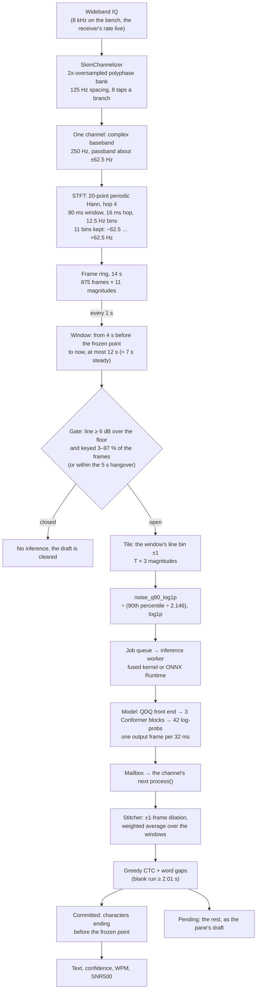
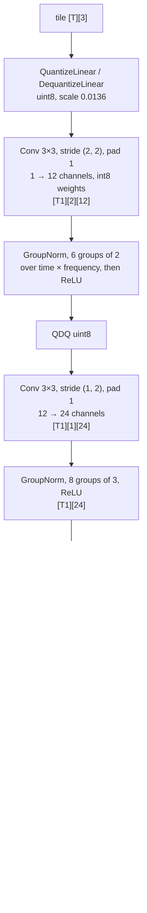
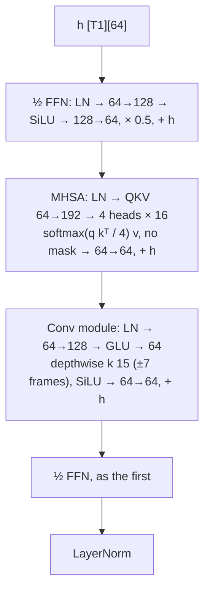
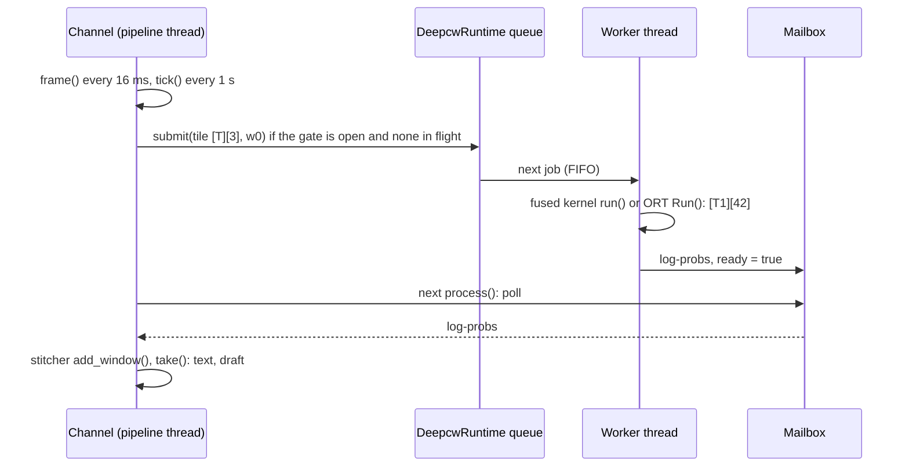

# DeepCW in cw_engine — the two backends and their upstreams

The engine carries two neural CW backends on e04's DeepCW models, both
optional (`OPT_BUILD_CW_DEEPCW`), so they can be compared on the same input:

| Backend | Files | Model | Streaming |
|---|---|---|---|
| `deepcw` (v1) | `engine/decode_deepcw.{h,cpp}` | deepcw-engine `8e264d2` `model.onnx` (v1) | OK1HRA/OK1BR's sliding-window commit rule |
| `deepcw2` / `deepcw2n` (v2) | `engine/decode_deepcw2.{h,cpp}` | deepcw-engine `c18fce5` `model.onnx` / `model_narrow.onnx` (v2) | e04's posterior stitcher |

Both run on `engine/deepcw_runtime.{h,cpp}` (the session, the sha256 pin, the
inference workers) over `engine/ort_shim.{h,cpp}` (ONNX Runtime loaded at run
time). This file records what upstream publishes, how the two backends
differ from it and from each other, how the v2 narrow decoder works from the
channel to the text ("The v2 narrow decoder, end to end"), and what is not
measured yet.

## Upstreams

| Repository | What | Licence |
|---|---|---|
| [e04/deepcw-engine](https://github.com/e04/deepcw-engine) | the models, their metadata (`model*.onnx.json`), Python and Node.js reference decoders | MIT since `79104fb` (2026-10-27); AGPL-3.0-only before |
| [e04/web-deep-cw-decoder](https://github.com/e04/web-deep-cw-decoder) | the web app (deepcw.cc): front end, streaming, pileup decoding; ships the v2 models | MIT since `f3bea57` (2026-10-27); no licence file before |
| [OK1BR/skimmer-for-linux](https://github.com/OK1BR/skimmer-for-linux) | the original DeepCW backend (`src/engine/decode_deepcw.c`, `ort_shim.c`) and its measured record (`docs/DEEPCW.md`) | GPL-3.0-or-later |
| [ok1hra/skimmer-for-linux](https://github.com/ok1hra/skimmer-for-linux) | the headless fork the engine is ported from (`03beb5b`, v0.8.0) | GPL-3.0-or-later |

Timeline:

| Date | Repo | Event |
|---|---|---|
| 2026-04-09 | web | v0.5.4 — the web code OK1BR evaluated; every later commit until 10-27 changes only the README |
| 2026-06-16 | engine | `8e264d2`: the v1 model, sha256 `ef120799…fe02` |
| 2026-09-12…19 | OK1BR | the DeepCW backend written and tuned against v1 (`1d0d88d` … `544f756`) |
| 2026-09-20 | OK1HRA | forks from OK1BR (merge base `12154fc`) |
| 2026-10-22 | OK1HRA | `82793c2` model fetcher pinned to `8e264d2`; `3d45d4c` Debian's `libonnxruntime.so.1.21` |
| 2026-10-24 | engine | `c18fce5` "v2": new `model.onnx` (sha256 `cd5ee381…73ae`), new `model_narrow.onnx` (`fc80c4ba…46e5`), new reference decoders with a streaming stitcher |
| 2026-10-27 | web | `a50a775` / `fe91767`: moves to the v2 models and ships them in the repo |
| 2026-10-27 | both | relicensed to MIT |
| 2026-11-07 | OK1BR | `4db0483` (gh#27): DeepCW's SNR in 500 Hz — not in OK1HRA's fork; ported here |

OK1HRA's DeepCW core is OK1BR's `544f756` (2026-09-19) unchanged. Neither
fork reads the v2 contract.

## The model contracts

From the metadata and from the ONNX graphs (parsed directly: node attributes
and initialisers).

| | v1 (`8e264d2`) | v2 (`c18fce5`) | v2 narrow |
|---|---|---|---|
| Input | `[batch, 1, time, 65]`, 400–1200 Hz | the same | `[batch, 1, time, 3]`, 787.5–812.5 Hz |
| STFT (at 3200 Hz) | FFT 256, periodic Hann 256, hop 48 (15 ms), centred (reflect pad) | the same (`win_length` 256 stated) | the same |
| Normalization | `log1p(\|X\|)` of the raw magnitude | `noise_q90_log1p`: \|X\| / noise, then log1p; noise = 90th percentile of the window's magnitudes / sqrt(−2 ln 0.1) = /2.146, floored at peak·1e-3 and 1e-5 | the same |
| Input quantization | none | uint8 QDQ, scale 0.0211, zero point 0: values above 5.38 clip (≈ 47 dB over the per-bin noise) | scale 0.0136: clips at 3.48 (≈ 30 dB) |
| Front end | 3 × Conv2d 3×3, stride (1, 2), GroupNorm, SiLU | first conv stride (2, 2), then (1, 2) ×2; ReLU | 2 convs: (2, 2), (1, 2) |
| Encoder | 6 Conformer blocks, d 192, depthwise k 17 | the same | 3 blocks, d 64, k 15 |
| Parameters | 3 614 481 | 3 614 874 | 199 331 |
| Output | `[batch, T, 42]` log-probs, one frame per 15 ms | `[batch, ceil(T/2), 42]`, one frame per 30 ms (`output_time_stride` 2) | the same |
| Classes | `, . / 0-9 ? A-Z` space (40), blank (41) | the same | the same |
| Reference window | 5–20 s (README) | windows of ≤ 12 s, the first at 2 s | the same |

The front end's GroupNorm is ONNX `InstanceNormalization` over the whole
group, time included, and the self-attention has no mask: every frame of a
window affects how every other frame is read, padding included.

**A v2 file read as v1** gives no error at the ONNX level: the output is
`[1, ceil(T/2), 42]`, and a reader that accepts up to T frames maps output
frame j to input frame j — every spike in the first half of the window, the
tail guard measured from the wrong end, the cursor dedup broken between
ticks. `deepcw_runtime` refuses it twice over: the file's sha256 must be the
backend's pinned one (`kDeepcwModelV1` / `kDeepcwModelV2` /
`kDeepcwModelV2Narrow`), and every run's output must be
`[batch, ceil(T / stride), 42]`.

## The v2 narrow decoder, end to end

What `deepcw2n` does with one channel, from the channelizer's output to the
committed text, with the numbers the code uses. File references are to
`src/engine/`. The rates are the CW bank's: 125 Hz channel spacing, 250 Hz
complex output per channel.

### The whole chain



### Stage by stage

| # | Stage | Input → output | Rate, size | Where |
|---|---|---|---|---|
| 1 | Polyphase channelizer | wideband IQ → M channels | M = in_rate / 125 (64 at 8 kHz), hop M/2, 250 Hz out | `channelizer.cpp` |
| 2 | STFT | 250 Hz IQ → 11 magnitudes | N = 20 (80 ms), hop 4 (16 ms): 62.5 frames/s, 80 % overlap | `decode_deepcw2.cpp` `frame()` |
| 3 | Frame ring | — | 14 s = 875 frames × 11 floats | `m_ring` |
| 4 | Scheduler | ring → window [w0, E) | every 63 frames (1.008 s), the phase staggered per channel | `tick()`, `window()` |
| 5 | Gate, line bin, SNR | window → open / closed, bin p | over the window's 11-bin profile | `window_stats()` |
| 6 | Tile | window → [T][3] | T ≤ 750 (12 s), ≈ 438 (7 s) steady | `tile()` |
| 7 | Normalisation | [T][3] → [T][3] | one noise level per window | `deepcw2_normalize()` |
| 8 | Inference | [T][3] → [ceil(T/2)][42] | 31.25 output frames/s | `deepcw_narrow_fused.cpp` / ORT |
| 9 | Stitcher | windows → averaged log-probs | rows from the committed point to the covered end | `DeepcwStitcher` |
| 10 | CTC read-out | log-probs → spans → text | greedy best path | `decode_greedy()`, `take()` |

### 1. The channelizer

`SkimChannelizer` is a 2×-oversampled polyphase filter bank (Crochiere and
Rabiner; harris, *Multirate Signal Processing*, ch. 6–7):

- M = in_rate / 125 Hz branches, an M-point FFT (FFTW) every M/2 input
  samples, so each channel comes out at 2 × 125 = 250 Hz complex.
- The prototype is WDSP's `fir_bandpass`, a 4-term Blackman-Harris window,
  8 taps per branch (8 M taps; 512 at 8 kHz), cut off at ±62.5 Hz.
- Neighbouring channels overlap: a station halfway between two channel
  centres is at +62.5 Hz in one and −62.5 Hz in the other, inside both
  outputs' ±125 Hz Nyquist band.

DeepCW reads one channel's 250 Hz stream. The channel's centre is 0 Hz; a
station anywhere in ±62.5 Hz falls into one of the 11 bins below.

### 2. The short-time Fourier transform

Per channel, every 4 samples (16 ms), a 20-point DFT of the last 20 samples
(80 ms) under a periodic Hann window, evaluated only at the 11 bins
k = −5 … +5 (`frame()`; Oppenheim and Schafer, *Discrete-Time Signal
Processing*, §10.3):

| Quantity | Value | Reference model (3200 Hz audio) |
|---|---|---|
| Window | 20 samples = 80 ms, periodic Hann | 256 samples = 80 ms |
| Hop | 4 samples = 16 ms (62.5 frames/s) | 48 samples = 15 ms |
| Overlap | 16 of 20 samples, 80 % | 208 of 256, 81 % |
| Bin spacing | 250 / 20 = 12.5 Hz | 3200 / 256 = 12.5 Hz |
| Bins | 11, −62.5 … +62.5 Hz | 65, 400 … 1200 Hz (wide); 3 (narrow) |
| Noise bandwidth of a bin | 1.5 × 12.5 = 18.75 Hz (Hann ENBW, harris 1978) | the same |
| Frame alignment | causal, end-aligned | centred, reflect-padded |

The hop is 16 ms against the model's 15 ms: every duration reads 6.7 %
longer than in training. At 25 WPM a dit (48 ms) spans 3 frames; at 12 WPM
(100 ms), 6.25.

The same pass keeps the channel's level (the peak bin's magnitude, held and
decaying with a 2 s time constant), its tone offset (a parabolic fit of the log magnitudes around the
peak bin, smoothed 0.05 a frame) and the band-noise statistic for SNR500.

### 3–5. The window, the gate and the line bin

Every 63 frames (1.008 s; each channel's phase offset by 7 frames per
registration, so a full band does not infer all at once) `tick()` asks the
stitcher where the next window starts:

- **start** = max(stream start, frozen point − 4 s, end − 12 s), on an
  output-frame boundary (an even input frame);
- **end** = the current frame, rounded down to an even frame;
- the first window waits until 2 s of frames exist.

In steady state the frozen point is 2 s behind the previous window's end, so
the window starts 2 + 4 = 6 s before the previous end, i.e. 7 s before now:
about 438 input frames, 219 output frames.

`window_stats()` then reads the window's 11-bin profile (the magnitudes
summed over time):

- p = the strongest bin; the floor = the mean of the bins at least 3 bins
  from p;
- **line ratio** = 20 log10(line / floor); **duty** = the share of frames
  where bin p is over the midpoint between its maximum and the floor;
- the gate opens when ratio ≥ 6 dB and 3 % ≤ duty ≤ 97 %. After it closes,
  windows keep coming for 5 s (the 2 s freeze guard + the 1 s right ramp +
  two steps) so the over's last characters commit;
- the line bin is p clamped to 1 … 9, so the tile always has two neighbours.

The tile follows the strongest bin of each window. A station drifting across
a bin edge changes the tile's centre between windows; the stitcher's
averaging then mixes readings of two centrings.

### 6–7. The tile and its normalisation

The narrow tile is the window's three bins p − 1, p, p + 1: a [T][3] array of
magnitudes, 37.5 Hz of spectrum around the line. The model was trained on
787.5–812.5 Hz of 3200 Hz audio, the same three 12.5 Hz bins.

`deepcw2_normalize()` applies the model's `noise_q90_log1p` rule to the
3T values of the window:

1. q = the 90th percentile of the magnitudes;
2. noise = max(q / sqrt(−2 ln 0.1), peak · 10⁻³, 10⁻⁵), where
   sqrt(−2 ln 0.1) = 2.146 is the Rayleigh distribution's 90th percentile
   in units of its σ (Papoulis and Pillai, §4.3): if the cells are noise,
   noise is their Rayleigh σ;
3. x ← log1p(x / noise).

What the numbers mean for the model's input:

| Cell | x / noise | log1p | uint8 step (scale 0.0136) |
|---|---|---|---|
| noise, median | 1.18 | 0.78 | 57 |
| noise, 90th percentile | 2.15 | 1.15 | 84 |
| a line 10 dB over the noise σ | 3.16 | 1.43 | 105 |
| a line 20 dB over | 10 | 2.40 | 176 |
| a line 30 dB over | 31.6 | 3.48 | 255: the clip |

Anything more than about 30 dB over the per-bin noise reads as the same
value. In a 3-bin tile a keyed line lifts all three bins: a tone on a bin
centre leaks into both neighbours at half its amplitude (−6 dB) through the
Hann window. With any usual duty cycle more than 10 % of the cells are then
key-down, the 90th percentile falls on the signal, and the noise estimate
rises with the signal: the input is closer to "relative to the line" than
"relative to the noise". The model was trained so; the wide model's tile
takes a median instead (`noise_mode`).

### 8. The model

199,331 parameters. Shapes for a window of T input frames; T1 = ceil(T / 2)
output frames (219 for a 7 s window).



Each block is a macaron Conformer (Gulati et al. 2020; the half-step FFNs
from Lu et al. 2019), d = 64:



| Part | Shape | Parameters | MAC per 7 s window (T1 = 219) |
|---|---|---|---|
| Conv 0 (int8, dequantised) | 3×3, 1 → 12, stride (2, 2) | 108 | 0.05 M |
| Conv 1 | 3×3, 12 → 24, stride (1, 2) | 2,592 | 0.38 M |
| Projection 24 → 64 | | 1,600 | 0.34 M |
| ½ FFN × 2, per block | 64 → 128 → 64 | 33,152 | 7.2 M |
| Self-attention, per block: projections | 64 → 192, 64 → 64 | 16,640 | 3.6 M |
| Self-attention, per block: scores and sum | 2 · T1² · 64 | — | 6.1 M |
| Conv module, per block | 64 → 128, GLU, dw 15, 64 → 64 | 13,504 | 2.9 M |
| Head 64 → 42 | | 2,730 | 0.59 M |
| Total (3 blocks, LayerNorms incl.) | | 199,331 | ≈ 61 M |

The MAC counts are derived from the shapes (multiply-accumulates; the
norms, activations and softmax are not counted). The attention is quadratic
in the window: at the 12 s maximum (T1 = 375) it is 18 M per block, about
as much as the rest of the block (23 M).

**What each output frame sees.** The front end looks ±1 input frame (±16 ms)
per conv. Each conv module looks ±7 output frames (±224 ms), and attention
reaches the whole window without a mask, so every output frame depends on
the whole tile, its noise level and its padding. The first GroupNorm is
computed over the whole window too (ONNX `InstanceNormalization`, time
included). The same keyed frame therefore reads slightly differently in
each window that holds it; that is what the stitcher averages.

**The classes.** 42 per output frame: the 40 characters
`, . / 0–9 ? A–Z` (indices 0–39), the word space (40) and the CTC blank
(41) (Graves et al. 2006). An output frame is 32 ms here (2 × 16 ms; 30 ms
in training), so at 25 WPM a dit is 1.5 output frames, at 35 WPM 1.07.

### 9. The stitcher

`DeepcwStitcher` is e04's `PosteriorStitcher` (`decode_morse.py`, MIT),
on output frames (31.25 a second):

| Constant | Seconds | Output frames | Upstream name |
|---|---|---|---|
| Window, at most | 12 | 375 | `MAX_SEGMENT_SECONDS` |
| First window after | 2 | (125 input frames) | `MIN_PENDING_SECONDS` |
| Step | 1 | 31.25 | `STEP_SECONDS` |
| Left context | 4 | 125 | `STITCH_LEFT_CONTEXT_SECONDS` |
| Freeze guard | 2 | 63 | `STITCH_FREEZE_GUARD_SECONDS` |
| Left ramp | 2 | 62.5 | `STITCH_LEFT_RAMP_SECONDS` |
| Right ramp | 1 | 31.25 | `STITCH_RIGHT_RAMP_SECONDS` |
| Dilation | ±32 ms | ±1 | `STITCH_DILATION_FRAMES` |
| Word gap | 2.01 | 63 | `WORD_BOUNDARY_BLANK_HOPS` (134 hops of 15 ms) |
| Weight floor | — | 10⁻³ | `MIN_VIEW_WEIGHT` |
| An uncovered frame | — | blank 0, others −30 | `UNCOVERED_LOG_PROB` |

Three positions move forward along the output frames:

```
                     committed_end      frozen_end              covered_end
                          │                  │                        │
 ─── text already out ────┼── settled: no ───┼── still averaged: new ──┤
                          │   new window     │   windows add to it     │
                          │   adds to it     │                         │
                          ◄────────── rows kept (sums, weights) ──────►
```

Each window adds its frames from the frozen point on, each weighted

  w(f) = max(10⁻³, smoothstep(left / 2 s) · smoothstep(right / 1 s)),
  smoothstep(t) = 3t² − 2t³ for t in [0, 1],

where left and right are the frame's distance in seconds from the window's
start and end (no left ramp on the stream's first window, no right ramp on a
final one). In steady state the frames a window adds are at least 4 s from
its start, so only the right ramp matters:

| A frame's age at the window's end | 0 s | 0.25 s | 0.5 s | 0.75 s | ≥ 1 s |
|---|---|---|---|---|---|
| weight | 0.001 | 0.16 | 0.50 | 0.84 | 1 |

Before averaging, each window's log-probs are log-softmaxed, then every class
except the blank takes its maximum over ±1 frame and the row is
renormalised (`dilated_log_probs()`): a character two windows place one frame
apart still adds up.

**Three readings per frame.** A window ending at E starts at E − 7 s and adds
frames from E − 3 s (the frozen point it inherits, 2 s behind the previous
end at E − 1 s); the 4 s before that are context only. So
every frame is read by three windows, at ages 0–1 s, 1–2 s and 2–3 s, the
youngest down-weighted by the ramp:

```
 time (s)      E-8   E-7   E-6   E-5   E-4   E-3   E-2   E-1   E     E+1
               |     |     |     |     |     |     |     |     |     |
 ends at E-1   [ctx ··················][added ···········]
 ends at E           [ctx ··················][added ···········]
 ends at E+1               [ctx ··················][added ···········]
                                                   ▲     ▲
                          a frame between E-2 and E-1 is added by all three:
                          at age 2–3 s, 1–2 s and 0–1 s (the last one ramped)
```

After each window: `frozen_end` = its end − 2 s, and `take()` reads the
average from `committed_end` to `covered_end`:

1. **greedy CTC**: per frame the best class; repeats merged, blanks dropped
   (Graves et al. 2006; Hannun 2017);
2. **word gaps**: a run of ≥ 63 blank frames (2.01 s) between two
   characters becomes a space, counting the blanks carried over from the
   previous take;
3. **commit** every character whose last frame is before the frozen point,
   and the spaces between them;
4. **release** the frames up to the next character's start (their blanks and
   spaces now settled), drop their rows;
5. the rest is **pending**: the pane's gray draft.

Confidence is the mean averaged posterior of the committed characters; the
WPM is 12 × letters / seconds over a committed span of ≥ 6 letters and
≥ 2 s (the PARIS convention).

At a TX hold (`hold_begin()`) a final window runs: no right ramp,
everything committed.

### 10. Inference, threads and buffers



A channel has at most one window in flight; a tick that finds one pending is
skipped. The workers run batch 1 (batching costs on the CPU, "Runtime
defaults"), one thread each, hardware threads − 2 of them; the fused kernel
keeps its scratch per thread.

Buffers (floats are 4 bytes; derived from the code's sizes):

| Buffer | Size | Bytes |
|---|---|---|
| Sample ring | 20 complex samples | 160 |
| Twiddles and window | 11 × 20 × 2 + 20 | 1.8 K |
| Frame ring | 875 frames × 11 | 38.5 K |
| Tile buffer | 875 × 65 (sized for the wide model) | 228 K |
| A queued job | T × 3, ≈ 438 × 3 | 5.3 K (7 s) |
| Stitcher rows | ≤ ≈ 7 s × 31.25 × 43 | ≈ 38 K |
| Fused kernel scratch, per worker | T1 × 384 + T1p × 38 floats | ≈ 370 K (T1 = 219) |
| Fused weights, shared | 199,300 values | ≈ 0.8 M |
| The queue | ≥ 256 windows, more while they fit 64 MB | |

### Time and latency

| Event | When |
|---|---|
| First window | 2 s after the channel starts (and the gate is open) |
| A character is committed | 2–3 s after its last element ends (the freeze guard plus up to one step), plus the queue and the run |
| A word gap is read | after 2.01 s of blank between two characters |
| The over's tail | the hangover keeps windows coming 5 s after the gate closes |
| One window's inference | 1.43 ms (fused, AVX2) / 2.0 ms (ONNX Runtime), i5-13400, one thread; GEMMs 0.58 ms, attention 0.48 ms, front end 35 µs |
| Per busy channel | one window a second: 0.5 % of a core fused, 0.73–0.99 % on ONNX Runtime (cw_bench `--time`, this repository's bench machine, which runs a window in about 5 ms) |
| Per idle channel | 0.01 %: the STFT and the gate only |

### Further reading

- A. Graves, S. Fernández, F. Gomez, J. Schmidhuber, "Connectionist
  Temporal Classification: Labelling Unsegmented Sequence Data with
  Recurrent Neural Networks", ICML 2006. The CTC loss and best-path
  decoding.
- A. Hannun, "Sequence Modeling with CTC", Distill, 2017. An illustrated
  introduction to CTC.
- A. Gulati et al., "Conformer: Convolution-augmented Transformer for Speech
  Recognition", Interspeech 2020. The block used here.
- Y. Lu et al., "Understanding and Improving Transformer From a
  Multi-Particle Dynamic System Point of View" (Macaron Net), 2019. The
  half-step FFNs.
- A. Vaswani et al., "Attention Is All You Need", NeurIPS 2017. Multi-head
  attention and the sinusoidal position code.
- Y. Wu, K. He, "Group Normalization", ECCV 2018; J. L. Ba, J. R. Kiros,
  G. E. Hinton, "Layer Normalization", 2016.
- Y. N. Dauphin et al., "Language Modeling with Gated Convolutional
  Networks", ICML 2017 (GLU); S. Elfwing, E. Uchibe, K. Doya,
  "Sigmoid-Weighted Linear Units", Neural Networks 2018 (SiLU).
- B. Jacob et al., "Quantization and Training of Neural Networks for
  Efficient Integer-Arithmetic-Only Inference", CVPR 2018. The uint8 / int8
  QDQ scheme.
- I. Goodfellow, Y. Bengio, A. Courville, *Deep Learning*, MIT Press, 2016.
  Textbook background for all of the above.
- A. V. Oppenheim, R. W. Schafer, *Discrete-Time Signal Processing*, 3rd ed.,
  Pearson, 2010. The short-time Fourier transform.
- F. J. Harris, "On the Use of Windows for Harmonic Analysis with the
  Discrete Fourier Transform", Proc. IEEE 66(1), 1978. The Hann window's
  noise bandwidth; the Blackman-Harris window of the channelizer.
- R. E. Crochiere, L. R. Rabiner, *Multirate Digital Signal Processing*,
  Prentice-Hall, 1983; f. j. harris, *Multirate Signal Processing for
  Communication Systems*, Prentice Hall, 2004. Polyphase filter banks and
  oversampled channelizers.
- A. Papoulis, S. U. Pillai, *Probability, Random Variables and Stochastic
  Processes*, 4th ed., McGraw-Hill, 2002. The Rayleigh magnitude of noise
  behind the 2.146 and 1.1774 factors.
- K. Chellapilla, S. Puri, P. Simard, "High Performance Convolutional Neural
  Networks for Document Processing", 2006. The im2col form of a conv the
  fused kernel uses.

## The front end against the reference

Both backends use the v1 backend's front end (OK1BR): per channel a 20-point
periodic Hann DFT every 4 samples of the 250 Hz channel, the bins −5..+5
kept per frame in a ring.

| | Reference (3200 Hz audio) | Here |
|---|---|---|
| Window | 80 ms Hann, 12.5 Hz bins | the same |
| Hop | 15 ms | 16 ms: a 6.7 % time stretch (OK1BR: 15–35 WPM read offline, v1) |
| Frame alignment | centred, reflect-padded at the clip edges | causal, end-aligned (time labels only) |
| Bins | 65 bins of audio, noise in all | the channel's 11 bins at 27..37 (centre 32 = 800 Hz), the rest zero; the outer bins sit on the channelizer's skirt. OK1BR (v1): ±3 bins read as the full audio, ±1 degrades |
| Scale, v1 | log1p of the raw magnitude | each window peak-normalised to 30 before log1p (OK1BR's fix: real IQ fell below the range the first InstanceNorm's epsilon allows; IZ4ECE decoded nothing) |
| Scale, v2 wide | `noise_q90_log1p` over the whole tile (65 bins of audio: a CW line is ~5 % of the cells, the 90th percentile is noise) | log1p over a noise level from the populated bins' **median** ÷ 1.1774 (`noise_mode` "median"). Upstream's 90th percentile over the populated bins (`"q90"`, what the web app does for its frequency-shifted tiles, `audioToShiftedSpectrogramTensor`) lands on the signal when a keyed line is a quarter of the cells; under fast fading the fades then read as below the noise. `"fill"` fills the 54 empty bins with Rayleigh noise and applies upstream's rule to the whole tile |
| Scale, v2 narrow | `noise_q90_log1p` over its 3 bins | the same (the model was trained so) |
| Narrow tile | 3 bins around the track's `round(f / 12.5 Hz)` | the window's line bin and its two neighbours |

## Streaming: three designs

| | web app `useStreamingDecode` (unchanged since v0.5.4) | engine v2 reference `PosteriorStitcher` = `deepcw2` | OK1BR/OK1HRA = `deepcw` |
|---|---|---|---|
| Window | the audio since the last commit, ≤ 30 s | ≤ 12 s, from 4 s before the frozen point (≈ 7 s in steady state) | the whole 10 s ring |
| Cadence | ≥ 1 s | 1 s | 1 s CPU / 0.5 s CUDA |
| Left context after a commit | none (committed audio is dropped) | 4 s | the ring |
| What is read | the latest inference | per frame, the average of every covering window's log-probs, weighted by smoothstep ramps (2 s from a window's start, 1 s to its end) after a ±1-frame max dilation of every non-blank class | the latest inference |
| Commit | up to the last word gap whose midpoint lies in [2 s, end − 1.25 s]; forced at 30 s | every character ending before the 2 s freeze guard | every spike ≥ 1 s before the window end |
| Dedup | — | the committed frames leave the average | frame cursor + 4-frame margin; spaces by order, slack and the last committed gap |
| Word gaps | the model's | the model's + a blank run ≥ 2.01 s (134 hops) between two characters, carried across commits | the model's + the weak-gap tear rule (posterior < 0.8, left piece ≥ 3, right ≤ 2, not a known short word) |
| Draft | the whole uncommitted reading | the pending spans | the reliable prefix (≥ 0.384 s from the end, posterior ≥ 0.9) |
| End | — | `finalize`: a final window, no right ramp, everything committed | TX-hold flush: live-end trim, 0.5 s dead air, whole-word test |
| Confidence | — | — (`deepcw2`: the mean averaged posterior of the committed characters) | the mean spike posterior |

OK1BR's first commit rule was the web app's (commit up to a word gap, drop
the committed audio); measured, it lost stations (34 → 27 on the 80 m
fixture) and was replaced by the sliding window. Upstream's v2 reference
keeps left context too, by averaging instead of a cursor.

OK1BR's open word-gap problem — the model emits no space after a long pause
(a fifth of consecutive committed characters > 1.9 s apart with none) — is
what upstream's 2.01 s blank-run rule addresses. It does not touch the
"DE" + call glue after 0.64–1.0 s pauses; the web README's own DeepCW rows
show the same glue (`55N55N`, `73AE0QDE`), a property of the model.

## The web app, then and now

| | v0.5.4 (what OK1BR evaluated) | 2026-10-27 |
|---|---|---|
| Front end | 9600 Hz, FFT 768, hop 192 (20 ms), not centred, per-window CMVN | hop 144 (15 ms), centred, `noise_q90_log1p`, output stride 2 |
| Models | en, en_narrow (5 bins), ja, cw_detect — fetched by UUID, unpublished | en and en_narrow (3 bins) in the repo, byte-identical to deepcw-engine v2; ja still unpublished; cw_detect removed |
| Pileup | the cw_detect model | a classical per-bin SNR (90th-percentile key-on power over the band's median power; lock 12 dB, release 9 dB, noise ≈ 5 dB, sidebands within 150 Hz and 18 dB under a stronger bin masked); ≤ 5 tracks, each re-read on an 8 s window by the narrow model, text held 1.5 s |
| Licence | none | MIT |

The README now also points to e04/DeepRTTY, an RTTY decoder of the same kind.

## Licences here

- v1 model: published only under AGPL-3.0-only (the MIT relicensing came
  after it was replaced). Not bundled.
- v2 models and both reference implementations: MIT, Copyright (c) 2026 e04.
  `decode_deepcw2.cpp` carries the notice for the ported stitcher and
  normalisation. Shipping the models needs the same notice beside them.
- ONNX Runtime C API header (`vendor/onnxruntime`): MIT, Microsoft.
- The narrow model's fused-kernel weights (`tools/deepcw_narrow_extract.py`'s
  output): e04's weights in another layout, MIT, Copyright (c) 2026 e04; the
  file carries the notice as its `notice` tensor. Not bundled.

## SDRIAK's changes against OK1HRA's backend

| Where | Change | Why |
|---|---|---|
| `deepcw_runtime.cpp` | the model's sha256 is checked before every load; a known DeepCW file of another contract is named in the error | OK1HRA checks only when its fetcher installs the file; any file at the path was read |
| `deepcw_runtime.cpp` | every run's output shape must be the contract's `[batch, ceil(T/stride), 42]` | upstream takes `min(T, od[1])` frames |
| `deepcw_runtime.cpp` | a worker batches only windows of one length | upstream zero-pads a batch to its longest window, which the front end's GroupNorm and the unmasked attention see — a channel younger than the ring, or a flush window, was read differently batched than alone, and replays (batch 1) never reproduced it |
| `deepcw_runtime.cpp` | a failed run delivers an empty result | upstream delivers nothing and those channels wait for good |
| `deepcw_runtime.cpp` | one ONNX Runtime environment per process, shared by the backends | ORT allows one |
| `decode_deepcw.cpp`, `decode.h` | OK1BR `4db0483` (gh#27) ported: `snr_db` is SNR in 500 Hz (key-down power of the frames within 3 dB of the window peak, line ±1 bin, over the band's noise density × 18.75 Hz), `noise()` / `set_band_noise()` / `set_noise_bw()` hooks, `snr_in_500hz()`; the process-wide band floor EMA is gone | OK1HRA's "peak over the inner-bin floor − 10 dB" read ~8 dB high (OK1BR, against stations of known SNR); marked `OK1BR 4db0483` in the code |

The TX-hold flush keeps its 0.5 s of zero frames as OK1BR measured it (93 %
of flushed characters agree with the full-context reading, all with
posterior ≥ 0.9). Zero frames are quieter than any band; the reference
pads by reflection and its `finalize` does not pad.

## Synthetic bench (cw_bench)

`experiments/cw_bench` keys synthetic CW into 8 kHz IQ, through a Watterson
channel, the real channelizer and one decoder channel; configurations
`dcw1`, `dcw2`, `dcw2n`, `dcw2v1` (the v1 model through `deepcw2`'s
stitcher, `DeepcwV2Config::model_v1`) and `:q90` / `:fill` / `:nogate`
variants; `--tail 4` so the late-committing backends see each over's end.
24 WPM, 10 overs (≈ 500 characters) a point unless stated; differences of a
few points are noise.

SNR500 (dB) where payload CER falls to 10 %, AWGN, 8 overs a point:

| | 12 WPM | 18 WPM | 25 WPM | 35 WPM |
|---|---|---|---|---|
| v2 (Bayesian) | +3.3 | +3.1 | +3.0 | +3.2 |
| v3 (Bayesian) | −1.1 | −1.0 | −0.9 | +0.3 |
| DeepCW v1 | −5.6 | −4.2 | −3.4 | −2.1 |
| DeepCW v2 wide (q90) | −5.6 | −4.5 | −3.2 | −2.0 |
| DeepCW v2 narrow | −6.0 | −4.3 | −3.6 | −2.4 |

The three models are equal in noise. e04's claim (< 8 % CER at −10 dB in
2500 Hz = −3 dB SNR500) holds: 5–7 % at −3 dB.

Payload CER under fading (ITU-R F.1487 two-path conditions; flat = one
fading path; beat = two static paths ±0.5 Hz, 1 ms apart):

| Condition | SNR500 | v2 | v3 | DCW v1 | DCW v1 via stitcher | DCW v2 wide, q90 | DCW v2 wide, median | DCW v2 narrow |
|---|---|---|---|---|---|---|---|---|
| ITU good | +10 dB | 0.13 | 0.12 | 0.02 | 0.03 | 0.03 | 0.03 | 0.03 |
| ITU poor | 0 dB | 0.72 | 0.62 | 0.33 | 0.37 | 0.45 | 0.45 | 0.42 |
| | +10 dB | 0.34 | 0.46 | 0.06 | 0.06 | 0.21 | 0.17 | 0.13 |
| | +20 dB | 0.15 | 0.18 | 0.01 | 0.02 | 0.16 | 0.06 | 0.04 |
| ITU low latitude (10 Hz) | +10 dB | 0.61 | 0.66 | 0.17 | 0.16 | 0.29 | 0.18 | 0.32 |
| | +20 dB | 0.25 | 0.25 | 0.09 | 0.07 | 0.23 | 0.11 | 0.26 |
| flat 3 Hz | +10 dB | 0.51 | 0.59 | 0.08 | 0.09 | 0.34 | 0.26 | 0.24 |
| | +20 dB | 0.20 | 0.20 | 0.03 | 0.03 | 0.29 | 0.13 | 0.13 |
| beat | +10 dB | 0.62 | 0.64 | 0.13 | 0.13 | 0.55 | 0.49 | 0.41 |
| | +20 dB | 0.43 | 0.43 | 0.09 | 0.09 | 0.54 | 0.32 | 0.24 |

- The Bayesian decoders do not bridge deep fades; v3 is no better than v2
  once the fading is faster than ~0.5 Hz.
- The v1 model reads the same through e04's stitcher as through OK1BR's
  commit rule: the stitcher is not what costs v2 under fading.
- The median noise level halves v2 wide's error at +20 dB under fast fading
  and costs nothing from −9 to 0 dB (identical there); it is the default.
  `fill` is equal to it within the noise.
- What remains — v2 wide and narrow 2–4× worse than v1 under fast fading at
  0–10 dB — is the v2 model generation on this input (both v2 models; the
  narrow one is normalised as it was trained). v2 halves the time
  resolution (30 ms output frames: a 24 WPM dit is 1.6 frames) and was
  retrained; which of the two matters is not separated.

Cost on one core of an i3-N300, per 47 s over: v3 < 0.1 s, v2 narrow ≈ 0.5 s,
v2 wide ≈ 4 s, v1 ≈ 8.5 s. On the bench machine (one thread, per 27 s over
at 25 WPM, the bench and the channelizer subtracted): v3 0.05 s, v2 narrow
0.39 s, v2 wide 3.0 s, v1 9.4 s; the Bell R-series decoder 0.73 s with
100 paths, 0.12 s with 25 (BELL.md, "The R-series configuration").

## Runtime defaults

`DeepcwRuntimeConfig` (and `DeepcwConfig`, `DeepcwV2Config`): 1 intra-op
thread, batch auto (1, or 32 on CUDA), workers auto, set when the workers start:
- the hardware threads − 2, leaving room for the channelizer;
- at most 8 for the narrow model on ONNX Runtime's CPU;
- 2 on CUDA.

An explicit worker count is clamped to 1 .. the hardware threads (it was
1..8). The workers flush denormals (FTZ/DAZ). The queue holds at least 256
windows, and more while their tiles fit 64 MB: about 12,000 narrow windows,
570 wide (it was 256 jobs).

Measured with `experiments/deepcw_throughput` on an i5-13400 (6 P-cores with
HT and 4 E-cores, 16 threads), ONNX Runtime 1.32, 7 s windows, windows/s:

| | 1 worker | 8 workers | 14 workers | 16 workers |
|---|---|---|---|---|
| narrow, ONNX Runtime, batch 1 | 503 | 2570 | 1975 | 1909 |
| narrow, ONNX Runtime, batch 128 | 409 | 834 | — | 848 |
| narrow, fused kernel | 702 | 4240 | 5110 | 5333 |
| wide, ONNX Runtime, batch 1 | 44.5 | 202 | 235 | — |
| wide, ONNX Runtime, batch 32 | 39.0 | 117 | 121 | — |

- Batching costs on the CPU for both v2 models; one run of N windows is no
  cheaper per window than N runs.
- With 4 intra-op threads ONNX Runtime spins: 4 × 8 used 11 cores for the
  windows 1 × 8 reads on 8.
- The narrow model on ONNX Runtime loses beyond 8 workers; the fused kernel
  and the wide model gain to the last thread.
- FTZ/DAZ changed nothing on these tiles; it guards the workers.
- In runtime mode (300–1000 channels in flight) the fused kernel reads 5,020
  windows/s at 14 workers, against 4,240 with the old cap of 8.

## The narrow model's fused kernel

`engine/deepcw_narrow_fused.{h,cpp}` runs `model_narrow.onnx` as one
hand-written forward pass, without ONNX Runtime. `tools/deepcw_narrow_extract.py`
turns the pinned model into a weight blob. It finds each weight's role from
the graph, checks every constant the kernel hard-codes, writes the matrices
[in][out], and with `--check` runs a NumPy forward pass against ONNX Runtime.
The blob is pinned too (`DeepcwNarrowFused::kSha256`, `253ffb73…`) and records
the model's sha256. `SKIM_DEEPCW2_FUSED=<blob>` runs `deepcw2n` on it
(`DeepcwRuntimeConfig::fused_path`), one window per call on the runtime's
workers. `SKIM_DEEPCW2_FUSED_CHECK=1` also runs ONNX Runtime on every window and
prints the difference when the backend goes.

- **Front end**: bit-exact with ONNX Runtime on an FMA CPU, for every window
  of 3 or more input frames. The first GroupNorm feeds a uint8 quantiser (step
  0.0405), so a last-bit difference moves a feature a whole step: one such
  flip moved a log-prob by 0.15. So it reproduces ONNX Runtime's arithmetic:
  - each conv is an im2col product, taps in (channel, time, frequency) order,
    as one FMA chain from zero (MLAS's SGEMM);
  - each GroupNorm is ONNX Runtime's InstanceNormalization, i.e. Eigen's SSE
    reduction: 4-lane packets, two accumulators, (p0 + p2) + (p1 + p3), the
    unaligned head of the mean's sum from a 16-byte aligned buffer, none for
    the squared deviations; then x · cs + (b − mean · cs);
  - the file is built with `-ffp-contract=off`.

  Probed against ONNX Runtime's intermediate tensors (`relu_1`, 30 tiles of 1
  to 875 frames): all but 44 of 81,360 values match, and those 44 are all in
  windows of 1–2 frames, where Eigen sums 3 values another way.
- **Encoder** (`deepcw_narrow_kernel.inc`): written once against an 8-lane
  API. It is built four ways, and the best the CPU runs is taken:
  - for AVX2 + FMA (that file alone gets `-mavx2 -mfma`; the CPU is checked
    at run time);
  - for SSE2 (x86 without AVX2; baseline on x86-64: no flags, no check);
  - for NEON: AArch64 (baseline on arm64: no flags, no check) and 32-bit ARM
    built with NEON (the NDK's armeabi-v7a);
  - for plain arrays (32-bit ARM without NEON, other CPUs).

  `SKIM_DEEPCW2_FUSED_ISA` (`DeepcwRuntimeConfig::fused_isa`;
  `deepcw_throughput --fused-isa`) forces one: `avx2`, `sse`, `neon` or
  `generic`. Activations are [time][channel],
  the channels the SIMD lanes. GEMMs are 6 rows × 16 columns per block.
  Attention takes 6 queries × 16 keys per block, keys transposed and values
  copied per head, the max out of the score loop, 1 / sum on the outputs. exp
  is Cephes; 1 / x is rcpps plus one Newton step.
- **Exactness**: the encoder has no quantiser, so its float rounding stays
  smooth. Against a float64 forward pass from the same features, on keyed
  tiles: ONNX Runtime 2.3e-5, fused (AVX2) 2.6e-5, NumPy float32 2.4e-5. Fused
  against ONNX Runtime is 4–8e-5 (the two errors added). On the hardest
  cw_bench tiles (−6 dB) float32 itself is ill-conditioned: ONNX Runtime up to
  3.4e-4 from float64, fused up to 4.4e-4, NumPy 5.4e-4. "About 1e-5" against
  ONNX Runtime would need its encoder's arithmetic too.
- **Gate**: `cw_engine_deepcw2_test` (D), with `SKIM_DEEPCW2_FUSED`. It checks
  the backend's text on the kernel, and with `SKIM_DEEPCW2_NARROW_MODEL` 108
  keyed tiles against ONNX Runtime, every encoder the CPU runs: |Δ log-prob| ≤ 1e-4 and the
  same greedy text. Measured: AVX2 7.9e-5, generic 5.7e-5, 0 texts differ.
- **cw_bench**: the fading table (dcw2n, 24 WPM; AWGN, ITU poor, flat 3 Hz;
  −6 to +20 dB, 10 overs a point) is identical to ONNX Runtime cell for cell.
  `cw_bench`'s output is byte-identical for those and for AWGN at 12, 18 and
  30 WPM. Over 6,763 windows, 0 had another greedy path.
- **Cost** (i5-13400, one 7 s window = 438 frames, 61 MMAC, batch 1):

  | workers | ONNX Runtime 1.32, 1 thread | fused (AVX2) |
  |---|---|---|
  | 1 | 503 windows/s, 2.0 ms | 702 windows/s, 1.42 ms |
  | 4 | 1840 | 2715 |
  | 8 | 2570, 3.1 ms | 4240, 1.89 ms |
  | 12 | 2144, 5.6 ms | 4882, 2.45 ms |

  One window: GEMMs ≈ 0.58 ms at ≈ 70 GMAC/s (the core's FMA peak), attention
  ≈ 0.48 ms, the front end 35 µs. The rest of the speed-up is int8 GEMMs (PLAN
  step 5).

### On x86 without AVX2 (SSE2)

`deepcw_narrow_kernel_sse.cpp` covers x86 CPUs without AVX2:
- Intel before Haswell (Core 2 to Ivy Bridge);
- the Atom-class Celeron and Pentium J/N up to Jasper Lake (N4500, N5105,
  N6000: no AVX at all; common in cheap mini PCs);
- AMD before Excavator.

How it differs from the AVX2 file:
- Each 8-lane vector is two `__m128`. x86-64 has 16 vector registers, so the
  GEMM and attention blocks are 2 rows (`DCWN_ROWS`) and the depthwise conv
  takes 32 channels a pass. 3 and 4 rows measured the same (3.52, 3.66 ms).
- No FMA: a · b + c rounds twice, as MLAS's SSE SGEMM does on these CPUs, so
  the front end is designed to match ONNX Runtime there. That is not verified:
  this machine's ONNX Runtime uses FMA. Here the SSE front end differs in the
  last bit, and the uint8 quantiser turns that into log-prob jumps of up to
  0.085 on cw_bench windows. Still, 0 windows took another greedy path, and
  the cw_bench fading table (dcw2n, AWGN / ITU poor / flat 3 Hz, −6 to +20
  dB) is identical cell for cell.
- The gate (`deepcw2_test` D) passes on it: 108 keyed tiles, 5.1e-5, the same
  greedy text.

Cost on the i5-13400, SSE forced, ms per 7 s window: SSE 3.55, AVX2 1.43,
the plain-array path 8.75 (2.5× slower than SSE). ONNX Runtime on AVX2 takes
2.0 here. ONNX Runtime on SSE could not be measured here (MLAS picks its
kernels by CPUID). On a CPU without AVX2, run `deepcw_throughput --fused`,
which prints both.

### On arm64 phones (NEON)

`deepcw_narrow_kernel_neon.cpp` is the encoder for arm64-v8a phones. It
targets the Samsung Galaxy A24: MediaTek Helio G99, 2 × Cortex-A76 at 2.2 GHz
plus 6 × Cortex-A55 at 2.0 GHz, ARMv8.2-A.
- Each 8-lane vector is two `float32x4_t`. The 6 × 16 GEMM block keeps its 24
  accumulators in AArch64's 32 vector registers.
- 1 / x is vrecpe plus two Newton steps; exp is the Cephes polynomial of the
  AVX2 file.
- `run()` sets FPCR.FZ for the call, as it sets FTZ/DAZ on x86.

Checked without a phone: cross-built with `aarch64-linux-gnu-g++` and
`clang --target=aarch64-linux-gnu` (Debian bookworm), run under
`qemu-aarch64`:
- the front end is bit-exact with x86 ONNX Runtime (FMA rounds exactly once,
  and Eigen's NEON reduction has SSE's order): 0 of 81,216 values differ;
- log-probs are within 1.6e-5 of ONNX Runtime on keyed tiles and 4.2e-4 on
  the hardest cw_bench tiles (float32 conditioning, as on x86), with the same
  greedy text.

Speed on the phone is not measured. Estimate, from the FMA width:
- A76: 2 × 128-bit FMA pipes, ≈ 17.6 GMAC/s peak, ≈ 6 ms per 7 s window;
- A55: in-order, ≈ 15–20 ms per window;
- all 8 cores: some hundreds of windows a second before thermal limits.

Run `cw_engine_deepcw_throughput --fused` on the phone (adb shell) to measure.

### On 32-bit Android (armeabi-v7a)

The same file has a 32-bit branch for armeabi-v7a, which the NDK builds with
NEON. It covers old and low-end phones, Android Go devices and TV boxes, often
a 64-bit chip under a 32-bit OS. The branch differs from AArch64 in five ways:
- No FMA guaranteed on ARMv7 (VFPv4 is optional), so it uses vmlaq: a · b + c
  rounded twice.
- Rounding to nearest by adding and taking away 1.5 · 2^23 (32-bit NEON
  always rounds to nearest).
- Pairwise vpadd / vpmax for the across-vector sum and max.
- A scalar square root (once per LayerNorm row).
- 16 vector registers, so 2-row blocks, as on SSE. 32-bit NEON flushes
  denormals itself.

32-bit ARM built without NEON gets the plain-array encoder. armhf's default
is `-mfpu=vfpv3-d16`, so 32-bit Raspberry Pi OS does too; use the 64-bit OS
on a Pi 3/4/5/Zero 2.

Checked without a device: built with `arm-linux-gnueabihf-g++ -march=armv7-a
-mfpu=neon -mfloat-abi=hard` and `clang --target=armv7a-linux-gnueabihf`, the
stub built without NEON too, run under `qemu-arm`:
- log-probs are within 3.7e-5 of ONNX Runtime on keyed tiles and 2.5e-4 on
  the hardest cw_bench tiles, with the same greedy text;
- the front end is not bit-exact with x86 ONNX Runtime, which uses FMA: 27,715
  of 81,216 values differ in the last bit, as on the SSE path, and a window
  can then jump by a quantiser step.

Whether ONNX Runtime's 32-bit ARM kernels multiply-add with one rounding or
two is not known here.

Speed is not measured. Estimate:
- a Cortex-A53 or A7 in 32-bit mode issues a 128-bit vmla every 2 cycles, so
  roughly 30–40 ms per window per core: tens of channels on a phone;
- the plain-array path is probably scalar there (compilers do not vectorise
  floats onto 32-bit NEON without `-ffast-math`), a few times slower.

The Android build does not set `OPT_BUILD_CW_DEEPCW`, and no SDRIAK module
constructs a DeepCW backend yet (cw_bench and the gates do). The fused path
needs neither ONNX Runtime nor the `.onnx` file, only the weights blob.

## Not measured yet

Nothing of v2 has run on channelized IQ. To measure before trusting it:

- v2 on the 11-bin zero-filled tile: noise-only output, the two-tone phantom,
  the ±k bins needed, an oracle noise level against the median;
- the narrow model's centring: a tone between two bins, drift, the line bin
  changing between windows;
- the 6.7 % time stretch against v2's training (and the 2.01 s word gap,
  kept in seconds here);
- the TX-hold mute click against the v2 input (no live-end trim in `deepcw2`);
- cost: v2 halves the frames the encoder sees (attention ≈ ¼); the narrow
  model has 1/18 of the parameters.

## Gates and models

`ctest -R deepcw` runs `cw_engine_deepcw_test` (v1: the model pin, the commit
rule, draft, word gaps, the DSP half; with `SKIM_ORT_LIB` and
`SKIM_DEEPCW_MODEL` also the model) and `cw_engine_deepcw2_test` (v2: the
normalisation, the stitcher on synthetic CTC streams, the DSP half; with
`SKIM_DEEPCW2_MODEL` and/or `SKIM_DEEPCW2_NARROW_MODEL` also the models, and
with `SKIM_DEEPCW2_FUSED` the narrow model's fused kernel). Both exit 77
(skipped) without a model.

| File | sha256 | From |
|---|---|---|
| v1 `model.onnx` | `ef120799457bca042d4690944f0faf93268eb4654e7f50f28784ad63bdc1fe02` | deepcw-engine at `8e264d243bbd4467bd19f3f28292219405b47e0e` |
| v2 `model.onnx` | `cd5ee38106348ad86a8f2d40ef1ce7dccea0d7f7fbfd0f2dee0fd1a8a28773ae` | deepcw-engine at `79104fbe1ea0abd09eb27c6ebf9c6bab364d0d7f` |
| v2 `model_narrow.onnx` | `fc80c4baec72d756af1dbce9b70357a731b0b1a6b8306815bcfc61b6403c46e5` | deepcw-engine at `79104fb` |
| v2 narrow, fused-kernel weights | `253ffb73161a09f3ee7d2c23d03106e4d64ecd8b846ac6a7ec7f48fe81820dc3` | `tools/deepcw_narrow_extract.py model_narrow.onnx <out>` |
