# DeepCW in cw_engine — the two backends and their upstreams

The engine carries two neural CW backends on e04's DeepCW models, both
optional (`OPT_BUILD_CW_DEEPCW`), so they can be compared on the same input:

| Backend | Files | Model | Streaming |
|---|---|---|---|
| `deepcw` (v1) | `engine/decode_deepcw.{h,cpp}` | deepcw-engine `8e264d2` `model.onnx` (v1) | OK1HRA/OK1BR's sliding-window commit rule |
| `deepcw2` / `deepcw2n` (v2) | `engine/decode_deepcw2.{h,cpp}` | deepcw-engine `c18fce5` `model.onnx` / `model_narrow.onnx` (v2) | e04's posterior stitcher |

Both run on `engine/deepcw_runtime.{h,cpp}` (the session, the sha256 pin, the
inference workers) over `engine/ort_shim.{h,cpp}` (ONNX Runtime loaded at run
time). This file records what upstream publishes, how the two backends
differ from it and from each other, and what is not measured yet.

## Upstreams

| Repository | What | Licence |
|---|---|---|
| [e04/deepcw-engine](https://github.com/e04/deepcw-engine) | the models, their metadata (`model*.onnx.json`), Python and Node.js reference decoders | MIT since `79104fb` (2026-10-27); AGPL-3.0-only before |
| [e04/web-deep-cw-decoder](https://github.com/e04/web-deep-cw-decoder) | the web app (deepcw.cc): front end, streaming, pileup decoding; ships the v2 models | MIT since `f3bea57` (2026-10-27); no licence file before |
| [OK1BR/skimmer-for-linux](https://github.com/OK1BR/skimmer-for-linux) | the original DeepCW backend (`src/engine/decode_deepcw.c`, `ort_shim.c`) and its measured record (`docs/DEEPCW.md`) | GPL-3.0-or-later |
| [ok1hra/skimmer-for-linux](https://github.com/ok1hra/skimmer-for-linux) | the headless fork the engine is ported from (`03beb5b`, v0.8.0) | GPL-3.0-or-later |

Timeline:

| Date | Repo | Event |
|---|---|---|
| 2026-04-09 | web | v0.5.4 — the web code OK1BR evaluated; every later commit until 10-27 changes only the README |
| 2026-06-16 | engine | `8e264d2`: the v1 model, sha256 `ef120799…fe02` |
| 2026-09-12…19 | OK1BR | the DeepCW backend written and tuned against v1 (`1d0d88d` … `544f756`) |
| 2026-09-20 | OK1HRA | forks from OK1BR (merge base `12154fc`) |
| 2026-10-22 | OK1HRA | `82793c2` model fetcher pinned to `8e264d2`; `3d45d4c` Debian's `libonnxruntime.so.1.21` |
| 2026-10-24 | engine | `c18fce5` "v2": new `model.onnx` (sha256 `cd5ee381…73ae`), new `model_narrow.onnx` (`fc80c4ba…46e5`), new reference decoders with a streaming stitcher |
| 2026-10-27 | web | `a50a775` / `fe91767`: moves to the v2 models and ships them in the repo |
| 2026-10-27 | both | relicensed to MIT |
| 2026-11-07 | OK1BR | `4db0483` (gh#27): DeepCW's SNR in 500 Hz — not in OK1HRA's fork; ported here |

OK1HRA's DeepCW core is OK1BR's `544f756` (2026-09-19) unchanged. Neither
fork reads the v2 contract.

## The model contracts

From the metadata and from the ONNX graphs (parsed directly: node attributes
and initialisers).

| | v1 (`8e264d2`) | v2 (`c18fce5`) | v2 narrow |
|---|---|---|---|
| Input | `[batch, 1, time, 65]`, 400–1200 Hz | the same | `[batch, 1, time, 3]`, 787.5–812.5 Hz |
| STFT (at 3200 Hz) | FFT 256, periodic Hann 256, hop 48 (15 ms), centred (reflect pad) | the same (`win_length` 256 stated) | the same |
| Normalization | `log1p(\|X\|)` of the raw magnitude | `noise_q90_log1p`: \|X\| / noise, then log1p; noise = 90th percentile of the window's magnitudes / sqrt(−2 ln 0.1) = /2.146, floored at peak·1e-3 and 1e-5 | the same |
| Input quantization | none | uint8 QDQ, scale 0.0211, zero point 0: values above 5.38 clip (≈ 47 dB over the per-bin noise) | scale 0.0136: clips at 3.48 (≈ 30 dB) |
| Front end | 3 × Conv2d 3×3, stride (1, 2), GroupNorm, SiLU | first conv stride (2, 2), then (1, 2) ×2; ReLU | 2 convs: (2, 2), (1, 2) |
| Encoder | 6 Conformer blocks, d 192, depthwise k 17 | the same | 3 blocks, d 64, k 15 |
| Parameters | 3 614 481 | 3 614 874 | 199 331 |
| Output | `[batch, T, 42]` log-probs, one frame per 15 ms | `[batch, ceil(T/2), 42]`, one frame per 30 ms (`output_time_stride` 2) | the same |
| Classes | `, . / 0-9 ? A-Z` space (40), blank (41) | the same | the same |
| Reference window | 5–20 s (README) | windows of ≤ 12 s, the first at 2 s | the same |

The front end's GroupNorm is ONNX `InstanceNormalization` over the whole
group, time included, and the self-attention has no mask: every frame of a
window affects how every other frame is read, padding included.

**A v2 file read as v1** gives no error at the ONNX level: the output is
`[1, ceil(T/2), 42]`, and a reader that accepts up to T frames maps output
frame j to input frame j — every spike in the first half of the window, the
tail guard measured from the wrong end, the cursor dedup broken between
ticks. `deepcw_runtime` refuses it twice over: the file's sha256 must be the
backend's pinned one (`kDeepcwModelV1` / `kDeepcwModelV2` /
`kDeepcwModelV2Narrow`), and every run's output must be
`[batch, ceil(T / stride), 42]`.

## The front end against the reference

Both backends use the v1 backend's front end (OK1BR): per channel a 20-point
periodic Hann DFT every 4 samples of the 250 Hz channel, the bins −5..+5
kept per frame in a ring.

| | Reference (3200 Hz audio) | Here |
|---|---|---|
| Window | 80 ms Hann, 12.5 Hz bins | the same |
| Hop | 15 ms | 16 ms: a 6.7 % time stretch (OK1BR: 15–35 WPM read offline, v1) |
| Frame alignment | centred, reflect-padded at the clip edges | causal, end-aligned (time labels only) |
| Bins | 65 bins of audio, noise in all | the channel's 11 bins at 27..37 (centre 32 = 800 Hz), the rest zero; the outer bins sit on the channelizer's skirt. OK1BR (v1): ±3 bins read as the full audio, ±1 degrades |
| Scale, v1 | log1p of the raw magnitude | each window peak-normalised to 30 before log1p (OK1BR's fix: real IQ fell below the range the first InstanceNorm's epsilon allows; IZ4ECE decoded nothing) |
| Scale, v2 wide | `noise_q90_log1p` over the whole tile (65 bins of audio: a CW line is ~5 % of the cells, the 90th percentile is noise) | log1p over a noise level from the populated bins' **median** ÷ 1.1774 (`noise_mode` "median"). Upstream's 90th percentile over the populated bins (`"q90"`, what the web app does for its frequency-shifted tiles, `audioToShiftedSpectrogramTensor`) lands on the signal when a keyed line is a quarter of the cells; under fast fading the fades then read as below the noise. `"fill"` fills the 54 empty bins with Rayleigh noise and applies upstream's rule to the whole tile |
| Scale, v2 narrow | `noise_q90_log1p` over its 3 bins | the same (the model was trained so) |
| Narrow tile | 3 bins around the track's `round(f / 12.5 Hz)` | the window's line bin and its two neighbours |

## Streaming: three designs

| | web app `useStreamingDecode` (unchanged since v0.5.4) | engine v2 reference `PosteriorStitcher` = `deepcw2` | OK1BR/OK1HRA = `deepcw` |
|---|---|---|---|
| Window | the audio since the last commit, ≤ 30 s | ≤ 12 s, from 4 s before the frozen point (≈ 7 s in steady state) | the whole 10 s ring |
| Cadence | ≥ 1 s | 1 s | 1 s CPU / 0.5 s CUDA |
| Left context after a commit | none (committed audio is dropped) | 4 s | the ring |
| What is read | the latest inference | per frame, the average of every covering window's log-probs, weighted by smoothstep ramps (2 s from a window's start, 1 s to its end) after a ±1-frame max dilation of every non-blank class | the latest inference |
| Commit | up to the last word gap whose midpoint lies in [2 s, end − 1.25 s]; forced at 30 s | every character ending before the 2 s freeze guard | every spike ≥ 1 s before the window end |
| Dedup | — | the committed frames leave the average | frame cursor + 4-frame margin; spaces by order, slack and the last committed gap |
| Word gaps | the model's | the model's + a blank run ≥ 2.01 s (134 hops) between two characters, carried across commits | the model's + the weak-gap tear rule (posterior < 0.8, left piece ≥ 3, right ≤ 2, not a known short word) |
| Draft | the whole uncommitted reading | the pending spans | the reliable prefix (≥ 0.384 s from the end, posterior ≥ 0.9) |
| End | — | `finalize`: a final window, no right ramp, everything committed | TX-hold flush: live-end trim, 0.5 s dead air, whole-word test |
| Confidence | — | — (`deepcw2`: the mean averaged posterior of the committed characters) | the mean spike posterior |

OK1BR's first commit rule was the web app's (commit up to a word gap, drop
the committed audio); measured, it lost stations (34 → 27 on the 80 m
fixture) and was replaced by the sliding window. Upstream's v2 reference
keeps left context too, by averaging instead of a cursor.

OK1BR's open word-gap problem — the model emits no space after a long pause
(a fifth of consecutive committed characters > 1.9 s apart with none) — is
what upstream's 2.01 s blank-run rule addresses. It does not touch the
"DE" + call glue after 0.64–1.0 s pauses; the web README's own DeepCW rows
show the same glue (`55N55N`, `73AE0QDE`), a property of the model.

## The web app, then and now

| | v0.5.4 (what OK1BR evaluated) | 2026-10-27 |
|---|---|---|
| Front end | 9600 Hz, FFT 768, hop 192 (20 ms), not centred, per-window CMVN | hop 144 (15 ms), centred, `noise_q90_log1p`, output stride 2 |
| Models | en, en_narrow (5 bins), ja, cw_detect — fetched by UUID, unpublished | en and en_narrow (3 bins) in the repo, byte-identical to deepcw-engine v2; ja still unpublished; cw_detect removed |
| Pileup | the cw_detect model | a classical per-bin SNR (90th-percentile key-on power over the band's median power; lock 12 dB, release 9 dB, noise ≈ 5 dB, sidebands within 150 Hz and 18 dB under a stronger bin masked); ≤ 5 tracks, each re-read on an 8 s window by the narrow model, text held 1.5 s |
| Licence | none | MIT |

The README now also points to e04/DeepRTTY, an RTTY decoder of the same kind.

## Licences here

- v1 model: published only under AGPL-3.0-only (the MIT relicensing came
  after it was replaced). Not bundled.
- v2 models and both reference implementations: MIT, Copyright (c) 2026 e04.
  `decode_deepcw2.cpp` carries the notice for the ported stitcher and
  normalisation. Shipping the models needs the same notice beside them.
- ONNX Runtime C API header (`vendor/onnxruntime`): MIT, Microsoft.
- The narrow model's fused-kernel weights (`tools/deepcw_narrow_extract.py`'s
  output): e04's weights in another layout, MIT, Copyright (c) 2026 e04; the
  file carries the notice as its `notice` tensor. Not bundled.

## SDRIAK's changes against OK1HRA's backend

| Where | Change | Why |
|---|---|---|
| `deepcw_runtime.cpp` | the model's sha256 is checked before every load; a known DeepCW file of another contract is named in the error | OK1HRA checks only when its fetcher installs the file; any file at the path was read |
| `deepcw_runtime.cpp` | every run's output shape must be the contract's `[batch, ceil(T/stride), 42]` | upstream takes `min(T, od[1])` frames |
| `deepcw_runtime.cpp` | a worker batches only windows of one length | upstream zero-pads a batch to its longest window, which the front end's GroupNorm and the unmasked attention see — a channel younger than the ring, or a flush window, was read differently batched than alone, and replays (batch 1) never reproduced it |
| `deepcw_runtime.cpp` | a failed run delivers an empty result | upstream delivers nothing and those channels wait for good |
| `deepcw_runtime.cpp` | one ONNX Runtime environment per process, shared by the backends | ORT allows one |
| `decode_deepcw.cpp`, `decode.h` | OK1BR `4db0483` (gh#27) ported: `snr_db` is SNR in 500 Hz (key-down power of the frames within 3 dB of the window peak, line ±1 bin, over the band's noise density × 18.75 Hz), `noise()` / `set_band_noise()` / `set_noise_bw()` hooks, `snr_in_500hz()`; the process-wide band floor EMA is gone | OK1HRA's "peak over the inner-bin floor − 10 dB" read ~8 dB high (OK1BR, against stations of known SNR); marked `OK1BR 4db0483` in the code |

The TX-hold flush keeps its 0.5 s of zero frames as OK1BR measured it (93 %
of flushed characters agree with the full-context reading, all with
posterior ≥ 0.9). Zero frames are quieter than any band; the reference
pads by reflection and its `finalize` does not pad.

## Synthetic bench (cw_bench)

`experiments/cw_bench` keys synthetic CW into 8 kHz IQ, through a Watterson
channel, the real channelizer and one decoder channel; configurations
`dcw1`, `dcw2`, `dcw2n`, `dcw2v1` (the v1 model through `deepcw2`'s
stitcher, `DeepcwV2Config::model_v1`) and `:q90` / `:fill` / `:nogate`
variants; `--tail 4` so the late-committing backends see each over's end.
24 WPM, 10 overs (≈ 500 characters) a point unless stated; differences of a
few points are noise.

SNR500 (dB) where payload CER falls to 10 %, AWGN, 8 overs a point:

| | 12 WPM | 18 WPM | 25 WPM | 35 WPM |
|---|---|---|---|---|
| v2 (Bayesian) | +3.3 | +3.1 | +3.0 | +3.2 |
| v3 (Bayesian) | −1.1 | −1.0 | −0.9 | +0.3 |
| DeepCW v1 | −5.6 | −4.2 | −3.4 | −2.1 |
| DeepCW v2 wide (q90) | −5.6 | −4.5 | −3.2 | −2.0 |
| DeepCW v2 narrow | −6.0 | −4.3 | −3.6 | −2.4 |

The three models are equal in noise. e04's claim (< 8 % CER at −10 dB in
2500 Hz = −3 dB SNR500) holds: 5–7 % at −3 dB.

Payload CER under fading (ITU-R F.1487 two-path conditions; flat = one
fading path; beat = two static paths ±0.5 Hz, 1 ms apart):

| Condition | SNR500 | v2 | v3 | DCW v1 | DCW v1 via stitcher | DCW v2 wide, q90 | DCW v2 wide, median | DCW v2 narrow |
|---|---|---|---|---|---|---|---|---|
| ITU good | +10 dB | 0.13 | 0.12 | 0.02 | 0.03 | 0.03 | 0.03 | 0.03 |
| ITU poor | 0 dB | 0.72 | 0.62 | 0.33 | 0.37 | 0.45 | 0.45 | 0.42 |
| | +10 dB | 0.34 | 0.46 | 0.06 | 0.06 | 0.21 | 0.17 | 0.13 |
| | +20 dB | 0.15 | 0.18 | 0.01 | 0.02 | 0.16 | 0.06 | 0.04 |
| ITU low latitude (10 Hz) | +10 dB | 0.61 | 0.66 | 0.17 | 0.16 | 0.29 | 0.18 | 0.32 |
| | +20 dB | 0.25 | 0.25 | 0.09 | 0.07 | 0.23 | 0.11 | 0.26 |
| flat 3 Hz | +10 dB | 0.51 | 0.59 | 0.08 | 0.09 | 0.34 | 0.26 | 0.24 |
| | +20 dB | 0.20 | 0.20 | 0.03 | 0.03 | 0.29 | 0.13 | 0.13 |
| beat | +10 dB | 0.62 | 0.64 | 0.13 | 0.13 | 0.55 | 0.49 | 0.41 |
| | +20 dB | 0.43 | 0.43 | 0.09 | 0.09 | 0.54 | 0.32 | 0.24 |

- The Bayesian decoders do not bridge deep fades; v3 is no better than v2
  once the fading is faster than ~0.5 Hz.
- The v1 model reads the same through e04's stitcher as through OK1BR's
  commit rule: the stitcher is not what costs v2 under fading.
- The median noise level halves v2 wide's error at +20 dB under fast fading
  and costs nothing from −9 to 0 dB (identical there); it is the default.
  `fill` is equal to it within the noise.
- What remains — v2 wide and narrow 2–4× worse than v1 under fast fading at
  0–10 dB — is the v2 model generation on this input (both v2 models; the
  narrow one is normalised as it was trained). v2 halves the time
  resolution (30 ms output frames: a 24 WPM dit is 1.6 frames) and was
  retrained; which of the two matters is not separated.

Cost on one core of an i3-N300, per 47 s over: v3 < 0.1 s, v2 narrow ≈ 0.5 s,
v2 wide ≈ 4 s, v1 ≈ 8.5 s. On the bench machine (one thread, per 27 s over
at 25 WPM, the bench and the channelizer subtracted): v3 0.05 s, v2 narrow
0.39 s, v2 wide 3.0 s, v1 9.4 s; the Bell R-series decoder 0.73 s with
100 paths, 0.12 s with 25 (BELL.md, "The R-series configuration").

## Runtime defaults

`DeepcwRuntimeConfig` (and `DeepcwConfig`, `DeepcwV2Config`): 1 intra-op
thread, batch auto (1, or 32 on CUDA), workers auto, set when the workers start:
- the hardware threads − 2, leaving room for the channelizer;
- at most 8 for the narrow model on ONNX Runtime's CPU;
- 2 on CUDA.

An explicit worker count is clamped to 1 .. the hardware threads (it was
1..8). The workers flush denormals (FTZ/DAZ). The queue holds at least 256
windows, and more while their tiles fit 64 MB: about 12,000 narrow windows,
570 wide (it was 256 jobs).

Measured with `experiments/deepcw_throughput` on an i5-13400 (6 P-cores with
HT and 4 E-cores, 16 threads), ONNX Runtime 1.32, 7 s windows, windows/s:

| | 1 worker | 8 workers | 14 workers | 16 workers |
|---|---|---|---|---|
| narrow, ONNX Runtime, batch 1 | 503 | 2570 | 1975 | 1909 |
| narrow, ONNX Runtime, batch 128 | 409 | 834 | — | 848 |
| narrow, fused kernel | 702 | 4240 | 5110 | 5333 |
| wide, ONNX Runtime, batch 1 | 44.5 | 202 | 235 | — |
| wide, ONNX Runtime, batch 32 | 39.0 | 117 | 121 | — |

- Batching costs on the CPU for both v2 models; one run of N windows is no
  cheaper per window than N runs.
- With 4 intra-op threads ONNX Runtime spins: 4 × 8 used 11 cores for the
  windows 1 × 8 reads on 8.
- The narrow model on ONNX Runtime loses beyond 8 workers; the fused kernel
  and the wide model gain to the last thread.
- FTZ/DAZ changed nothing on these tiles; it guards the workers.
- In runtime mode (300–1000 channels in flight) the fused kernel reads 5,020
  windows/s at 14 workers, against 4,240 with the old cap of 8.

## The narrow model's fused kernel

`engine/deepcw_narrow_fused.{h,cpp}` runs `model_narrow.onnx` as one
hand-written forward pass, without ONNX Runtime. `tools/deepcw_narrow_extract.py`
turns the pinned model into a weight blob. It finds each weight's role from
the graph, checks every constant the kernel hard-codes, writes the matrices
[in][out], and with `--check` runs a NumPy forward pass against ONNX Runtime.
The blob is pinned too (`DeepcwNarrowFused::kSha256`, `253ffb73…`) and records
the model's sha256. `SKIM_DEEPCW2_FUSED=<blob>` runs `deepcw2n` on it
(`DeepcwRuntimeConfig::fused_path`), one window per call on the runtime's
workers. `SKIM_DEEPCW2_FUSED_CHECK=1` also runs ONNX Runtime on every window and
prints the difference when the backend goes.

- **Front end**: bit-exact with ONNX Runtime on an FMA CPU, for every window
  of 3 or more input frames. The first GroupNorm feeds a uint8 quantiser (step
  0.0405), so a last-bit difference moves a feature a whole step: one such
  flip moved a log-prob by 0.15. So it reproduces ONNX Runtime's arithmetic:
  - each conv is an im2col product, taps in (channel, time, frequency) order,
    as one FMA chain from zero (MLAS's SGEMM);
  - each GroupNorm is ONNX Runtime's InstanceNormalization, i.e. Eigen's SSE
    reduction: 4-lane packets, two accumulators, (p0 + p2) + (p1 + p3), the
    unaligned head of the mean's sum from a 16-byte aligned buffer, none for
    the squared deviations; then x · cs + (b − mean · cs);
  - the file is built with `-ffp-contract=off`.

  Probed against ONNX Runtime's intermediate tensors (`relu_1`, 30 tiles of 1
  to 875 frames): all but 44 of 81,360 values match, and those 44 are all in
  windows of 1–2 frames, where Eigen sums 3 values another way.
- **Encoder** (`deepcw_narrow_kernel.inc`): written once against an 8-lane
  API. It is built four ways, and the best the CPU runs is taken:
  - for AVX2 + FMA (that file alone gets `-mavx2 -mfma`; the CPU is checked
    at run time);
  - for SSE2 (x86 without AVX2; baseline on x86-64: no flags, no check);
  - for NEON: AArch64 (baseline on arm64: no flags, no check) and 32-bit ARM
    built with NEON (the NDK's armeabi-v7a);
  - for plain arrays (32-bit ARM without NEON, other CPUs).

  `SKIM_DEEPCW2_FUSED_ISA` (`DeepcwRuntimeConfig::fused_isa`;
  `deepcw_throughput --fused-isa`) forces one: `avx2`, `sse`, `neon` or
  `generic`. Activations are [time][channel],
  the channels the SIMD lanes. GEMMs are 6 rows × 16 columns per block.
  Attention takes 6 queries × 16 keys per block, keys transposed and values
  copied per head, the max out of the score loop, 1 / sum on the outputs. exp
  is Cephes; 1 / x is rcpps plus one Newton step.
- **Exactness**: the encoder has no quantiser, so its float rounding stays
  smooth. Against a float64 forward pass from the same features, on keyed
  tiles: ONNX Runtime 2.3e-5, fused (AVX2) 2.6e-5, NumPy float32 2.4e-5. Fused
  against ONNX Runtime is 4–8e-5 (the two errors added). On the hardest
  cw_bench tiles (−6 dB) float32 itself is ill-conditioned: ONNX Runtime up to
  3.4e-4 from float64, fused up to 4.4e-4, NumPy 5.4e-4. "About 1e-5" against
  ONNX Runtime would need its encoder's arithmetic too.
- **Gate**: `cw_engine_deepcw2_test` (D), with `SKIM_DEEPCW2_FUSED`. It checks
  the backend's text on the kernel, and with `SKIM_DEEPCW2_NARROW_MODEL` 108
  keyed tiles against ONNX Runtime, every encoder the CPU runs: |Δ log-prob| ≤ 1e-4 and the
  same greedy text. Measured: AVX2 7.9e-5, generic 5.7e-5, 0 texts differ.
- **cw_bench**: the fading table (dcw2n, 24 WPM; AWGN, ITU poor, flat 3 Hz;
  −6 to +20 dB, 10 overs a point) is identical to ONNX Runtime cell for cell.
  `cw_bench`'s output is byte-identical for those and for AWGN at 12, 18 and
  30 WPM. Over 6,763 windows, 0 had another greedy path.
- **Cost** (i5-13400, one 7 s window = 438 frames, 61 MMAC, batch 1):

  | workers | ONNX Runtime 1.32, 1 thread | fused (AVX2) |
  |---|---|---|
  | 1 | 503 windows/s, 2.0 ms | 702 windows/s, 1.42 ms |
  | 4 | 1840 | 2715 |
  | 8 | 2570, 3.1 ms | 4240, 1.89 ms |
  | 12 | 2144, 5.6 ms | 4882, 2.45 ms |

  One window: GEMMs ≈ 0.58 ms at ≈ 70 GMAC/s (the core's FMA peak), attention
  ≈ 0.48 ms, the front end 35 µs. The rest of the speed-up is int8 GEMMs (PLAN
  step 5).

### On x86 without AVX2 (SSE2)

`deepcw_narrow_kernel_sse.cpp` covers x86 CPUs without AVX2:
- Intel before Haswell (Core 2 to Ivy Bridge);
- the Atom-class Celeron and Pentium J/N up to Jasper Lake (N4500, N5105,
  N6000: no AVX at all; common in cheap mini PCs);
- AMD before Excavator.

How it differs from the AVX2 file:
- Each 8-lane vector is two `__m128`. x86-64 has 16 vector registers, so the
  GEMM and attention blocks are 2 rows (`DCWN_ROWS`) and the depthwise conv
  takes 32 channels a pass. 3 and 4 rows measured the same (3.52, 3.66 ms).
- No FMA: a · b + c rounds twice, as MLAS's SSE SGEMM does on these CPUs, so
  the front end is designed to match ONNX Runtime there. That is not verified:
  this machine's ONNX Runtime uses FMA. Here the SSE front end differs in the
  last bit, and the uint8 quantiser turns that into log-prob jumps of up to
  0.085 on cw_bench windows. Still, 0 windows took another greedy path, and
  the cw_bench fading table (dcw2n, AWGN / ITU poor / flat 3 Hz, −6 to +20
  dB) is identical cell for cell.
- The gate (`deepcw2_test` D) passes on it: 108 keyed tiles, 5.1e-5, the same
  greedy text.

Cost on the i5-13400, SSE forced, ms per 7 s window: SSE 3.55, AVX2 1.43,
the plain-array path 8.75 (2.5× slower than SSE). ONNX Runtime on AVX2 takes
2.0 here. ONNX Runtime on SSE could not be measured here (MLAS picks its
kernels by CPUID). On a CPU without AVX2, run `deepcw_throughput --fused`,
which prints both.

### On arm64 phones (NEON)

`deepcw_narrow_kernel_neon.cpp` is the encoder for arm64-v8a phones. It
targets the Samsung Galaxy A24: MediaTek Helio G99, 2 × Cortex-A76 at 2.2 GHz
plus 6 × Cortex-A55 at 2.0 GHz, ARMv8.2-A.
- Each 8-lane vector is two `float32x4_t`. The 6 × 16 GEMM block keeps its 24
  accumulators in AArch64's 32 vector registers.
- 1 / x is vrecpe plus two Newton steps; exp is the Cephes polynomial of the
  AVX2 file.
- `run()` sets FPCR.FZ for the call, as it sets FTZ/DAZ on x86.

Checked without a phone: cross-built with `aarch64-linux-gnu-g++` and
`clang --target=aarch64-linux-gnu` (Debian bookworm), run under
`qemu-aarch64`:
- the front end is bit-exact with x86 ONNX Runtime (FMA rounds exactly once,
  and Eigen's NEON reduction has SSE's order): 0 of 81,216 values differ;
- log-probs are within 1.6e-5 of ONNX Runtime on keyed tiles and 4.2e-4 on
  the hardest cw_bench tiles (float32 conditioning, as on x86), with the same
  greedy text.

Speed on the phone is not measured. Estimate, from the FMA width:
- A76: 2 × 128-bit FMA pipes, ≈ 17.6 GMAC/s peak, ≈ 6 ms per 7 s window;
- A55: in-order, ≈ 15–20 ms per window;
- all 8 cores: some hundreds of windows a second before thermal limits.

Run `cw_engine_deepcw_throughput --fused` on the phone (adb shell) to measure.

### On 32-bit Android (armeabi-v7a)

The same file has a 32-bit branch for armeabi-v7a, which the NDK builds with
NEON. It covers old and low-end phones, Android Go devices and TV boxes, often
a 64-bit chip under a 32-bit OS. The branch differs from AArch64 in five ways:
- No FMA guaranteed on ARMv7 (VFPv4 is optional), so it uses vmlaq: a · b + c
  rounded twice.
- Rounding to nearest by adding and taking away 1.5 · 2^23 (32-bit NEON
  always rounds to nearest).
- Pairwise vpadd / vpmax for the across-vector sum and max.
- A scalar square root (once per LayerNorm row).
- 16 vector registers, so 2-row blocks, as on SSE. 32-bit NEON flushes
  denormals itself.

32-bit ARM built without NEON gets the plain-array encoder. armhf's default
is `-mfpu=vfpv3-d16`, so 32-bit Raspberry Pi OS does too; use the 64-bit OS
on a Pi 3/4/5/Zero 2.

Checked without a device: built with `arm-linux-gnueabihf-g++ -march=armv7-a
-mfpu=neon -mfloat-abi=hard` and `clang --target=armv7a-linux-gnueabihf`, the
stub built without NEON too, run under `qemu-arm`:
- log-probs are within 3.7e-5 of ONNX Runtime on keyed tiles and 2.5e-4 on
  the hardest cw_bench tiles, with the same greedy text;
- the front end is not bit-exact with x86 ONNX Runtime, which uses FMA: 27,715
  of 81,216 values differ in the last bit, as on the SSE path, and a window
  can then jump by a quantiser step.

Whether ONNX Runtime's 32-bit ARM kernels multiply-add with one rounding or
two is not known here.

Speed is not measured. Estimate:
- a Cortex-A53 or A7 in 32-bit mode issues a 128-bit vmla every 2 cycles, so
  roughly 30–40 ms per window per core: tens of channels on a phone;
- the plain-array path is probably scalar there (compilers do not vectorise
  floats onto 32-bit NEON without `-ffast-math`), a few times slower.

The Android build does not set `OPT_BUILD_CW_DEEPCW`, and no SDRIAK module
constructs a DeepCW backend yet (cw_bench and the gates do). The fused path
needs neither ONNX Runtime nor the `.onnx` file, only the weights blob.

## Where a keyed channel's CPU goes

i5-13400, dcw2n on the fused kernel (AVX2), `cw_bench --time` (the
decoder's own `process()`), 24 WPM, +10 dB, 5 overs (169 s of audio):

| | per channel and second of audio |
|---|---|
| decoder, keyed (gate open): DSP, stitcher, inference | 1.38 ms (0.14 % of a core) |
| of it, inference: 0.92 windows/s × ≈ 1.45 ms | ≈ 1.33 ms |
| decoder, noise only (gate closed: the DSP alone) | 0.025 ms |
| channelizer (125 Hz channels; 48, 96, 192 kHz bands) | ≈ 0.005 ms per channel |

Inference is about 97 % of a keyed channel's cost. The channelizer for a
whole 96 kHz band (768 channels) takes 0.4 % of a core, and idle channels
cost next to nothing. For comparison, v3 takes 0.12 ms per keyed
channel-second.

The gate (line over floor, `SKIM_DEEPCW2_GATE_DB` 6) already skips every
window on noise: 0 of 351 windows run in 3 × 120 s of noise, against 351
with `:nogate`. During an over it stays open for 96 % of the ticks (301 of
314 windows). It costs nothing in CER from −6 to +10 dB; at −9 dB under
fading, 0.89 against 0.85. A learned gate has room only on non-CW signals
(carriers, digital modes, QRM), which the bench does not model; count them
on a band recording (`--bed`) first.

## Time decimation (SKIM_DEEPCW2_DECIM): measured, not taken

The model's input hop is k × 16 ms (k = 1..3), so the model reads the keying
k times faster and a window costs ~1/k (attention ~1/k²). The stitcher's
frame rate follows the hop, and its word gap (upstream's 134 model hops) is
scaled by k. The plan's rule was k = ⌊40 / WPM⌋: 3 at 12 WPM, 2 at 18, 1 at 25.

SNR500 (dB) where payload CER falls to 10 %, AWGN, 10 overs a point:

| | 12 WPM | 18 WPM | 25 WPM |
|---|---|---|---|
| k = 1 | −6.0 | −5.1 | −3.5 |
| k = 2 | −4.7 | −3.5 | never |
| k = 3 | −3.4 | — | — |

Payload CER at +10 / +20 dB under fading, 10 overs a point:

| | k = 1 | k = 2 | k = 3 |
|---|---|---|---|
| 12 WPM, ITU poor | 0.13 / 0.05 | 0.15 / 0.07 | 0.16 / 0.11 |
| 12 WPM, flat 3 Hz | 0.11 / 0.06 | 0.19 / 0.15 | 0.23 / 0.20 |
| 18 WPM, ITU poor | 0.09 / 0.02 | 0.12 / 0.05 | — |
| 18 WPM, flat 3 Hz | 0.20 / 0.09 | 0.26 / 0.20 | — |

- Under the plan's rule slow stations lose 1.6–2.6 dB at the 10 % point
  (most of DeepCW's lead over v3), and under fast fading the CER at +20 dB
  doubles. Compressing time also makes the fading k times faster to the
  model, and fast fading is where v2 is already weak.
- At 3 % CER, k = 2 at 12 WPM costs nothing (−3.6 against −3.4): the loss
  sits at the weak-signal edge.
- Not taken: the switch stays as an experiment, default 1.

### Against v3 (OK1HRA's decoder), the whole pipeline

i5-13400, one core, `cw_bench --time` (each run alone). The decoder's
`process()` per channel and second of audio, in ms. "During an over" is the
over's average: it includes its 2 s lead-in and its tail, where the gate
closes.

| | over, 24 WPM, +10 dB | over, 24 WPM, 0 dB | over, 12 WPM, +10 dB | noise only (detector closed) |
|---|---|---|---|---|
| v3 | 0.121 | 0.119 | 0.169 | 0.0091 |
| dcw2n (L 4, G 2, S 1; default) | 1.385 | 1.386 | 1.477 | 0.0244 |
| dcw2n (L 1, G 2, S 3) | 0.410 | 0.410 | 0.427 | 0.0193 |

The channelizer (125 Hz channels) takes 0.0042–0.0047 ms per channel and
second, for every channel, decoded or not.

A 96 kHz band (768 channels), in % of one core:

| | decoders off (channelizer only) | all idle | 50 keyed | 200 keyed |
|---|---|---|---|---|
| v3 | 0.32 | 1.0 | 1.6 | 3.3 |
| dcw2n (4, 2, 1) | 0.32 | 2.2 | 9.0 | 29 |
| dcw2n (1, 2, 3) | 0.32 | 1.8 | 3.8 | 9.6 |

- A keyed channel: dcw2n costs 11× v3 by default and 3.4× with (1, 2, 3).
- An idle one: 2.1–2.7× v3 (its 20-point DFT per 16 ms frame against v3's
  front end), both under 0.025 ms/s.
- With few stations on the band the channelizer and the idle channels are
  most of the cost for every decoder.

Under load: continuously keyed 24 WPM stations, each a 250 Hz channel
baseband (AWGN, random groups), decoded by T threads with 40 channels each,
in lockstep as a bank delivers them, each thread as fast as it runs. dcw2n is
(L 1, G 2, S 3) on the fused kernel, inline. Real-time stations carried
(channel-seconds per wall second), and ms per station-second:

| busy threads (of 16) | v3 | dcw2n (1, 2, 3) | ratio |
|---|---|---|---|
| 1 | 7,290 (0.14) | 2,370 (0.42) | 3.1× |
| 6 (one per P-core) | 39,300 (0.15) | 13,000 (0.46) | 3.0× |
| 11 (2/3 of the threads) | 60,200 (0.18) | 19,300 (0.57) | 3.1× |
| 16 | 65,500 (0.24) | 19,400 (0.82) | 3.4× |

- dcw2n's throughput stops at about 11 threads: the HT siblings and E-cores
  share the vector units its GEMMs already fill. Per station it costs 2×
  more at 16 threads than at 1; v3 costs 1.3× more.
- At 2/3 of the machine's maximum throughput, v3 carries about 43,700
  stations and dcw2n about 12,900; at 2/3 of the threads busy, 60,200 and
  19,300.
- A 96 kHz band is 768 channels, and its channelizer and idle channels add
  about 2 % of a core. So at 2/3 load dcw2n (1, 2, 3) decodes every channel of
  about 25 bands keyed at once, and v3 about 78.
- Both read the same amount (45,600 and 47,300 characters at 11 threads).

### Memory per channel

Heap per channel, measured with `mallinfo2` over 200 channels: a probe
creates them, then feeds each 40 s of a keyed pattern at 24 WPM dit length,
on the 250 Hz channel input. Per-process shared
data is not included: the fused weights (199 K parameters, under 1 MB) and
one scratch buffer per worker thread.

| | new channel | after 40 s keyed |
|---|---|---|
| v2 (Viterbi, v2 preset) | 8 KB | 112 KB |
| v3 (Viterbi, v3 preset) | 51 KB | 155 KB |
| dcw2n (L 1, G 2, S 3), before the tile fix | 268 KB | 296 KB |
| dcw2n (L 1, G 2, S 3) | 51 KB | 79 KB |

- **v2 and v3:** the Viterbi lattice's rings (`CwLatticeRings`, 104 KB) are
  allocated when a channel first keys.
- **dcw2n:**
  - a 14 s ring of 11 DFT bins (38 KB);
  - the window tile, 3 bins over the ring (10 KB);
  - the stitcher's log-probabilities, which grow while keyed.
- **The tile fix:** the tile used to be sized for the wide model's 65 bins
  (222 KB) on every channel. It now takes the model's bin count, and the
  `fill` noise mode's generator (5 KB) is made only when used. The decoded
  text is byte-identical: campaign overs rerun, and the wide model
  checked old against new code in all three noise modes.
- A 96 kHz band of 768 channels, 50 of them keyed: v3 about 44 MB, dcw2n
  about 41 MB.

## A 2 s tick and a 2 s left context (SKIM_DEEPCW2_STEP, SKIM_DEEPCW2_LEFT)

A window is the left context + the 2 s freeze guard + the step: 7 s each
second by default, 5 s each second with a 2 s left context, 8 s every 2 s
with a 2 s tick, 6 s every 2 s with both. dcw2n on the fused kernel (AVX2),
cw_bench, 10 overs a point.

Cost per keyed channel (`--time`, 24 WPM, +10 dB, 5 overs):

| | ms per channel-second | keyed channels per core (i5-13400) |
|---|---|---|
| default: tick 1 s, left 4 s | 1.38 | 722 |
| tick 2 s | 0.89 | 1,128 |
| left 2 s | 0.94 | 1,062 |
| tick 2 s, left 2 s | 0.59 | 1,682 |

Payload CER, 24 WPM, −6 / −3 / 0 / +10 / +20 dB:

| | AWGN | ITU poor | flat 3 Hz |
|---|---|---|---|
| default | .48 .03 .00 .00 .00 | .64 .51 .39 .12 .03 | .68 .56 .50 .20 .13 |
| tick 2 s | .47 .04 .00 .00 .00 | .63 .51 .39 .12 .03 | .69 .55 .50 .20 .13 |
| left 2 s | .47 .04 .00 .00 .00 | .64 .53 .40 .12 .03 | .69 .59 .49 .18 .12 |
| both | .46 .04 .00 .00 .00 | .63 .51 .38 .11 .03 | .67 .56 .49 .19 .12 |

SNR500 (dB) at 10 % / 3 % payload CER, AWGN:

| | 12 WPM | 18 WPM | 25 WPM | 35 WPM |
|---|---|---|---|---|
| default | −6.0 / −3.4 | −5.1 / −3.8 | −3.5 / −1.8 | −2.0 / −0.5 |
| tick 2 s | −6.1 / −3.5 | −5.1 / −3.8 | −3.6 / −1.7 | −2.0 / −0.3 |
| left 2 s | −5.9 / −3.4 | −5.2 / −3.9 | −3.6 / −1.9 | −1.9 / −0.3 |
| both | −6.0 / −3.4 | −5.1 / −3.7 | −3.7 / −1.9 | −1.9 / −0.4 |

Default against both, payload CER at −3 / 0 / +10 / +20 dB:

| | default | both |
|---|---|---|
| 24 WPM, flat 0.1 Hz | .45 .28 .03 .00 | .45 .28 .03 .01 |
| 24 WPM, flat 0.3 Hz | .41 .24 .05 .01 | .41 .24 .05 .01 |
| 24 WPM, ITU moderate | .39 .30 .07 .03 | .40 .29 .07 .03 |
| 12 WPM, ITU poor | .50 .39 .13 .05 | .50 .39 .12 .05 |
| 12 WPM, flat 3 Hz | .54 .44 .11 .06 | .54 .42 .12 .05 |
| 12 WPM, flat 0.3 Hz | .32 .25 .07 .04 | .33 .25 .07 .03 |

Impulses (25 WPM, +6 dB; none, Poisson 1/3/10 per s at 40 dB, periodic
50/s at 30 dB): 0.0, 2.4, 6.9, 46.9, 5.9 % by default, against 0.0, 2.4,
6.9, 46.9, 4.1 % with both. 0 false characters on 20 minutes of noise,
gate on or off, either way.

- Every difference is within the bench's noise (±0.02 CER, ±0.1 dB),
  including slow fading (flat 0.1 Hz: fades longer than the 2 s context)
  and 12 WPM (2 s holds about 2 characters).
- What the tick costs is latency, not CER. A character commits at the first
  tick after it leaves the 2 s freeze guard: 2–3 s behind the air (2.5 on
  average) with a 1 s tick, 2–4 s (3.0) with a 2 s one. The pane's pending
  draft also refreshes once per tick. The left context costs nothing seen.

### Shorter still: left context, freeze guard and step swept

`SKIM_DEEPCW2_LEFT` (L), `SKIM_DEEPCW2_GUARD` (G) and `SKIM_DEEPCW2_STEP`
(S); `SKIM_DEEPCW2_LRAMP` / `_RRAMP` set the stitcher's ramps (left at their
defaults here). The model reads (L + G + S) / S seconds per second of audio,
and attention grows with the window's square. A character commits G to
G + S behind the air. cw_bench with `--tail 6`, so the long-latency settings
commit the over's end; the baseline then differs slightly from the tables
above. Cost is measured one run at a time.

| L, G, S (s) | ms per keyed channel-second | channels per core | latency | 12 WPM: 10 % / 3 % point (dB) |
|---|---|---|---|---|
| 4, 2, 1 (default) | 1.39 | 722 | 2–3 s | −6.0 / −3.4 |
| 2, 2, 2 | 0.61 | 1,663 | 2–4 s | −6.0 / −3.4 |
| 1, 2, 2 | 0.48 | 2,091 | 2–4 s | −5.9 / −2.8 |
| 1, 2, 3 | 0.41 | 2,450 | 2–5 s | −6.0 / −3.4 |
| 1, 1, 2 | 0.37 | 2,673 | 1–3 s | −5.5 / −0.5 |
| 1, 1, 3 | 0.33 | 3,028 | 1–4 s | — |
| 1, 1, 4 | 0.31 | 3,213 | 1–5 s | — |
| 1, 0.5, 4 | 0.28 | 3,566 | 0.5–4.5 s | — |

Checks for the rows with no loss in the table:
- 24 WPM (AWGN, ITU poor, flat 3 Hz, −6 to +20 dB), 12 WPM (ITU poor,
  flat 3 Hz), 18, 25 and 35 WPM thresholds: within noise for every row down
  to L 1, G 1;
- flat 0.1 Hz, ITU moderate, 35 WPM ITU poor, 12 WPM flat 0.3 Hz: within
  noise;
- impulses and noise: within noise, 0 false characters.

What fails:
- 0.5, 0.5, 3: breaks at 12 WPM (ITU poor at +20 dB 0.10 against 0.03,
  flat 3 Hz 0.13 against 0.06).
- A 1 s guard: loses at 12 WPM on the ladder (the 3 % point −0.5 against
  −3.4 dB). The guard has to outlast the longest character, which at 12 WPM
  takes about 1.9 s (a "0"). At 24 WPM 1 s is enough, so a guard from the
  station's speed (about 22 dits) would allow the 1 s rows on fast stations.
- The 3 % crossing is the noisiest number here (about 15 errors a point at
  10 overs), so 1, 2, 2's −2.8 may be noise; 1, 1, 2's −0.5 is not.
- Steps past 3 s gain little: the read ratio nears 1, but the window, and so
  its attention, grows.

### Recommended setting: L 1, G 2, S 3

**For a skimmer running dcw2n, use (1, 2, 3)**: 1 s of left context, a 2 s
freeze guard and a 3 s step. That is `DeepcwStitchConfig` `left_context_s = 1`,
`freeze_guard_s = 2`, `step_s = 3`, or `SKIM_DEEPCW2_LEFT=1
SKIM_DEEPCW2_GUARD=2 SKIM_DEEPCW2_STEP=3`.
- **What it gains:** a keyed channel costs 0.41 ms per channel-second, 3.4×
  less than the default (1.39). One core carries 2,450 keyed channels,
  against 722.
- **What it costs:** latency only. Text arrives 2–5 s behind the air, against
  2–3 s.
- **Quality:** no measured loss. The sweep above found none, and the quality
  comparison below (36 M characters per decoder) ran at (1, 2, 3)
  throughout. Where its faults were checked at the default too (30 Hz
  spread, the slow-speed spaces), they were the same.

The code's default stays (4, 2, 1), the setting of the upstream e04
stitcher (`STEP_SECONDS` and the rest), for its shorter latency. Keep it where the text has to
follow the air closely, for a single-channel decoder or a live pane, and where
CPU is no concern. Do not go below a 2 s guard: a 1 s guard breaks at 12 WPM
("What fails" above).

## v3 against DeepCW v2 narrow (1, 2, 3): decoding quality

v3 (OK1HRA's decoder) against dcw2n on the fused kernel with the stitcher at
L 1 s, G 2 s, S 3 s (the setting costed in "Against v3" above). Driver:
`experiments/cw_bench/compare.py`. Figures and tables:
`compare_plot.py`, which also writes `figures/deepcw_vs_v3/points.csv`, the
characters and errors behind every point.

How it was run:
- Both decoders get the same seeds, so they see the same text, keying and
  noise in every over.
- Each point (condition × SNR) has 300 overs, about 15,600 payload
  characters. The offset, keying and text-at-speed groups have 180 overs.
- SNR500 steps 1 dB in AWGN and 1.5 dB under fading. Runs use `--lead 2 --tail 6`.
- The false-character rows are one hour of noise per condition and decoder.
- In all: 2,328 cw_bench runs and 35.7 M scored characters per decoder.
  That took 130 minutes on 14 threads of the i5-13400, about 30 core-hours.
  The channel-position sweep (520 runs, 100 overs a point) and the impulse
  repair (450 runs) took another 16 and 74 minutes.
- Split by odd and even seeds, the two halves' crossings differ by a median of
  0.07 dB at 10 % and 0.13 dB at 3 %. Where a fading curve runs nearly flat
  through the threshold, a crossing can move by up to 2.4 dB at 10 % and
  6 dB at 3 %; the floors are the steadier number there.

The SNR500 where payload CER falls to 10 % and to 3 %; lower is better and Δ is
dcw2n − v3. A "—" means the curve never gets that low; the floors are listed
below each table.

### Speed and jitter (AWGN)

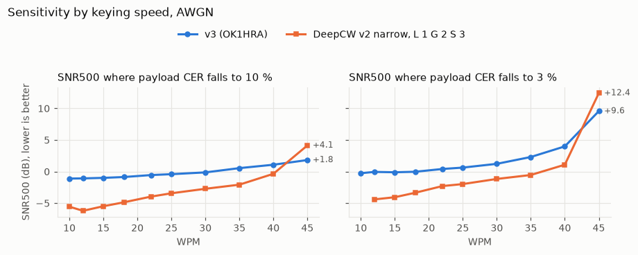

| WPM | v3 10 % | dcw2n 10 % | Δ | v3 3 % | dcw2n 3 % | Δ |
|---|---|---|---|---|---|---|
| 10 | −1.1 | −5.6 | −4.5 | −0.3 | — | — |
| 12 | −1.1 | −6.2 | −5.1 | −0.0 | −4.4 | −4.4 |
| 15 | −1.0 | −5.5 | −4.5 | −0.1 | −4.0 | −3.9 |
| 18 | −0.9 | −4.9 | −4.0 | −0.0 | −3.3 | −3.3 |
| 22 | −0.5 | −4.0 | −3.4 | +0.4 | −2.3 | −2.7 |
| 25 | −0.4 | −3.4 | −3.0 | +0.6 | −2.0 | −2.6 |
| 30 | −0.1 | −2.7 | −2.6 | +1.2 | −1.2 | −2.4 |
| 35 | +0.6 | −2.1 | −2.6 | +2.3 | −0.5 | −2.8 |
| 40 | +1.1 | −0.3 | −1.4 | +4.0 | +1.1 | −2.9 |
| 45 | +1.8 | +4.1 | +2.3 | +9.6 | +12.4 | +2.9 |

- dcw2n is 2.5–5 dB more sensitive from 10 to 40 WPM, and the gap grows as
  the speed falls. At 45 WPM it is 2.3 dB worse and has a 2.8 % floor; the
  model's top speed is between 40 and 45 WPM.
- **Floors above +10 dB:**
  - dcw2n: 0.00–0.03 % at 15–40 WPM;
  - v3: 0.2–1.3 % at +20 dB, worse than at +12 dB, where it is 0.00–0.03 %. At high SNR v3 often
    starts an over with junk ("I 0 OM TTTM M VVV …"), and some of it
    lands in the payload.
- **10 and 12 WPM:**
  - dcw2n's floor (6.0 % and 1.1 %) is not misread characters. It is
    spurious word spaces, nearly all of them between a letter and a
    following digit ("H1SH" read as "H 1SH").
  - With spaces ignored, 10 WPM is 0.09 %.
  - Letter-only text gets none (0 extra spaces in 2,556 characters at
    10 WPM).
  - The stitcher setting does not change it: the default (4, 2, 1) and a
    3 s guard give the same 6.8 %. It comes from the model.

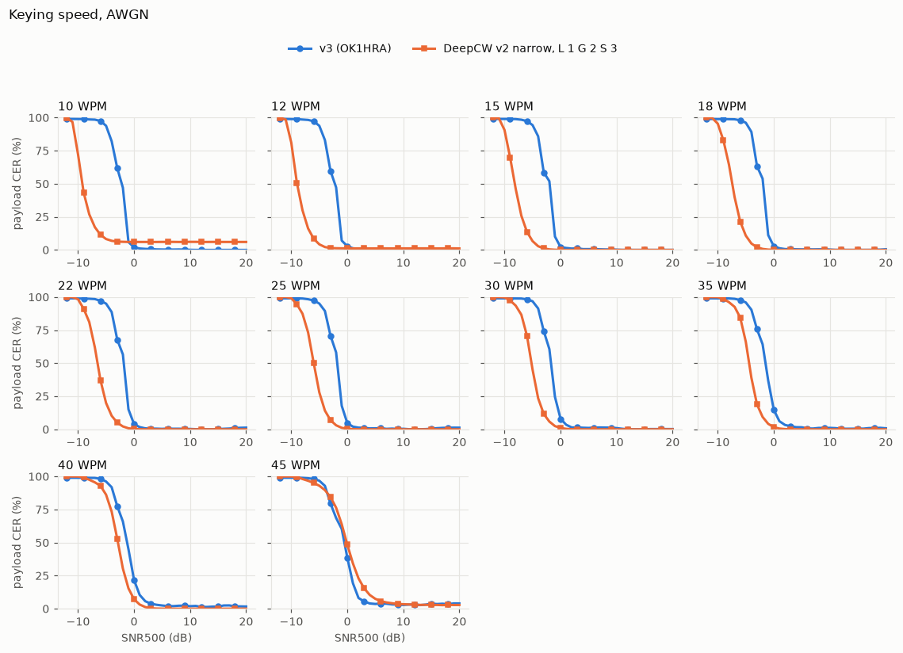

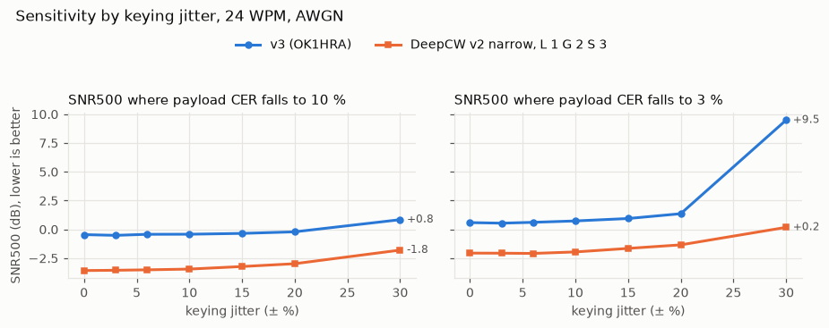

| jitter | v3 10 % | dcw2n 10 % | Δ | v3 3 % | dcw2n 3 % | Δ |
|---|---|---|---|---|---|---|
| ±0 % | −0.4 | −3.6 | −3.1 | +0.6 | −2.1 | −2.6 |
| ±10 % | −0.4 | −3.4 | −3.0 | +0.7 | −2.0 | −2.7 |
| ±20 % | −0.2 | −3.0 | −2.8 | +1.4 | −1.3 | −2.7 |
| ±30 % | +0.8 | −1.8 | −2.6 | +9.5 | +0.2 | −9.3 |

Neither decoder minds jitter up to ±20 % of every element. At ±30 %, v3 needs
9 dB more to reach 3 % and floors at 0.6–1.6 %; dcw2n's floor is 0.13–0.19 %. (±3, 6 and
15 % are in the figure and fall between the rows shown.)

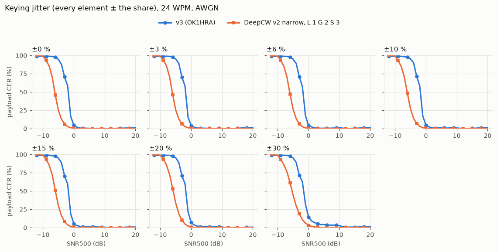

### Fading

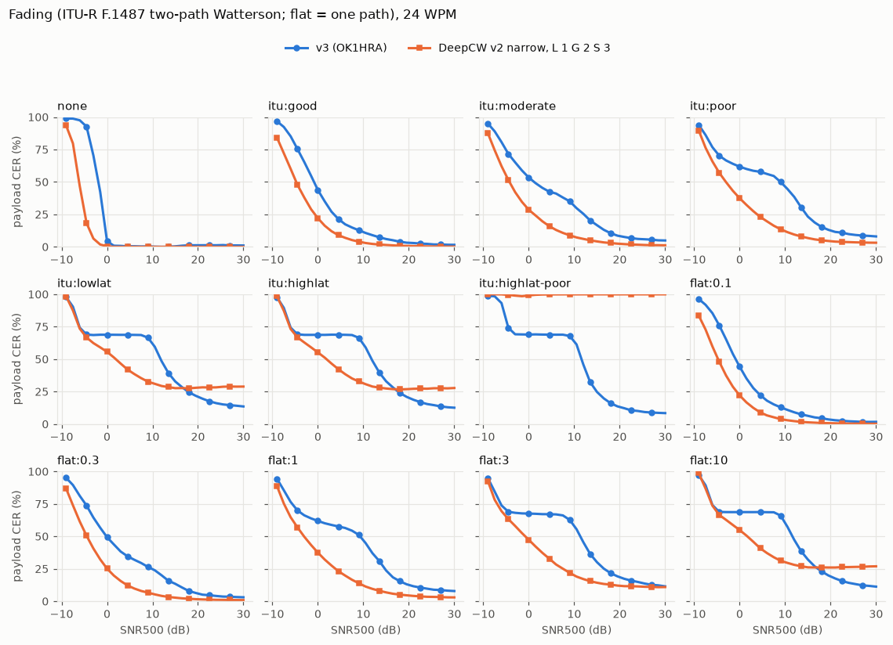

| 24 WPM | v3 10 % | dcw2n 10 % | Δ | floor at +30 dB, v3 | dcw2n |
|---|---|---|---|---|---|
| none | −0.2 | −3.5 | −3.2 | 1.1 % | 0.00 % |
| ITU good (0.1 Hz) | +11.1 | +4.0 | −7.1 | 1.6 % | 0.14 % |
| ITU moderate (0.5 Hz) | +18.4 | +8.1 | −10.3 | 4.9 % | 1.2 % |
| ITU poor (1 Hz) | +23.8 | +11.6 | −12.2 | 8.0 % | 3.2 % |
| flat 0.1 Hz | +11.2 | +4.1 | −7.2 | 1.7 % | 0.24 % |
| flat 0.3 Hz | +16.8 | +5.9 | −11.0 | 3.1 % | 0.91 % |
| flat 1 Hz | +23.5 | +11.6 | −11.9 | 7.9 % | 3.0 % |
| flat 3 Hz | — | — | — | 11.5 % | 10.9 % |
| ITU low latitude (10 Hz) | — | — | — | 13.6 % | 28.9 % |
| ITU high latitude (10 Hz) | — | — | — | 12.6 % | 27.8 % |
| flat 10 Hz | — | — | — | 11.3 % | 26.9 % |
| ITU high latitude, disturbed (30 Hz) | +24.1 | — | — | 8.4 % | 99.99 % |

- **Up to 1 Hz spread:** dcw2n reaches 10 % 7–12 dB earlier and floors 2.5–4×
  lower. This is the HF case that matters most, and dcw2n's lead here is
  the largest of the whole test.
- **3 Hz:** dcw2n is ahead below about +20 dB; the floors are equal at about 11 %.
- **10 Hz:** dcw2n is ahead below about +15 dB. Above it v3 is better:
  dcw2n stops at about 27 %, v3 goes on to 12 %.
- **30 Hz (disturbed high latitude):** dcw2n decodes nothing at any SNR. The
  result is the same with the gate off and with the default stitcher, so this
  is the model. A tone smeared over ±30 Hz is wider than its three bins, and
  presumably no such signal was in its training data. v3 reads it to 8.4 %.

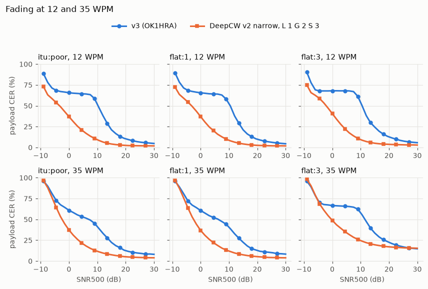

At 12 and 35 WPM the picture is the same: dcw2n is 11–14 dB ahead at 10 %
under ITU poor, flat 1 Hz and, at 12 WPM, flat 3 Hz. Under flat 3 Hz at
12 WPM dcw2n's floor is half of v3's (2.9 % against 5.7 %); at 35 WPM both
floor at about 15 %.

### Impulse noise

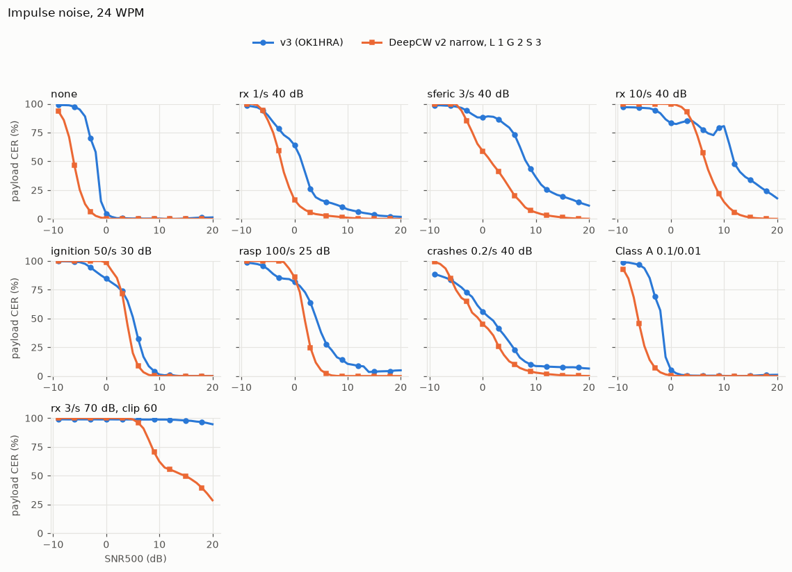

Without the impulse repair (`ImpulseRepair`, ALGORITHM.md §5.7); with it, see
"Impulse repair" below.

| 24 WPM | v3 10 % | dcw2n 10 % | floor at +20 dB, v3 | dcw2n |
|---|---|---|---|---|
| none | −0.5 | −3.6 | 1.3 % | 0.00 % |
| receiver clicks 1/s, 40 dB | +9.2 | +1.3 | 1.8 % | 0.00 % |
| sferics 3/s, 40 dB | — | +8.0 | 11.6 % | 0.11 % |
| receiver clicks 10/s, 40 dB | — | +10.9 | 17.9 % | 0.05 % |
| ignition 50/s, 30 dB | +7.8 | +5.9 | 0.03 % | 0.00 % |
| rasp 100/s, 25 dB | +10.8 | +4.3 | 5.0 % | 0.00 % |
| crashes 0.2/s, 40 dB | +9.1 | +6.1 | 6.6 % | 0.08 % |
| Middleton Class A 0.1 / 0.01 | −0.4 | −3.4 | 1.1 % | 0.00 % |
| clicks 3/s, 70 dB, clipped at 60 dB | — | — | 94.7 % | 28.6 % |

- dcw2n is ahead under every impulse type.
- Against random clicks, sferics and crashes v3 gets stuck at a 2–18 % floor.
  dcw2n reaches 0.1 % or better.
- Ignition-like periodic noise costs both about the same (1.9 dB apart).
- A clipped front end (70 dB clicks clipped at 60 dB) defeats v3 entirely:
  95 % CER at +20 dB, where dcw2n reads 71 % of the payload.

### Impulse repair

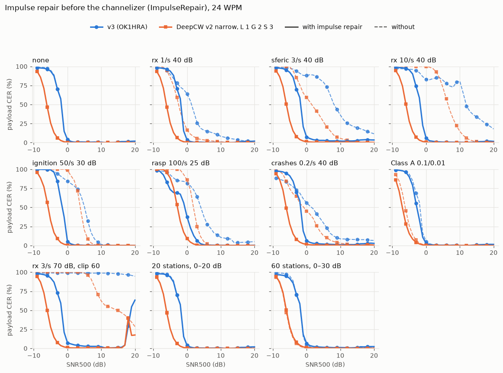

The impulse group again, with `ImpulseRepair` (ALGORITHM.md §5.7) on the
wideband stream in front of the channelizer (`cw_bench --repair`). It splits
off the strong carriers, predicts the rest with a complex AR(32) model, and
where the prediction error jumps 12 dB over its median with a white
(not narrowband) error spectrum it fills the gap by forward and backward
prediction. Nothing is zeroed, so carriers run through the gap. Costs:
- 2.4 % of a core at 48 kHz, 10.6 % at 192 kHz (once for the whole band,
  not per channel);
- 70 ms of latency;
- no memory to speak of.

It is not in any pipeline yet: only cw_bench and bench.py run it. v3 and
dcw2n both get the repaired IQ; neither uses the per-frame repair weights
(`set_repair_weights()`; coherent Bell does).

| 24 WPM, 10 % point | v3 | v3 + repair | dcw2n | dcw2n + repair | CER at +20 dB: v3 | v3 + r | dcw2n | dcw2n + r |
|---|---|---|---|---|---|---|---|---|
| none | −0.5 | −0.6 | −3.6 | −3.6 | 1.3 % | 1.9 % | 0.00 % | 0.00 % |
| clicks 1/s, 40 dB | +9.2 | −0.5 | +1.3 | −3.5 | 1.8 % | 2.0 % | 0.00 % | 0.02 % |
| sferics 3/s, 40 dB | — | −0.2 | +8.0 | −3.3 | 11.6 % | 3.4 % | 0.11 % | 0.32 % |
| clicks 10/s, 40 dB | — | −0.2 | +10.9 | −3.4 | 17.9 % | 1.6 % | 0.05 % | 0.42 % |
| ignition 50/s, 30 dB | +7.8 | −0.2 | +5.9 | −3.1 | 0.03 % | 0.08 % | 0.00 % | 0.00 % |
| rasp 100/s, 25 dB | +10.8 | +2.4 | +4.3 | −0.1 | 5.0 % | 0.31 % | 0.00 % | 0.00 % |
| crashes 0.2/s, 40 dB | +9.1 | −0.3 | +6.1 | −3.3 | 6.6 % | 2.8 % | 0.08 % | 0.46 % |
| Middleton Class A 0.1 / 0.01 | −0.4 | −0.9 | −3.4 | −4.2 | 1.1 % | 1.5 % | 0.00 % | 0.00 % |
| clicks 3/s, 70 dB, clipped at 60 | — | −0.2 | — | −3.3 | 94.7 % | 63 % | 28.6 % | 17.5 % |
| 20 stations, 0–20 dB | −0.5 | −0.5 | −3.6 | −3.5 | 1.3 % | 2.0 % | 0.00 % | 0.00 % |
| 60 stations, 0–30 dB | −0.5 | −0.3 | −3.5 | −3.3 | 1.6 % | 2.3 % | 0.00 % | 0.12 % |

- **It nearly undoes impulse noise for both decoders.** With the repair,
  every impulse type but rasp brings the 10 % point back to within 0.5 dB of
  the clean band. Rasp (100 pulses/s) still costs about 3 dB, against 8–11
  without. The gains at 10 %: dcw2n 4.4–14.3 dB, v3 8–10 dB, and v3's
  10–18 % floors under sferics and 10 clicks/s go away.
- **The two gains add up.** dcw2n + repair keeps its usual 3 dB lead over
  v3 + repair. v3 + repair beats dcw2n without it under every impulse type,
  so against impulses the repair matters more than the choice of decoder.
- **Heavy-tailed noise (Class A):** the repair gains 0.5 (v3) and 0.8 dB
  (dcw2n) over the plain band.
- **Above about +16 dB it fails for strong pulses.** The split that sets
  aside strong carriers takes 31 Hz bins standing 25 dB over the median bin.
  A keyed carrier at about 45 % duty crosses that line at SNR500 ≈ +16.5 dB
  (+12 dB for 500 → 31 Hz, −3.5 dB for the duty). From then on the
  carrier's own bins bypass the repair, impulse energy included. 70 dB
  pulses clipped at 60 read at 0.5 % (dcw2n) and 0.6–2 % (v3) from 0 to
  +16 dB, then jump to 17–40 % and 30–63 %. Under 40 dB pulses the same
  leak shows as a creeping floor: v3 2 → 3.4 % from +10 to +20 dB under
  sferics. The pulse-fit subtraction listed as not done in §5.7 would cover
  those bins.
- **What it costs where there are no impulses:**
  - dcw2n: nothing in a clean band. 60 stations at up to +30 dB move its
    10 % point by 0.2 dB, and the top-SNR CER to 0.12 %.
  - v3: the 10 % point stays put, but the high-SNR floor rises from
    1.3 to 1.9 % (2.3 % with 60 stations).
  - Under impulses dcw2n + repair floors at 0.3–0.5 % from about +2 dB on,
    where dcw2n without the repair reaches 0.00–0.1 % at +20 dB. Impulses the
    repair misses or fills badly cost a few characters; without the repair
    dcw2n only gets there 5–15 dB higher.
- False text, one hour of noise per condition: dcw2n + repair produced
  none. v3 + repair produced 0–9 characters an hour, against 0–4 without,
  but only 8 under crashes, against 148.

This is the bench's 8 kHz stream with a single channel's worth of signals
in it. ALGORITHM.md §5.7 has the 48 kHz runs: there a crowd of 30–200
stations costs nothing, as the same crowd is spread over six times the band.

### Other stations, tone offset, keying faults

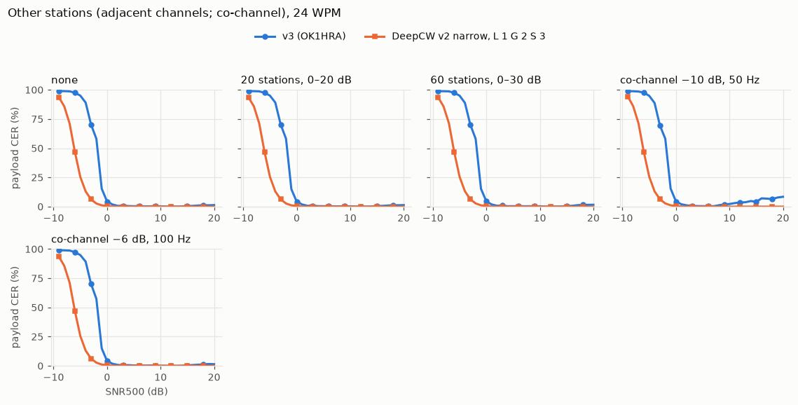

- 20 or 60 stations in the neighbouring channels (up to +30 dB) cost neither
  decoder anything.
- **A second station 10 dB weaker and 50 Hz away in the same channel:**
  - dcw2n ignores it.
  - v3 starts decoding it as the SNR rises, which is why its floor at +20 dB is 8.4 %.
- At −6 dB and 100 Hz both decoders are unaffected.

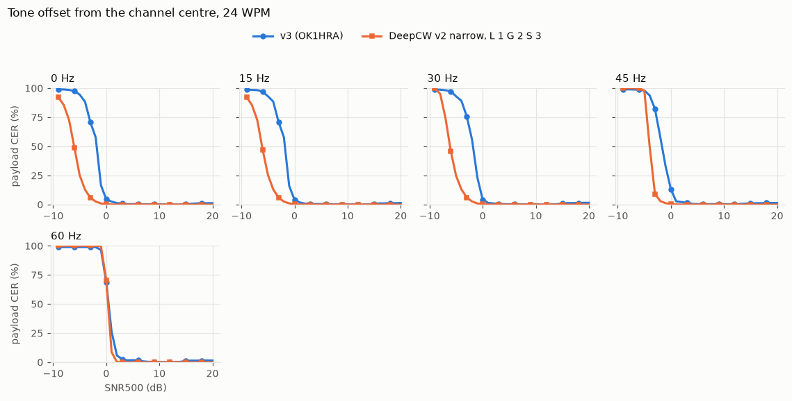

Tone offset in the 125 Hz channel:
- Both decoders are unaffected up to 30 Hz.
- At 45 Hz v3 loses 0.8 dB and dcw2n 0.6 dB.
- At 60 Hz (the channel's edge) v3 loses 2.3 dB and dcw2n 4.6 dB at 10 %.
  dcw2n stays 0.8 dB ahead.

### Where the tone sits in the channel

The bench's default offset is 10 Hz, so every other test has the tone near a
channel's centre. A skimmer sees stations anywhere. The channelizer is a
single 2×-oversampled polyphase bank: channels every 125 Hz, each with a
250 Hz complex output, so a tone is never more than 62.5 Hz from the nearest
centre. The sweep puts the tone at quarter bins of DeepCW's 12.5 Hz DFT
from 0 to 62.5 Hz (and five negative offsets), with two channel prototypes:
- **default:** the skimmer's prototype, flat to ±30 Hz, −0.9 dB at 40,
  −2.3 at 50 and −6 dB at the boundary;
- **flat:** `SkimChannelizer::create_ex(…, 85, 12)` (cw_bench
  `--passband 85 --taps 12`), flat to ±62.5 Hz.

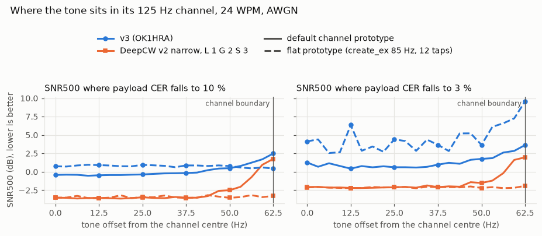

| offset | v3 10 % | dcw2n 10 % | v3 flat | dcw2n flat | dcw2n 3 % | dcw2n flat 3 % |
|---|---|---|---|---|---|---|
| 0 Hz | −0.4 | −3.5 | +0.8 | −3.5 | −2.1 | −2.1 |
| 25 Hz | −0.4 | −3.5 | +1.0 | −3.4 | −2.1 | −2.1 |
| 40.6 Hz | −0.1 | −3.5 | +0.9 | −3.5 | −2.0 | −2.1 |
| 46.9 Hz | +0.4 | −2.6 | +0.9 | −3.4 | −1.4 | −2.0 |
| 53.1 Hz | +0.8 | −2.0 | +0.6 | −3.4 | −1.2 | −2.1 |
| 56.3 Hz | +1.2 | −0.7 | +0.5 | −3.2 | −0.2 | −2.2 |
| 59.4 Hz | +1.7 | +1.0 | +0.6 | −3.4 | +1.6 | −2.2 |
| 62.5 Hz | +2.5 | +1.8 | +0.5 | −3.3 | +2.0 | −1.9 |

(Negative offsets mirror the positive ones within 0.2 dB. The figure has all 26.)

- **Where in a 12.5 Hz DFT bin the tone sits does not matter.** Both
  decoders' curves are flat to 0.3 dB across a bin, for both prototypes.
- **With the default prototype both are flat to about 40 Hz.** From there
  dcw2n loses faster: 5.3 dB at the boundary, against 2.9 dB for v3. At the
  boundary dcw2n is only 0.7 dB ahead.
- **The loss comes from the prototype's roll-off, not from the model.**
  With the flat prototype dcw2n is flat to the boundary (−3.5 to −3.2 dB,
  3 % point −1.9 to −2.2). The narrow model's three input bins, clamped to
  ±50 Hz, are not the cause. Halving the channel spacing is not needed.
- **The flat prototype hurts v3.** Its 10 % point is about 1.2 dB worse
  near the centre (+0.8 against −0.4). It also gains a 1–6 % error tail
  between +3 and +8 dB that makes its 3 % point erratic (+2.6 to +9.6). At
  the boundary the flat prototype does help v3's 10 % point (+0.5 against
  +2.5). The flat filter lets in more noise and more of the neighbouring
  channel, and v3's tone and threshold tracking pays for that; dcw2n does not.
- **Averaged over a uniformly random position** (what a skimmer sees), the
  10 % point is v3 +0.07 dB with the default prototype and dcw2n −2.85 dB.
  The default prototype costs dcw2n about 0.6 dB on average, and up to 5 dB
  for the stations near a boundary.
- **So:** a skimmer running dcw2n should use the flat prototype, and one
  running v3 the default. The channelizer is shared, so a pipeline running
  both would have to pick one, or run two banks.

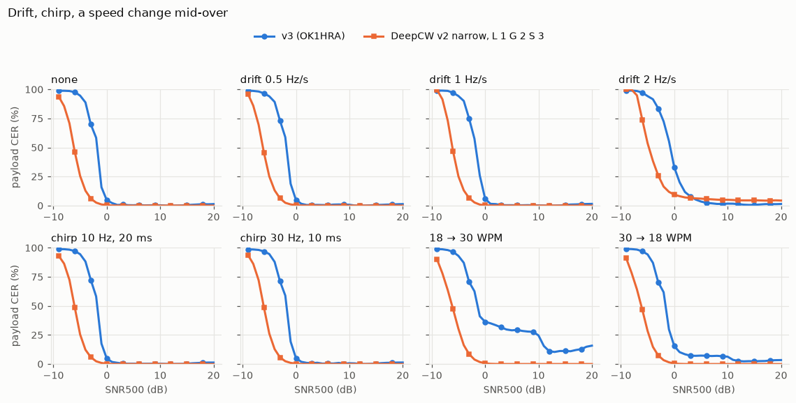

| | v3 10 % | dcw2n 10 % | Δ | v3 3 % | dcw2n 3 % | Δ |
|---|---|---|---|---|---|---|
| none | −0.5 | −3.6 | −3.1 | +0.7 | −2.1 | −2.8 |
| drift 1 Hz/s | −0.2 | −3.5 | −3.3 | +0.7 | −2.1 | −2.7 |
| drift 2 Hz/s | +2.5 | −0.2 | −2.7 | +5.5 | — | — |
| chirp 30 Hz, 10 ms | −0.3 | −3.6 | −3.3 | +0.7 | −2.2 | −2.8 |
| 18 → 30 WPM mid-over | — | −3.2 | — | — | −1.6 | — |
| 30 → 18 WPM mid-over | +1.1 | −3.4 | −4.5 | +11.7 | −1.8 | −13.5 |

- **Drift and chirp:**
  - Chirp costs neither decoder anything, and nor does drift up to 1 Hz/s.
  - At 2 Hz/s the tone has moved roughly 60 Hz by the end of a 24 WPM over, which puts it at the
    channel's edge. There dcw2n floors at 4.3 %, while v3 tracks the tone
    and floors at 1.4 %.
- **A speed change mid-over:**
  - It does not affect dcw2n.
  - v3 keeps the timing it learned. After a step up from 18 to 30 WPM it
    stays at a 10–16 % CER floor; after a step down it floors at 2–3 %.

### What is sent: letter groups against ham exchanges

`cw_bench --text`:
- `letters`: 12 random groups of 2–6 letters A–Z. The text has no structure,
  and it has no digits.
- `qso`: two parts of a typical exchange, in the form
  `CQ CQ DE OK1ABC OK1ABC K`, a contest exchange (`DX TU 5NN 123 OK1ABC`),
  a ragchew (`RST 579 579 NAME …`), a sign-off (`R R TNX FER QSO 73 73 … SK`)
  or a `QRZ`. Callsigns use real prefixes.
- `random`: alphanumeric groups of 2–6 characters.
- `payload`: the bench's default, which shuffles traffic words and
  callsign-like tokens.

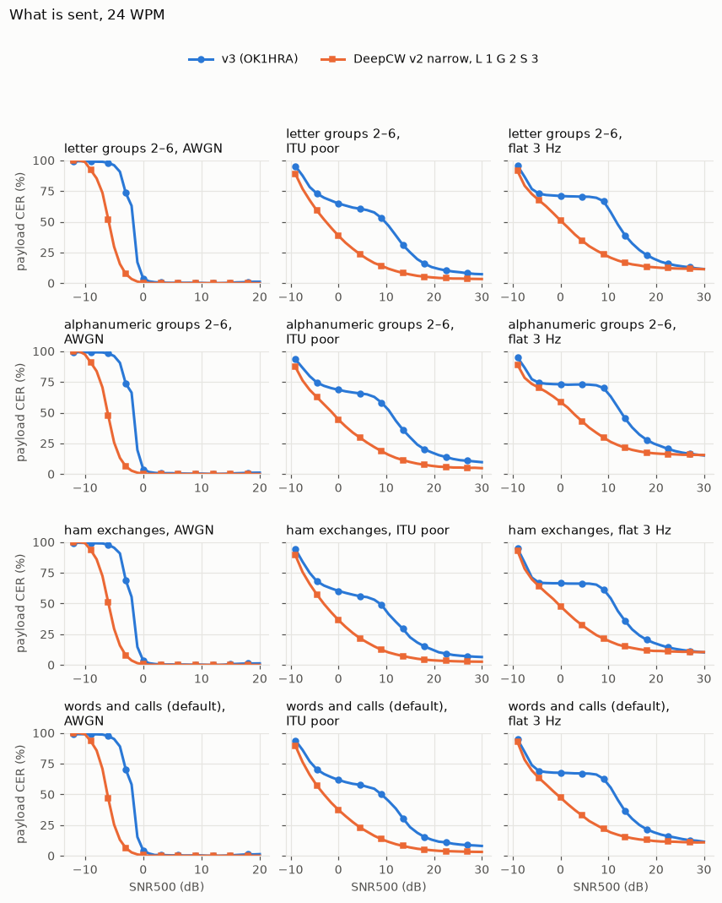

| 24 WPM | v3 10 % | dcw2n 10 % | Δ | v3 3 % | dcw2n 3 % | Δ |
|---|---|---|---|---|---|---|
| letter groups 2–6, AWGN | −0.5 | −3.3 | −2.8 | +0.3 | −1.8 | −2.1 |
| ham exchanges, AWGN | −0.6 | −3.3 | −2.7 | +0.3 | −1.7 | −2.0 |
| alphanumeric groups, AWGN | −0.4 | −3.5 | −3.2 | +0.4 | −2.1 | −2.5 |
| words and calls (default), AWGN | −0.5 | −3.5 | −3.0 | +0.5 | −2.1 | −2.6 |
| letter groups 2–6, ITU poor | +23.1 | +11.9 | −11.2 | — (7.3 %) | — (3.4 %) | |
| ham exchanges, ITU poor | +21.4 | +10.7 | −10.8 | — (6.5 %) | +24.5 | |
| alphanumeric groups, ITU poor | +29.2 | +14.8 | −14.4 | — (9.7 %) | — (4.8 %) | |
| letter groups 2–6, flat 3 Hz | — (11.5 %) | — (11.4 %) | | | | |
| ham exchanges, flat 3 Hz | — (10.3 %) | — (10.5 %) | | | | |

(In brackets: the floor at +30 dB.)

- **Letter groups against ham exchanges:**
  - In AWGN both decoders read random letter groups and ham exchanges equally
    well, within 0.1–0.2 dB. Neither leans on language or on the
    exchange's structure: dcw2n's advantage holds on text with no structure
    at all.
  - Under ITU poor fading, ham exchanges are 1.2 dB (dcw2n) and 1.7 dB (v3)
    easier than letter groups. Their floors are lower too (2.6 against 3.4 % for dcw2n, 6.5 against
    7.3 % for v3).
  - A plausible reason: exchanges are full of short, frequent characters
    (E, T, 5, N) and repeated words, which a deep fade has less chance to
    erase whole. They are not easier through context: neither decoder uses
    any.
- **Digits:** they make a text harder under fading. Under ITU poor,
  alphanumeric groups lose 2.9 dB (dcw2n) and 6.1 dB (v3) against letter groups and have the highest floors (dcw2n 4.8 %,
  v3 9.7 %). Their characters are the longest (five elements), so a fade is
  more likely to break one.

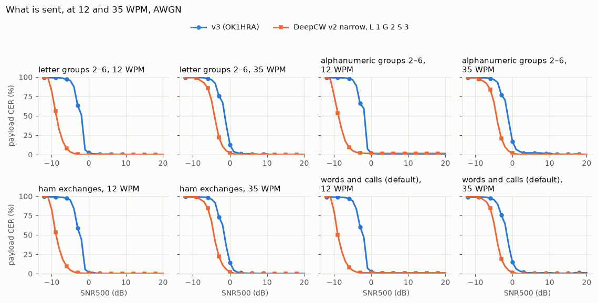

| AWGN | v3 10 % | dcw2n 10 % | v3 3 % | dcw2n 3 % | dcw2n floor |
|---|---|---|---|---|---|
| letter groups, 12 WPM | −1.1 | −6.2 | −0.2 | −4.7 | 0.00 % |
| ham exchanges, 12 WPM | −1.1 | −6.0 | −0.3 | −4.3 | 0.43 % |
| alphanumeric groups, 12 WPM | −1.1 | −6.1 | −0.2 | −4.0 | 1.55 % |
| letter groups, 35 WPM | +0.3 | −1.9 | +1.5 | −0.3 | 0.00 % |
| ham exchanges, 35 WPM | +0.4 | −1.8 | +1.6 | −0.2 | 0.00 % |
| alphanumeric groups, 35 WPM | +0.7 | −2.0 | +2.5 | −0.4 | 0.00 % |

The slow-speed space fault only appears where the text has digits. At
12 WPM pure letter groups floor at 0.00 %, ham exchanges (RST, serials,
callsigns) at 0.43 %, and alphanumeric groups at 1.55 %. At 35 WPM the
three texts are equal.

### Text from no signal

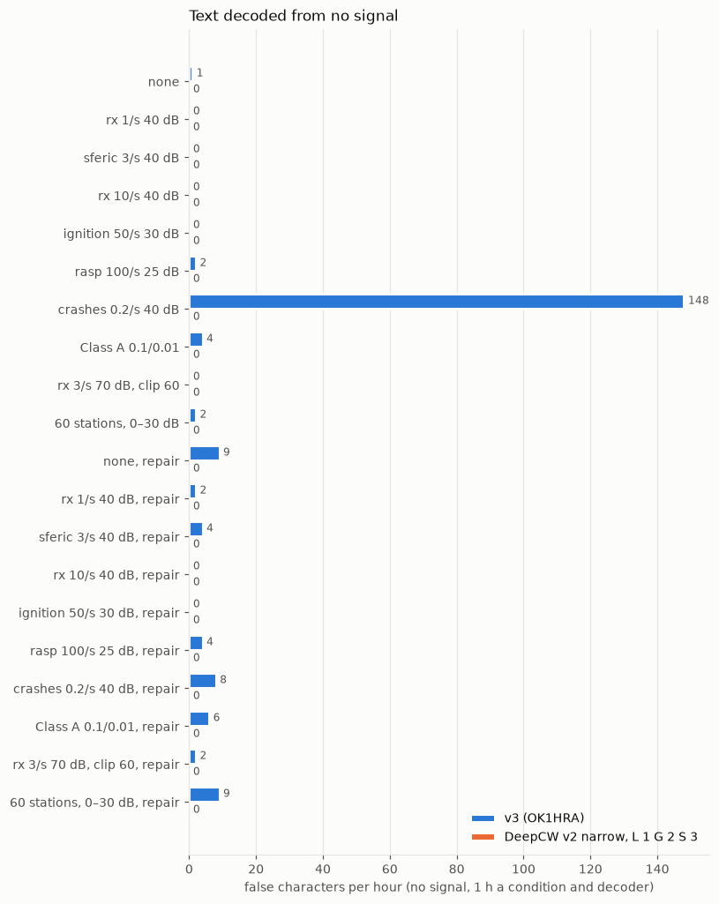

dcw2n produced no characters in twenty hours of noise (one hour per
condition, ten with the impulse repair and ten without), crashes and 60
adjacent stations included; its gate stays closed. Without the repair, v3
produced 0–4 characters an hour in most conditions and 148 an hour under
static crashes. With it, v3 produced 0–9 an hour, 8 under crashes.

### Summary

dcw2n (1, 2, 3) reads better than v3 almost everywhere:
- 2.5–5 dB in AWGN at 10–40 WPM;
- 7–14 dB under fading up to 1 Hz spread, with floors 2.5–4× lower;
- far better under impulse noise without the impulse repair, and still
  3 dB ahead with it;
- immune to a speed change, to a weaker co-channel station and to jitter up to ±30 %;
- no false text.

Where v3 is better:
- **45 WPM**, by 2.3 dB;
- **fast flutter (10 Hz)** above about +15 dB: floors of 12 % against 27 %;
- **30 Hz spread**, where dcw2n decodes nothing;
- **2 Hz/s drift**, where the tone reaches the channel's edge;
- **near the channel boundary with the default prototype**, where dcw2n
  loses 5.3 dB against v3's 2.9 dB. The flat prototype removes dcw2n's loss
  (but costs v3 about 1 dB);
- **12 WPM and slower**, where dcw2n inserts spurious word spaces before digits.

All of this is at the recommended stitcher setting (1, 2, 3) ("Recommended
setting: L 1, G 2, S 3" above), not the code's default (4, 2, 1).

The 30 Hz spread, the drift and the slow-speed spaces are about the narrow
model's input and training, not the stitcher; the default stitcher shows the
same faults.

The impulse repair (ALGORITHM.md §5.7) brings either decoder to within
0.5 dB of the clean band under every impulse type but 100/s rasp. Under
impulses it is worth more than switching decoder. Both decoders gain from
it, and the gains add to dcw2n's lead. It is not yet in a pipeline.

## Not measured yet

Nothing of v2 has run on channelized IQ. To measure before trusting it:

- v2 on the 11-bin zero-filled tile: noise-only output, the two-tone phantom,
  the ±k bins needed, an oracle noise level against the median;
- the narrow model's centring: a tone between two bins, drift, the line bin
  changing between windows;
- the 6.7 % time stretch against v2's training (and the 2.01 s word gap,
  kept in seconds here);
- the TX-hold mute click against the v2 input (no live-end trim in `deepcw2`);
- cost: v2 halves the frames the encoder sees (attention ≈ ¼); the narrow
  model has 1/18 of the parameters.

## Gates and models

`ctest -R deepcw` runs `cw_engine_deepcw_test` (v1: the model pin, the commit
rule, draft, word gaps, the DSP half; with `SKIM_ORT_LIB` and
`SKIM_DEEPCW_MODEL` also the model) and `cw_engine_deepcw2_test` (v2: the
normalisation, the stitcher on synthetic CTC streams, the DSP half; with
`SKIM_DEEPCW2_MODEL` and/or `SKIM_DEEPCW2_NARROW_MODEL` also the models, and
with `SKIM_DEEPCW2_FUSED` the narrow model's fused kernel). Both exit 77
(skipped) without a model.

| File | sha256 | From |
|---|---|---|
| v1 `model.onnx` | `ef120799457bca042d4690944f0faf93268eb4654e7f50f28784ad63bdc1fe02` | deepcw-engine at `8e264d243bbd4467bd19f3f28292219405b47e0e` |
| v2 `model.onnx` | `cd5ee38106348ad86a8f2d40ef1ce7dccea0d7f7fbfd0f2dee0fd1a8a28773ae` | deepcw-engine at `79104fbe1ea0abd09eb27c6ebf9c6bab364d0d7f` |
| v2 `model_narrow.onnx` | `fc80c4baec72d756af1dbce9b70357a731b0b1a6b8306815bcfc61b6403c46e5` | deepcw-engine at `79104fb` |
| v2 narrow, fused-kernel weights | `253ffb73161a09f3ee7d2c23d03106e4d64ecd8b846ac6a7ec7f48fe81820dc3` | `tools/deepcw_narrow_extract.py model_narrow.onnx <out>` |
