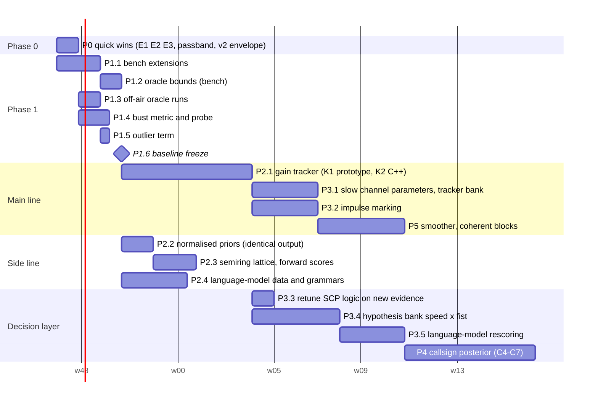

# CW decoder: the improvement plan

This is the execution plan for improving `cw_engine`'s decoding quality: what
to do, in which order, how each step is measured, and when to stop or change
course. It is the schedule; the reasoning lives in three companion documents:

- [ALGORITHM.md](ALGORITHM.md): how the decoder works (Levels 0–4), where it
  can improve (Level 5), and the measured experiments E0–E3;
- [FADING_TRACKER.md](FADING_TRACKER.md): the gain tracker for the HF fading
  channel (steps K0–K6);
- [BAYESIAN_DECODING.md](BAYESIAN_DECODING.md): the statistics, from
  calibrated evidence to the callsign posterior and the hypothesis bank
  (tracks A, B, C).

Step names below (P0.1, P2.3 …) are this plan's. Each step says which step
of the companion documents it implements (K2, B1, C3 …). Nothing here is
built yet, except the three experiment diffs of Phase 0.

- [1. Rules for every step](#1-rules-for-every-step)
- [2. Where the losses are](#2-where-the-losses-are)
- [3. Overview](#3-overview)
- [4. Phase 0: quick wins](#4-phase-0-quick-wins-days)
- [5. Phase 1: measurement](#5-phase-1-measurement)
- [6. Phase 2: the evidence, and the Bayesian structure beside it](#6-phase-2-the-evidence-and-the-bayesian-structure-beside-it)
- [7. Phase 3: channel, impulses, language model, hypothesis bank](#7-phase-3-channel-impulses-language-model-hypothesis-bank)
- [8. Phase 4: the callsign posterior](#8-phase-4-the-callsign-posterior)
- [9. Phase 5: refinements](#9-phase-5-refinements)
- [10. Decision points](#10-decision-points)
- [11. Effort and calendar](#11-effort-and-calendar)
- [12. Risks](#12-risks)
- [13. Not in the plan](#13-not-in-the-plan)

---

## 1. Rules for every step

1. **One switch per change.** Every change goes behind a `CwDecoderConfig`
   switch with an environment override (`SKIM_…`), default off, as v3 did
   next to v2. Accepted switches are collected into a new preset (a `v4`
   next to `cw_preset_v2` and v3) rather than flipping v3's defaults, so v3
   stays the reference.
2. **Byte-identical when off.** With the switch off, `cw_engine_cw_test`
   (67 checks) and `cw_engine_call_test` (65 checks) produce byte-identical
   output.
3. **No regression when on.** With it on, both gates pass, and so do
   `cw_engine_bench --gate quick` and `--gate startup` (once Phase 0 makes
   the latter pass).
4. **Bench, then air.** A step is measured on the bench
   (`experiments/cw_bench`, `bench.py ladder / offset / startup / fading /
   impulse / noise`), then A/B on replayed off-air IQ.
5. **False characters on noise never rise.** `bench.py noise` and the
   noise-only beds are run for every step. Every gain in sensitivity is
   paid for here first.
6. **From Phase 1 on, judge callsigns by cost, not count:** misses +
   k·busts (k = 5 to start), split by SCP and non-SCP calls
   (BAYESIAN_DECODING.md §2.5). The number of calls detected alone rewards
   snapping to the dictionary.
7. **Compare against the frozen baseline** of P1.6, not against the
   previous step's tuning.

The user builds and runs the tests; each step ends with the commands to run
and the numbers to compare.

---

## 2. Where the losses are

Measured on the bench (ALGORITHM.md E0, E3, §5.3.6). These numbers set the
order of the plan.

| Loss | Size | Cause | Addressed by |
|---|---|---|---|
| Fading | 9 dB behind CW Skimmer at 0.1 Hz Doppler, over 10 dB at 1 Hz; 15 % CER floor at +20 dB | no amplitude tracker follows a fade; σ1² held 2 s, µ_mark 0.35 s | P0.1 (part), P2.1 |
| Impulses | 3/s at 40 dB: CER 1.2 → 32 %; 10/s: 250 false characters per hour | no impulse model at all | P1.5 (part), P3.2 |
| Clock acquisition at slow speed | up to 4.3 dB at 12 WPM, 2.0 at 18, 1.2 at 25 | the bootstrap learns a wrong dit at the cliff | P3.4 |
| The weak-view pause rule | 0.9 dB at 18 WPM | judged on the 45 Hz envelope, not on the matched path | P0.6 |
| Channel start | 35 WPM: 9 % CER floor at any SNR | zero-history channelizer output, squelch opens on noise | P0.2, P0.3 |
| Channel edge | 2–3 dB for signals more than 55 Hz off a channel centre, 0.5–1 dB on average | the prototype rolls off towards the edge | P0.4 |
| v2 gating bandwidth | 1.8 dB in the v2 view | squelch, duty and bootstrap read the raw channel envelope | P0.5 |
| Busts from dictionary snapping | unmeasured | an SCP call within 5 score units of the reading wins; the reading as heard never competes | P1.4, Phase 4 |
| Speed-matched linear filters | under 0.3–0.6 dB left | — | nothing to do |

---

## 3. Overview

Five phases. From Phase 2 on, two lines run side by side: the **main line**
improves the evidence, and the **side line** builds the Bayesian structure
(priors, the forward algorithm, the language model) so that it is ready, and
byte-identical, when the evidence settles. The side line is built and
checked, but **not tuned** until the main line's B1 is accepted, because
everything it fits depends on the evidence.

The chart assumes one developer interleaving the lines; the bars show the
order and the dependencies, not exclusive weeks. §11 gives the effort.

**Milestones.**

| Milestone | After | What it gives |
|---|---|---|
| M0 | Phase 0 | the measured quick wins in a `v4` preset: channel start, channel edge, part of the fading loss |
| M1 | Phase 1 | a bench and an off-air harness that measure busts, fading, impulses, fists; oracle bounds; the frozen baseline |
| M2 | P2.1 | faded marks stay marks; one calibrated evidence for all SNR; the first release worth shipping |
| M3 | Phase 3 | impulse handling, the hypothesis bank in place of the decision-directed clock, the language model rescoring overs |
| M4 | Phase 4 | callsign posteriors and a calibrated spot gate |

---

## 4. Phase 0: quick wins (days)

Already built, or a few lines. Apply them together behind their switches,
A/B them on off-air replays, and put the accepted ones into the `v4` preset.

### P0.1 The view at word spaces (E3)

- **Change:** `experiments/view-at-word-space.diff`; the weak/strong view
  may change at a live word space, not only between overs.
- **Switch:** `CwFrontEndConfig::view_at_word`, `SKIM_V3_VIEW_WORD=1`.
- **Measured:** CER at +10 dB: ITU moderate 0.30 → 0.25, ITU poor
  0.51 → 0.41, 1 Hz 0.45 → 0.36. Unchanged at 0 dB and below, without
  fading, and on the ladder.
- **To do:** off-air A/B on replays with fading.
- **Pass:** no off-air regression; gates as measured.
- **Lifetime:** a stopgap; P2.1 removes the view switch it works around.
- **Effort:** 1–2 days.

### P0.2 The slow-clock witness (E2)

- **Change:** `experiments/acquire-settle-and-witness.diff`, the witness part;
  on a strong channel a second Schmitt trigger keeps collecting marks, and
  the clock jumps when the shortest tight class sits under 0.6 dit.
- **Switch:** `CwAcquireConfig::witness`, `SKIM_V2_WITNESS=1` /
  `SKIM_V3_WITNESS=1`.
- **Measured:** 35 WPM CER 5.1 → 1.8 % and 10.3 → 6.2 %; never engages at
  low SNR.
- **Pass:** `startup` case improves; ladder unchanged.
- **Effort:** 1 day.

### P0.3 Squelch settling, v2 view only (E2)

- **Change:** the same diff, the settle part; the squelch stays shut for the
  first 0.5 s while the floor learns from every sample.
- **Switch:** `CwAcquireConfig::settle_s`, `SKIM_V2_SETTLE_S=0.5`.
- **Measured:** channel-start CER at 14 dB 3.5–10.3 % → 0.4–1.5 %, no failed
  overs. In v3 it costs 0.3–0.5 dB at 3 % CER, because the bootstrap then
  learns a too-fast clock at a marginal onset.
- **Decision:** enable for v2 and the strong view only; for v3 wait for
  P3.4, which removes the bootstrap the cost comes from.
- **Pass:** `cw_engine_bench --gate startup` passes (registered `WILL_FAIL`
  today; flip it).
- **Effort:** 1 day.

### P0.4 Flat channel passband (E1)

- **Change:** the skimmer module opts in to `create_ex(in_rate, 125,
  kCwFlatPassbandHz = 85, kCwFlatTaps = 12)`.
- **Measured:** flat to ±62.5 Hz (−0.2 dB), still more than 100 dB down at
  125 Hz; 0.5–1 dB on average over random offsets, 2–3 dB for signals more
  than 55 Hz from a centre.
- **Cost:** 1.5× the polyphase work; each signal shows more strongly in the
  neighbouring channel.
- **To do:** `bench.py offset`, and on off-air replays count duplicate
  decodes of one station in adjacent channels: the ghost arbitration and the
  detector's own-quarter rule must keep them out.
- **Pass:** offset thresholds flat to 62.5 Hz; no rise in duplicates; CPU
  within budget on a full band.
- **Effort:** 2–3 days.

### P0.5 v2 gating on the narrow envelope

- **Change:** v2's squelch, keying-duty test and bootstrap read the 45 Hz
  narrow envelope instead of `raw` (ALGORITHM.md §5.3.6, "Centre").
- **Switch:** new, e.g. `CwLevelsConfig::narrow`, `SKIM_V2_NARROW_GATE=1`.
- **Expected:** 0.4–0.6 dB in the v2 view, measured once in a scratch build.
- **Pass:** ladder and offset cases improve by that much; `noise` false
  characters unchanged; startup unchanged.
- **Effort:** 2 days.

### P0.6 The pause rule on the matched path (E1)

- **Change:** `experiments/matched-alive-and-flat-passband.diff`, the
  `matched_alive` part.
- **Switch:** `CwWeakViewConfig::matched_alive`, `SKIM_V3_MATCHED_ALIVE=1`.
- **Measured:** 18 WPM threshold 0.9 dB better; 12 WPM at −3 dB 80 → 46 %
  CER; weak ladder total 1056 → 1036; but one QSB rung worse (6 dB: 37 → 51).
- **Decision:** on only if off-air replays with QSB agree.
- **Effort:** 1–2 days of A/B.

---

## 5. Phase 1: measurement

Phase 1 builds what every later decision needs. It ends with a frozen
baseline (P1.6).

### P1.1 Bench extensions (K0, A1)

1. **Truth output:** the true complex gain and keying per sample, for the
   tracker prototype (P2.1) and the reliability diagrams.
2. **Long continuous streams:** minutes of one station, many overs, as
   DeepCW's runs are. Today's 25 s cold overs over-weight acquisition.
3. **Channel presets:** two paths with different Doppler shifts (beating),
   drift, chirp; the ITU-R sets exist.
4. **Keying styles:** hand key, bug, paddle, computer, with log-normal
   element and space durations per style and an on/off imbalance (DeepCW's
   four styles, ALGORITHM.md §5.4 W0).
5. **Reliability diagrams:** a `bench.py` case that bins per-sample LLRs and
   segment scores against the true keying, per condition
   (BAYESIAN_DECODING.md §1.5).
6. **Callsign-level scoring:** inserted call lists with a set share (10–20 %)
   not in the MASTER.SCP snapshot used, some of them one or two edits from
   SCP calls; for each: correct, bust, missed; plus false spots.

**Effort:** 1–2 weeks. **Implements:** FADING_TRACKER.md K0,
BAYESIAN_DECODING.md A1 items 1–3, A2 items 1–2.

### P1.2 Oracle bounds on the bench (A1 item 4)

What would perfect knowledge buy? Each bound decides whether a later step is
worth building (§10).

| Oracle | How | Decides |
|---|---|---|
| clock | `oracle.h` mode `clock`: the dit from the true WPM; the bench writes the truth file (`t0_s t1_s carrier_hz wpm call`) | the speed part of the hypothesis bank (P3.4) |
| fist | a new oracle mode: char and word space from the bench's keying parameters | the fist part of P3.4 |
| channel | each over decoded under several fixed settings (coherent span, envelope bandwidth), the best per over kept against the truth | the tracker bank (P3.1) |
| gain | the true gain fed in place of σ1² and µ_mark | the ceiling of P2.1 |
| pause | the gate held open on the true keying (`oracle.h` `gate`) | P0.6, kept apart from the bank |

Run on `ladder`, `fading`, and the long-stream mode, all speeds and styles.

**Effort:** about 1 week.

### P1.3 Off-air oracle runs

On replayed off-air IQ with CW Skimmer Server's decodes as the truth
(`SKIM_ORACLE`, `skimmer-compare/oracle-truth.py`):

- `clock` and `gate`: how much of R's stations each stage costs today;
- `kws`: is R's call in the audio at all, by forced alignment against a free
  reading (the ceiling of the call reader);
- `combine`: how far soft-combining repeats would carry a station one
  reading does not (the ceiling of P4.2).

**Effort:** a few days, plus replay time. **Note:** R's decodes are a
reference, not ground truth; use them for recall, and the bench for busts.

### P1.4 The bust metric and the quick-win probe (A2)

1. **Off-air labels:** consensus with other RBN skimmers in the same minute
   and band (precision), and, after a contest, the published logs (a call in
   no log is very likely a bust).
2. **The probe:** add the reading as heard, W, to the candidates of the word
   re-read (`cw_reread.cpp:176`) and the call reader (`cw_callreader.cpp:189`),
   with an explicit SCP bonus β in place of the hidden one:
   `take X if s(X) + β > s(W)`. A few dozen lines, behind
   `SKIM_V3_RS_RAW_BETA` / `SKIM_V3_KWS_RAW_BETA` (β unset = today's rule).
3. **Sweep β** on the bench call lists and off air; report cost =
   misses + k·busts, SCP and non-SCP separately.

The probe is a **measurement**, not a setting to tune now: it is run again
after P2.1 (P3.3).

**Effort:** 1–2 weeks; off-air labels take calendar time.

### P1.5 Outlier term in the per-sample LLR

- **Change:** an ε-contamination term in both views
  (BAYESIAN_DECODING.md §1.8): `llr ← ln[(1−ε)p₁ + εq] − ln[(1−ε)p₀ + εq]`
  with a broad q, so one sample costs at most a few nats.
- **Where:** `CwPowerStats::llr` (`cw_frontend.h:490`),
  `CwDiscriminator::llr` (`cw_discriminator.h`).
- **Switch:** `SKIM_LLR_EPS` (0 = off).
- **Measure:** `bench.py impulse` (CER and false characters per hour), the
  ladder (must not move), `fading`.
- **Effort:** 2–3 days. It carries over into P2.1's LLR.

### P1.6 Baseline freeze

One report, run with the `v4` preset of Phase 0 and with v3: `ladder`,
`offset`, `startup`, `fading` (also long streams and all keying styles),
`impulse`, `noise`, the reliability diagrams, the callsign cost table, and
the oracle bounds. Every later step reports against it.

---

## 6. Phase 2: the evidence, and the Bayesian structure beside it

### Main line

#### P2.1 The gain tracker (K1, K2; B1)

The largest measured loss. FADING_TRACKER.md has the model and the design;
BAYESIAN_DECODING.md step B1 the additions.

1. **K1, prototype in Python** on P1.1's truth dumps: AR(1) against AR(2),
   the block length, the soft data-association weighting, the estimators of
   σ², P and B. **Pass:** tracker error against the true gain; B within 30 %
   from 0.1 to 10 Hz.
2. **K2, `CwGainTracker` in C++** next to `CwPowerStats`, on the ½-dit
   coherent block sums, supplying
   `llr = ln CN(z; μ, σ² + V) − ln CN(z; 0, σ²)` as the one view when on.
3. **The scale fix, in the same change:** a space scores 0, not −Σllr
   (`cw_lattice.h:281`, the `sign` in `cw_reread.cpp:15`, `CwCallAlignment`).
   First check byte-identical Viterbi output with the duration priors halved;
   then switch the LLR; then retune the evidence/prior balance once.
4. **Innovation gating** for impulses in the tracker's state, plus P1.5's
   ε term in its LLR.

- **Switch:** `CwGainTrackerConfig::enabled`, `SKIM_GAIN_TRACKER=1`; the old
  views stay selectable.
- **Pass (K2):** fading table at +10 dB clearly below v2 (ITU moderate
  < 0.19); no-fading ladder within 0.2 dB; `noise` false characters not up;
  gates pass; reliability diagrams near the diagonal in every condition;
  no off-air regression on strong stations.
- **Effort:** 4–6 weeks. **Depends:** P1.1, P1.6.

### Side line

Built and checked for identical output; tuned only after P2.1 is accepted.

#### P2.2 Normalised duration and transition priors (C1, structure)

- Normalise each duration prior over its window (`ln Z_type`, computed in
  `sync_prior_memo`), and replace the 0.5 segment cost by transition
  log-probabilities (BAYESIAN_DECODING.md step C1).
- Behind `SKIM_PRIORS_NORM=1`. With the switch off, identical output.
- Prepare, but do not fit yet: the transition tables from text statistics,
  the ε mixture on durations, the keying-style cases of P1.1 to fit them on.
- **Effort:** 1–2 weeks.

#### P2.3 One recursion, two semirings (C2, structure)

- Template `CwLattice::step`, `forced()` and `CwCallAlignment` over the
  "add": max (Viterbi) or log-sum-exp (forward). Viterbi output
  byte-identical.
- Forward scores for every candidate of the re-read and the call reader,
  written to the debug trace only (`rescore:` and `kws:` lines), next to
  today's Viterbi scores, so their difference can be studied before anything
  depends on them.
- The filler: a forward pass over the free reading with a uniform Morse
  character prior, also trace-only.
- **Effort:** 2 weeks.

#### P2.4 Language-model data (C2b, data)

No decoder change.

1. **Grammars** (finite-state): callsigns (shape rules from
   `SkimCallsign::is_valid` and the ITU tables), RST with cut numbers,
   contest serials and zones, Maidenhead locators, times, Q-codes, prosigns.
2. **Phrases:** `CQ … DE … K`, `TU`, `73`, `GL`, `FB OM`, `UR RST`, ragchew
   vocabulary, with frequencies.
3. **Corpus and character n-gram:** decoded traffic, contest logs, RBN spot
   streams; Kneser–Ney smoothing; a held-out set; never the bench's own
   texts.
4. **Mode classes:** contest, pile-up, ragchew, with the CQ/TEST context as
   the evidence for choosing.
5. **ε_new:** the share of calls on the air not in MASTER.SCP, measured from
   a contest's logs against the SCP file of the same date.

**Effort:** 2–3 weeks, mostly data.

---

## 7. Phase 3: channel, impulses, language model, hypothesis bank

Starts when P2.1 is accepted (decision D2).

### P3.1 Slow channel parameters and the tracker bank (K3; B2)

- B, the residual carrier offset, P and the beating indicator, per channel
  and per station across overs; B sets the tracker's poles.
- **Only if P1.2's channel oracle shows ≥ 1 dB:** a bank of 2–3 trackers
  with fixed spreads during acquisition, weighted by the likelihood of the IQ
  each predicted (multiple-model filter), collapsed once B is stable.
- **Pass (K3):** B and the offset followed on the beating and drift presets;
  fading table improves further or holds.
- **Effort:** 1–2 weeks, +1 for the bank.

### P3.2 Impulse marking (B3)

- Wideband detection from coincident jumps across channels; mapping onto the
  16 output samples the channelizer smears each impulse over; per-sample
  erasure weights to `process()` through a new hook on `SkimDecodeChannel`;
  marked samples kept out of the clock, the fist, the noise floor and the
  tracker. Dense trains repaired before the channelizer, never zeroed
  (ALGORITHM.md §5.7).
- Detection lives in the skimmer module, which owns the channelizer.
- **Pass:** `bench.py impulse` at 3/s well below the baseline 32 % CER;
  10/s false characters far below 250 per hour; no change without impulses.
- **Effort:** 2–3 weeks.

### P3.3 Retune the SCP logic on the new evidence

- Run P1.4's probe again with P2.1 on. If the re-read and the call reader
  fire much less often, they were compensating for the fading loss.
- Retune `max_deficit`, `min_margin`, `min_evidence` and the call reader's
  `min_score` / `min_margin` on the cost metric, now on half the old scale
  (the scale fix).
- This is the interim callsign logic until Phase 4 replaces it.
- **Effort:** about 1 week.

### P3.4 The hypothesis bank: speed × fist (C3)

**Only if P1.2's clock or fist oracle shows a gain worth it (≥ 1 dB on the
ladder or the long streams).**

- The hypothesis index θ = (speed cell, fist variant) in the lattice state:
  5–7 speed cells 1.3–1.4× apart over 10–50 WPM, each with its own adaptive
  dit clamped to the cell; 2–3 fist variants. All read the same evidence.
- A switching prior: θ changes at over breaks and pauses, elsewhere only
  with a small probability.
- A beam: all hypotheses in acquisition, those more than about 8 nats
  behind the best (forward probability, P2.3) dropped, 1–3 kept once locked;
  a pause or turnaround re-opens the bank.
- It replaces the Schmitt bootstrap, the re-lock and the watchdogs, and most
  of the pre-roll replay. With it, P0.3's settling can be enabled for v3.
- The re-read and the call reader score each candidate under the surviving
  hypotheses and sum them.
- The side line's P2.2 priors are fitted here, on P1.1's keying styles.
- **Pass:** the ladder approaches the oracle-clock bound at 12–18 WPM;
  speed-change and startup gates pass; `noise` false characters with the full
  bank not up (BAYESIAN_DECODING.md §1.13, trap 1); CPU on a full contest
  band within budget.
- **Effort:** 3–4 weeks (+1–2 for fitting the priors). **Depends:** P2.1,
  P2.2, P2.3.

### P3.5 Language-model rescoring (C2b)

- Forward–backward on the main lattice over the commit window
  (P2.3 extended) gives the N best readings per over, and per-character
  posteriors (grey text for unsure characters in the pane).
- Rescore them by acoustic + λ·language + ln P(θ), with P2.4's model; fit λ
  on the bench (expected near 1 after the scale fix).
- Rewrite the over in the pane through `SkimPaneOp`; reach the extractor
  only through correction tokens (the `take_aux_text()` rule).
- **Pass:** CER at the cliff improves; `noise` and bed false characters do
  not rise with the language model on; no regression on ragchew text with a
  contest model loaded.
- **Effort:** 2–3 weeks. **Depends:** P2.3, P2.4, P3.4.

---

## 8. Phase 4: the callsign posterior

Replaces counts and points with probabilities (BAYESIAN_DECODING.md C4–C7).

| Step | What | Effort |
|---|---|---|
| P4.1 (C4) | candidates: the reading as heard, N-best readings, SCP neighbours, recent calls; the open-world prior `(1−ε_new)·P_SCP + ε_new·P_shape`, activity-weighted; the normaliser with the filler and the noise hypothesis | 1–2 wk + data |
| P4.2 (C5) | an evidence ledger per channel and call across disjoint windows, tempered (τ fitted on long streams); retire `Confirmed::reads`, the wide-margin shortcut and the "heard twice" bonus | 1 wk |
| P4.3 (C6) | context (DE, CQ, 5NN, TEST) as likelihood ratios; the `␁CALL␂` token carries log-odds; the extractor's fused-run and despace fixes become candidate generators | 2 wk |
| P4.4 (C7) | calibration map (Platt, then isotonic or boosted trees) on bench and off-air labels; spot when P > k/(k+1); calibration checked separately for SCP and non-SCP calls | 1–2 wk + labels |

**Pass:** cost (misses + k·busts) below P3.3's retuned logic on the bench
and off air, at no loss of recall on SCP calls beyond what the cost ratio
accepts; reliability of the spot probability near the diagonal.

---

## 9. Phase 5: refinements

| Step | What | Gate | Effort |
|---|---|---|---|
| P5.1 (K4) | smoother at commit; posterior-weighted durations for the clock and the fist (one EM step per commit) | after P3.1 | 1–2 wk |
| P5.2 (K5) | coherence-limited coherent blocks from B and the tracked phase; about +1 dB on dits, up to +2.5 dB on long elements in quiet and moderate fading | after P3.1 | 1–2 wk |
| P5.3 | the lattice's forward key-down probability as the tracker's association weight (prediction before update in both directions) | after P3.4 | 1–2 wk |
| P5.4 | the language model inside the forward pass (Morse-tree node + context in the state, beamed) | if P3.5 gains | 2–4 wk |
| P5.5 (K6) | per-survivor gain beliefs in the lattice | only if a gap to the P1.2 gain oracle remains | 4+ wk |
| P5.6 | the hand constants (α, fist clamps, ε, τ, λ) fitted by gradient through the forward algorithm on the simulator | after Phase 4 | 2–3 wk |

---

## 10. Decision points

| Point | When | Question | If yes | If no |
|---|---|---|---|---|
| D0 | end of Phase 0 | does each quick win hold up off air? | into the `v4` preset | stays off, noted in ALGORITHM.md |
| D1 | P1.2 / P1.3 | which oracle bounds exceed about 1 dB (clock, fist, channel, gain)? | the matching step is built (P3.4, P3.1's bank, P5.5) | that dimension is dropped |
| D1b | P1.4 | does β change the cost much, i.e. are many spots snaps against the audio? | Phase 4 has a large payoff; keep it in the plan | Phase 4 can move after P5 |
| D2 | P2.1 | does the tracker meet K2's pass criteria? | into `v4`; start Phase 3 and the side line's tuning | back to K1 (model order, association); P0.1 stays the interim |
| D3 | P3.3 | did the SCP corrections fire much less on tracked evidence? | they were compensating; retuned margins ship until Phase 4 | margins stay as they are |
| D4 | P3.4 | does the bank reach most of the oracle-clock bound without false characters on noise? | it replaces bootstrap, re-lock and watchdogs | keep the decision-directed clock, use the bank only in the alignments |
| D5 | P3.5 | does language-model rescoring gain at the cliff without inventing text on noise? | P5.4 later | the language model stays as the filler's prior only |

---

## 11. Effort and calendar

Focused work for one developer. Bench sweeps, off-air A/B and retuning
dominate; labels take calendar time.

| Phase | Steps | Effort |
|---|---|---|
| 0 | P0.1–P0.6 | 1–2 wk |
| 1 | P1.1–P1.6 | 3–5 wk |
| 2 main | P2.1 | 4–6 wk |
| 2 side | P2.2–P2.4 | 5–7 wk |
| 3 | P3.1–P3.5 | 10–16 wk |
| 4 | P4.1–P4.4 | 5–7 wk |
| 5 | P5.1–P5.6, as gated | 4–10 wk |
| | **Total effort** | **about 32–53 weeks** |

**Calendar.** The side line overlaps the main line's bench and A/B waiting,
so the calendar is shorter than the sum: M2 (the tracker) after about
3 months, M3 after about 6, M4 after about 8, Phase 5 after that as gated.
With two people, one on each line, about 5–6 months to M4.

**CPU, to check on a full contest band at each milestone:** the flat
passband 1.5× the polyphase work; the tracker about 40 Mflop/s for 1536
channels; the hypothesis bank a few million operations per second per
channel in acquisition, run only on channels with a detected carrier; the
forward passes 2–4× the alignment DPs.

---

## 12. Risks

| Risk | Where | Guard |
|---|---|---|
| the tracker decodes worse than v2 on strong live air | P2.1 | old views selectable; strong-station A/B first; keep v2's view for Viterbi and the tracker's for the posterior if needed |
| AFC error, chirp or QRM read as fading | P2.1, P3.1 | FADING_TRACKER.md §5 risks; the innovation's phase drift; prefer the faster-fading assumption |
| more hypotheses and a language model invent text | P3.4, P3.5 | the `noise` case and beds with everything on; P(θ) and λ fitted, not hand-set |
| detections fall when snapping is reduced | P3.3, Phase 4 | judged by cost, not count (§1, rule 6) |
| one observation counted twice between tracker and lattice | P5.3 | prediction before update in both directions |
| correlated repeats overconfident | P4.2 | tempering; calibration checked against the number of copies |
| label bias | P1.3, P1.4, P4.4 | bench labels for busts, RBN for precision, logs for contests; check they agree |
| a stale MASTER.SCP | P4.1 | activity weights from recent spots; ε_new measured per contest |
| side-line work tuned on old evidence | Phase 2 | side line ships only byte-identical until D2 |

---

## 13. Not in the plan

- **Several channelizers at different bandwidths.** The channelizer is the
  expensive shared stage, and the bandwidth the decoder uses is set after
  it. Channel hypotheses are scored on the same IQ by the tracker bank
  (P3.1) instead.
- **Choosing a decoder by its text alone.** The language model enters as a
  prior multiplied with the acoustic likelihood (BAYESIAN_DECODING.md
  §1.13), never as a judge on its own.
- **A fixed whole-element coherent sum.** Without the measured Doppler
  spread it loses up to 6 dB in fast fading and 3 dB to a 2 Hz AFC error
  (ALGORITHM.md §5.3.4); P5.2 does it with B.
- **Speed-matched linear filters.** Measured: under 0.3–0.6 dB left
  (§5.3.6).
- **A learned denoiser in front of the decoder.** It can delete a weak
  signal or invent one (ALGORITHM.md §5.8). Networks enter only at the
  seams, as calibrated probabilities, after Phase 4.
