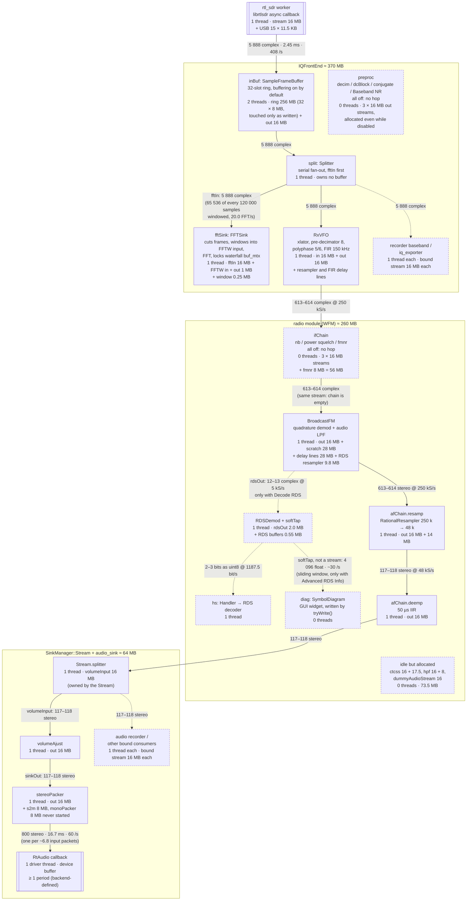
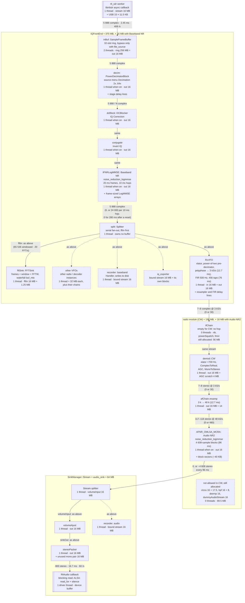

# SDRIAK DSP Pipeline: Threading, Buffering and Latency

Read from the tree of 2026-11-15. Every figure here was worked out from the
code. None was measured; §9 lists the probes that would
measure them.

This document follows samples from a source module through the IQ front end,
one VFO and the `radio` decoder to a sink module. It covers threads, hand-offs,
queues and latency, not the numerical DSP. What the buffers cost in memory is
in [buffer-size-requirements-current.md](buffer-size-requirements-current.md).

Scope is the desktop GUI receive path:

    source module -> IQFrontEnd -> RxVFO -> radio (IF chain, demod, AF chain)
                  -> SinkManager::Stream -> audio_sink -> RtAudio

Other sources and sinks appear only where they behave differently. `--server`
mode builds a different graph. There, `SourceManager::selectSource()` hands the
source stream to `server::setInput()` (compressor, handler sink, network), and
`IQFrontEnd` is not involved. That graph is not covered here.

---

## Summary

* **One thread per block, one packet per edge.** Every DSP block runs its own
  worker thread. Every connection between blocks is a `dsp::stream<T>`, a
  blocking, double-buffered single-producer/single-consumer hand-off that holds
  one published packet. Back-pressure is the only flow control.
* **Exceptions.** A few blocks break the one-thread rule:
  * `SampleFrameBuffer` is the input buffer. It runs 2 threads and a 32-slot
    ring, and it is **on by default**. Instead of blocking its writer, it drops
    data when the writer laps the reader.
  * `Prebuffer` is a jitter buffer on network sources, paced by a clock.
  * Driver callback threads sit at both ends.
* **Thread count.** WFM always starts a 2-thread RDS side branch, whether RDS
  is on or not. A default WFM session runs about 15 threads; NFM runs about
  12. Diagnostic displays (constellations, symbol scopes) cost no thread: the
  producing block feeds a `dsp::buffer::FrameTap` inline. Compared with
  upstream SDR++, the FFT branch runs 1 thread instead of 3 and the WFM RDS
  branch 2 instead of 5.
* **Two clocks, never reconciled.** The source paces the input and the audio
  device paces the output. Nothing in between resamples to make up for the
  difference. Clock drift ends in a drop (the input ring laps, or the driver
  overflows) or an underrun.
* **Latency builds up after stalls.** The whole chain is paced by the audio
  device, so a backlog that forms upstream drains no faster than the source
  refills it. A stall leaves its backlog behind as extra latency. That latency
  goes away only through a drop or a flush on play/stop (§6.4).
* **For narrow modes, filters dominate latency.** Every channel filter and
  resampler filter uses a transition band of 10 % of its cutoff, so its group
  delay is about 38/bandwidth seconds (§6.2). The DSP delay comes to:
  * about 2 ms for WFM,
  * about 8 ms for NFM,
  * about 17 ms for SSB,
  * **about 100 ms for 500 Hz CW**.
* **Other latency terms.** On top of the DSP delay:
  * audio packing and the device buffer add 25–50 ms,
  * source packetisation adds 2–5 ms for typical producers, but tens of ms for
    fixed-size producers at low sample rates,
  * the input ring adds 0 to about 155 ms, depending on its backlog,
  * network sources add 100–250 ms of prebuffer.

---

## 1. Primitives

### 1.1 `dsp::stream<T>` (`core/src/dsp/stream.h`)

Each stream holds two buffers, `writeBuf` and `readBuf`, each
`STREAM_BUFFER_SIZE` elements: 1 000 000, or 262 144 on 32-bit Android.
`setBufferSize()` resizes both and `capacity()` reports the size. Resizing is
for init time only, because it frees buffers a reader may still hold. Several
streams are sized to their actual bound instead of the constant, for
example the RDS branch; see
`buffer-size-requirements.md` §2.6.

The stream synchronises with two mutex/condition-variable pairs:

| side   | mutex / CV           | predicate   | stop flag    |
|--------|----------------------|-------------|--------------|
| writer | `swapMtx` / `swapCV` | `canSwap`   | `writerStop` |
| reader | `rdyMtx` / `rdyCV`   | `dataReady` | `readerStop` |

The protocol:

1. The writer fills `writeBuf`.
2. The writer calls `swap(n)`.
   * If `n > capacity()`, `swap()` aborts with a logged message. The write has
     already happened by then, so this detects an overflow but does not
     prevent it.
   * Otherwise it waits for `canSwap` or `writerStop`, swaps the two pointers,
     records `n`, clears `canSwap`, sets `dataReady` and wakes the reader.
   * It returns `false` if the stream was stopped.
3. The reader calls `read()`, which waits for `dataReady` or `readerStop`. It
   returns `n`, or -1 on stop. `read_for(timeout)` does the same but returns 0
   on timeout. Realtime audio callbacks and `Prebuffer` use it.
4. The reader consumes `readBuf`.
5. The reader calls `flush()`, which clears `dataReady`, sets `canSwap` and
   wakes the writer.

`stopWriter()` and `stopReader()` set the stop flags; `clearWriteStop()` and
`clearReadStop()` reset them. They never touch `dataReady`, so a packet
published before a stop is still waiting after the restart.

Two consequences:

* An edge holds one published packet. A producer that has finished its next
  packet waits in `swap()` until the consumer flushes. That is the whole
  back-pressure mechanism, and it travels upstream one block at a time.
* `flush()` is a separate call, so the consumer decides when the producer may
  continue. Ordinary blocks flush before they publish their own output (§1.2).
  Handler sinks flush only after their handler returns, so the handler's run
  time is passed straight back upstream.

### 1.2 `dsp::block` (`core/src/dsp/block.h`)

A block holds its registered input and output streams, one `std::thread`, and
a recursive `ctrlMtx`.

* **`start()`** sets `running` under `ctrlMtx` and calls `doStart()`. The
  default `doStart()` spawns `workerLoop()`, which is `while (run() >= 0) {}`.
  If `doStart()` throws, `recoverFailedStart()` joins any threads that did
  start.
* **`stop()`** takes `ctrlMtx` and calls `doStop()`. `doStop()` calls
  `stopReader()` on every input and `stopWriter()` on every output, joins the
  worker, then clears the flags. `stop()` also cancels any restart still owed
  by a pending `tempStart()`.
* **`tempStop()` / `tempStart()`** nest through `tempStopDepth`. Only the
  outermost pair stops and restarts the block, and only if it was running.
  These calls do not take `ctrlMtx` themselves. Callers lock `ctrlMtx` and use
  the RAII guard `dsp::block::TempStop`, which restarts the block in its
  destructor and logs a failure instead of throwing. `IQFrontEnd` uses a local
  `TempStopGroup` to do the same for a set of blocks.
* **`Processor<I,O>`'s destructor** stops the worker before the `out` stream
  is destroyed.

The standard `run()` is `OVERRIDE_PROC_RUN` in `core/src/dsp/processor.h`:

```cpp
int count = _in->read();              // wait for upstream
if (count < 0) return -1;             // stopReader()
process(count, _in->readBuf, out.writeBuf);
_in->flush();                         // release upstream first ...
if (!out.swap(count)) return -1;      // ... then wait for downstream
return count;
```

`OVERRIDE_MULTIRATE_PROC_RUN` skips the swap when a decimator produced
nothing.

The input is released before the output is published. A stalled chain can
therefore hold **up to two packets per edge**: one published and unread, and
one finished by the producer and waiting in `swap()`. When every consumer
keeps up, an edge holds close to nothing.

A stop that arrives while the worker is processing a packet, or waiting in
`swap()`, discards that packet. A packet that is published but not yet read
survives the stop. So a reconfiguration loses at most the one packet the
stopped block was working on. A `Splitter` stopped in the middle of fanning
out delivers that packet to the outputs before the stop and skips the rest.

### 1.3 `dsp::chain<T>` (`core/src/dsp/chain.h`)

A chain is an ordered list of optional `Processor<T,T>` blocks. A disabled
block is unlinked: it costs no thread and no hop. With every block disabled,
`chain.out` is simply the chain's input stream. Enabling or disabling a block
re-points its neighbour's input, which briefly stops that neighbour through
`setInput()`. When the last block changes, the chain also calls the
`onOutputChange` callback.

### 1.4 Blocks that run more than one thread, or pace themselves

| block                | file                         | threads | role                                                  |
|----------------------|------------------------------|---------|-------------------------------------------------------|
| `SampleFrameBuffer`  | `dsp/buffer/frame_buffer.h`  | 2       | front-end input ring (§2.2)                           |
| `Prebuffer`          | `dsp/buffer/prebuffer.h`     | 1       | clock-paced jitter buffer (§2.1)                      |
| `PrebufferedLink`    | `dsp/buffer/prebuffer.h`     | 1–2     | `Prebuffer` plus a `StreamLink`, with a live bypass   |

The opposite case is `dsp::buffer::FrameTap` (`dsp/buffer/frame_tap.h`): no
thread and no stream. A producer calls `push()` from its own `run()`, and the
tap hands a callback the last `keep` samples every `interval` samples, at
exact sample positions whatever the block size. Display callbacks use the
widgets' `tryWrite()`, which drops the frame if the UI holds the widget, so a
display can never stall the producer. The WFM RDS, POCSAG, Meteor, M17,
RyFi and weather-satellite scopes use it, and so do VOR's integration
windows.

---

## 2. The receive path

### 2.1 Source

The source module owns a `dsp::stream<complex_t>`, registered as
`SourceHandler::stream`, and writes into it from its own thread. Depending on
the module, that thread is:

* a driver callback (RtAudio, or a libusb-based device library),
* a worker thread of the module itself (`file_source`), or
* a network client thread.

That is usually one thread; network sources can have more.

* **Block sizes.** The per-producer table is in
  `buffer-size-requirements.md` §3. Two shapes matter for latency:
  * **`sampleRate / 200`**: 5 ms at any rate. Used by `audio_source`,
    `file_source`, sdrplay, limesdr, rtl_tcp and others.
  * **A fixed sample count**: hackrf 131 072, airspy 65 536, kiwisdr 512.
    The packet time of these grows as the sample rate falls. For example,
    hackrf is 6.5 ms at 20 MS/s but 65 ms at 2 MS/s.
  * **rtl_sdr** is neither. It uses `round(sr / 102400) × 512` bytes, which is
    about 2.5 ms at any rate: 5 888 samples at 2.4 MS/s, and 7 936 at
    3.2 MS/s, its maximum.
* **Network jitter buffer.** `kiwisdr_source` (default 250 ms) and
  `sdriak_server_source` ("RX prebuffer", default 100 ms, choices 0–1000 ms)
  route their decoded stream through `PrebufferedLink`. The `Prebuffer`:
  * collects samples up to the target,
  * then emits 10 ms slices paced by `steady_clock`,
  * drops the oldest samples beyond the target plus 40–100 ms of slack, and
  * starts priming again from empty when it runs out.

  A target of 0 bypasses it, leaving only the `StreamLink`. This is the only
  place where a local clock paces the IQ stream.
* **`file_source` has no pacing.** Its worker reads `sampleRate / 200` blocks
  and calls `swap()` as fast as they are accepted, so the playback rate comes
  from back-pressure alone, and in the end from the audio device clock. That is
  why `menuSelected()` turns the front-end input buffer **off** while the file
  source is selected, and `menuDeselected()` turns it back on.
  `SampleFrameBuffer` never blocks its writer, so with buffering on, the file
  would lap the ring. If the sink is draining into a null sink (no audio
  device), file playback runs as fast as the CPU allows.
* **`audio_source`.** The RtAudio input callback copies the samples and calls
  `swap()`, so the RtAudio thread blocks whenever the front end is behind.

`MainWindow::setPlayState()` starts and stops only the source. Every other
thread stays alive, blocked in `read()`. The input ring is flushed both when
playback starts and when it stops.

### 2.2 IQ front end (`core/src/signal_path/iq_frontend.{h,cpp}`)

`MainWindow::init()` builds and starts the front end before any source is
selected. It starts on a dummy stream at 8 MS/s. `SourceManager::selectSource()`
later calls `IQFrontEnd::setInput()`, which re-points `inBuf`.

**1. `inBuf`: `SampleFrameBuffer<complex_t>`, always 2 threads.**

The source comment reads "THIS IS TRASH AND MUST BE REWRITTEN". Its two
threads:

* `workerThread` runs `run()` and reads from the source.
  * In bypass mode it copies the packet into `out`, flushes, and swaps
    downstream, so ordinary back-pressure applies.
  * In buffering mode it copies the packet into slot `writeCur` of a ring of
    32 × `STREAM_BUFFER_SIZE` elements, advances `writeCur` modulo 32,
    notifies, and flushes. **It never waits for free space.**
* `readWorkerThread` waits until `writeCur != readCur`, copies slot `readCur`
  into `out`, and swaps downstream. In bypass mode it waits forever.

**Buffering is on by default**: `MainWindow::init()` passes `buffering = true`,
and only `file_source` turns it off.

The ring cannot tell full from empty. Depth is `(writeCur − readCur) mod 32`,
so 32 unread packets look like none. If the consumer falls 32 source packets
behind, the writer laps it:

1. The consumer sees an empty ring and waits.
2. The next write leaves exactly one readable slot.
3. The 31 packets queued behind that slot are skipped.

So under overload this block drops about 31 packets at once instead of pushing
back on the source, and the source driver never learns that anything stalled.
The ring allocates 32 × `STREAM_BUFFER_SIZE` complex samples: 256 MB at the
desktop constant, or 64 MB on 32-bit Android. The memory is touched only as
slots are written.

**2. `preproc` chain: one thread per enabled block.**

* `decim`, a power-of-two decimator, enabled when the source menu's
  decimation is above 1.
* `dcBlock`, enabled by the "IQ Correction" setting; off by default.
* `conjugate`, which inverts IQ; off by default.
* External blocks added with `IQFrontEnd::addPreprocessor()`, such as the
  wideband IF noise reduction in `noise_reduction_logmmse`.

**3. `split`: `Splitter<complex_t>`, 1 thread.**

For each bound output, in bind order, the splitter copies the packet and then
calls `swap()`. Because it writes **serially**, a single stalled consumer
stalls all the others and pushes back upstream.

* **Bind order:** `fftIn` (bound in `init()`), then each VFO as it is created,
  then extra consumers such as the recorder's baseband stream or
  `iq_exporter`.
* `bindStream()` and `unbindStream()` briefly stop the splitter. Adding a VFO
  or starting a baseband recording therefore pauses every consumer for a
  moment.
* The recorder writes baseband to disk inside its handler sink's thread, so a
  slow disk stalls the splitter.

**4. FFT branch.**

* **`fftSink`: `IQFrontEnd::FFTSink`, 1 thread: the whole branch.** It reads
  `fftIn` straight off the splitter.
  * `processFFTInput()` cuts frames. It multiplies each sample of the
    current frame by its window coefficient as it copies it into the FFTW
    input buffer, which is the only copy on this path. It then drops `skip`
    samples by counting, without touching them. A frame can span any
    number of input packets.
  * `genFrameParams()` computes the geometry: `interval = round(rate /
    fftRate)`, `keep = min(interval, fftSize)`, `skip = interval − keep`.
    Frames never overlap; when `keep < fftSize` the FFT is zero-padded.
  * The defaults in effect are an FFT size of 65 536, a rate of 20 Hz and a
    Nuttall window. These are core config defaults, which the Display menu
    applies during startup. They replace the 1024 that `MainWindow::init()`
    passes.

  | input rate | interval | keep                          | skip    |
  |------------|----------|-------------------------------|---------|
  | 8 MS/s     | 400 000  | 65 536                        | 334 464 |
  | 2.4 MS/s   | 120 000  | 65 536                        | 54 464  |
  | 48 kHz     | 2 400    | 2 400 (zero-padded to 65 536) | 0       |

* **`runFFT()`**, on the same thread, once per full frame: `fftwf_execute`,
  then a power spectrum straight into the waterfall's buffer.
  `WaterFall::getFFTBuffer()` locks the waterfall's `buf_mtx`, and
  `pushFFT()` releases it after zoom, colouring and level metering. The UI
  thread takes the same `buf_mtx` while it renders and resizes.

  **The FFT path sits in series with the audio path.** When the UI holds
  `buf_mtx`, `fftSink` stalls and stops reading `fftIn`, which stalls
  `split`, which starves every VFO.

`updateFFTPath()` briefly stops `fftSink` and starts the next frame from
scratch. It does not touch the VFOs.

**5. `RxVFO` (`core/src/dsp/channel/rx_vfo.h`): 1 thread per VFO.**

* `RxVFOKernel` fuses three stages and runs them in place on `out.writeBuf`,
  so the whole channeliser costs a single hand-off:
  1. `FrequencyXlator`
  2. `RationalResampler`: a power-of-two pre-decimator, then a polyphase stage
  3. an optional FIR, used only when the bandwidth differs from the output
     rate
* `setOffset()` publishes an atomic into the xlator, and `setBandwidth()`
  takes the kernel's `filterMtx`. Both run while the worker runs, so tuning
  does not stall the IQ chain.
* `setInSamplerate()`, `setOutSamplerate()` and `reset()` briefly stop the
  VFO.

### 2.3 Radio decoder (`decoder_modules/radio/src/radio_module.h`)

Each radio instance gets its VFO through `vfoManager.createVFO()`, which calls
`IQFrontEnd::addVFO()`; that starts the `RxVFO` immediately.

**1. `ifChain` (`complex_t`).** Each block costs one thread while enabled, and
all are off by default:

* `nb`, the noise blanker, offered only by demodulators that allow it
* `powerSquelch`, used by squelch mode "Power"
* `fmnr`, FM IF noise reduction

**2. Demodulator.** Each demodulator is one block: `FM`, `BroadcastFM`, `AM`,
`SSB`, `CW`, or RAW's `ComplexToStereo`. Its internal stages are fused into
`process()`. `selectDemodByID()` destroys the old demodulator and builds a new
one. Meanwhile the AF chain's input is parked on `dummyAudioStream`.

**WFM side branch** (`demodulators/wfm.h`). `WFM::start()` always starts two
more blocks, two threads in all:

* `rdsDemod` (`RDSDemod`): 1 thread
* `hs` (`Handler<uint8_t>`, which feeds the RDS decoder): 1 thread

`BroadcastFM` publishes `rdsOut` only while "Decode RDS" is on. While
"Advanced RDS Info" is on, `RDSDemod` also pushes its soft symbols into
`softTap`, a `FrameTap` that hands the symbol diagram a 4 096-symbol sliding
window about 30 times a second through `tryWrite()`. Otherwise the branch
sits idle in `read()`. Its stream and buffers are sized for its 5 kHz rate.

**3. `afChain` (`stereo_t`).** Blocks, in order:

* `ctcss`: CTCSS squelch modes. It contains its own fused VFO kernel.
* `resamp`: `RationalResamplerBlock`, converting the demodulator's AF rate to
  the audio rate. It is on for every demodulator whose post-processing is
  enabled, which is all except RAW.
* `hpf`: the "High Pass" option; off by default.
* `deemp`: de-emphasis. Default is 50 µs for WFM and none for the other modes.
* Blocks injected with `RADIO_IFACE_CMD_ADD_TO_AFCHAIN`, such as
  `noise_reduction_logmmse`'s OMLSA.

RAW disables the whole chain. `setAudioSampleRate()` stops the whole AF chain
while it retunes the resampler, the high-pass filter and de-emphasis.

### 2.4 Sink

**`SinkManager::Stream`** (`core/src/signal_path/sink.{h,cpp}`): one per
radio.

1. `splitter` (`Splitter<stereo_t>`, 1 thread) feeds the provider's input,
   `volumeInput`, plus any extra consumers bound through
   `SinkManager::bindStream()`, such as the audio recorder.
2. `volumeAjust` (`dsp::audio::Volume`, 1 thread) applies a gain of v² and
   handles mute. Its source comment reads "This block is useless and weird,
   get rid of it".
3. The provider's `Sink` object reads `stream->sinkOut`, which is
   `volumeAjust.out`. The default provider, "None", is a `NullSink` that
   drains the stream and reports 48 kHz.

**`audio_sink`** (`sink_modules/audio_sink/src/main.cpp`):

* **`stereoPacker`** (`Packer<stereo_t>`, 1 thread) collects samples into
  fixed blocks of one RtAudio period. The requested period is `sampleRate /
  60`, which is 800 frames or 16.7 ms at 48 kHz, with
  `RTAUDIO_MINIMIZE_LATENCY`. RtAudio may change the period, and the packer
  adopts whatever value it returns.
* **`s2m` and `monoPacker`** are built but never started. `doStop()` stops
  them, which is harmless.
* **The callback** runs on RtAudio's driver thread, and behaves differently by
  backend:
  * **Everything except ALSA:** it calls `stereoPacker.out.read()`, which
    blocks, so the callback waits for the DSP chain.
  * **ALSA:** it calls `read_for(period / 4)` and writes silence on timeout,
    because ALSA does not recover from an XRUN caused by a blocked callback.
  * **Both:** a stopped stream (-1) produces silence, and a short packet is
    zero-padded (`emitFrames`).
* **Start order** is `openStream`, `setSampleCount`, `startStream`, and only
  then `stereoPacker.start()`. The first callback can therefore run before the
  packer does. It blocks, or writes silence on ALSA.
* **Without a device**, or if the device fails to open, a `dsp::sink::Null`
  drains `sinkOut`. This keeps everything upstream flowing, including the
  waterfall through the IQ splitter. The drain is unpaced.
* **Each radio stream** routed to "Audio" gets its own `AudioSink`, with its
  own RtAudio stream and its own callback thread.

Other providers:

| provider               | packing                                     | device side                                                                                                  |
|------------------------|---------------------------------------------|--------------------------------------------------------------------------------------------------------------|
| `macos_coreaudio_sink` | `stereoPacker`, period `sr/60` (device may override) | AudioUnit callback with a blocking `read()`; null drain when there is no device                      |
| `android_audio_sink`   | packer = one Oboe burst; device buffer 2 × burst | callback mode: a producer thread fills a FIFO and the realtime callback never blocks and zero-fills; or blocking-write mode |
| `new_portaudio_sink`   | packer `sr/60`                              | PortAudio callback                                                                                           |
| `network_sink`         | n/a                                         | network output                                                                                               |

### 2.5 Noise reduction plug-in (`misc_modules/noise_reduction_logmmse`)

This module, ported from SDR++Brown, inserts one block into the front end and
one into each radio. Each costs one thread while enabled and nothing while it
is only inserted.

**Baseband NR (`IFNRLogMMSE`, `if_nr.h`) sits in the front end.**

* **Insertion.** `IQFrontEnd::addPreprocessor()` adds it disabled. The
  "Baseband NR" checkbox switches it with `togglePreprocessor()`.
* **Position.** `chain::addBlock()` appends, so the block sits last in
  `preproc`, after `decim`, `dcBlock` and `conjugate`. It therefore filters
  the IQ stream ahead of the splitter, which means the waterfall, every VFO
  and baseband recordings all see the denoised signal.
* **Rate.** It runs at the effective IQ rate, after decimation, and resets
  when that rate changes.
* **Algorithm.** LogMMSE with a 20 ms frame and 50 % overlap, which
  advances in 10 ms hops. At 2.4 MS/s a frame is 48 000 samples and each hop
  is a 96 000-point forward and inverse FFT.
* **Packets.**
  * It holds back 20–30 ms of input: 48 000 to 72 000 samples at 2.4 MS/s.
  * It emits only whole hops. At 2.4 MS/s that is 24 000 samples about every
    fourth 5 888-sample input packet.
  * Every other input packet produces a zero-length `swap()`. The splitter,
    the FFT sink and the VFOs are woken by it and do nothing.
* **Reset.** A reset happens on `doStart()`, on a rate change, and on every
  source retune (`sourceManager.onRetune`). A retune means a centre-frequency
  change, not a VFO drag. After a reset:
  1. It collects a noise profile of 14 frames of 10 ms each, twice over:
     672 000 samples, or **280 ms** at 2.4 MS/s.
  2. It emits nothing meanwhile, so the audio starves.
  3. It then releases the backlog in one burst of about 624 000 samples
     (≈ 260 ms). On 32-bit Android the burst is capped at the stream
     capacity.
* **The burst in a device-paced chain.** Downstream of this block the chain
  is paced by the audio device, so by §6.4 the burst should become extra
  latency that does not drain. It is larger than the input ring holds (31
  packets, or 76 ms for an RTL), so the ring should lap until the backlog
  fits. **Each retune with Baseband NR on should therefore give a gap of
  about 280 ms followed by drop glitches.** This is derived from the code, not
  observed.
* **Watchdog.** A CPU watchdog switches the block off after two consecutive
  400 ms windows above 95 % CPU, unless `DisableCpuDeactivation` is set.

**Audio NR2 (`AFNR_OMLSA_MCRA`, `af_nr.h`) sits in each radio.**

* **Insertion.** `attachAFToRadio()` sends `RADIO_IFACE_CMD_ADD_TO_AFCHAIN` to
  every radio, including radios created later (`onInstanceCreated`). It sends
  `ENABLE_IN_AFCHAIN` only when `AF_NR2_<radio>` is set.
* **Position.** The block is appended to `afChain`, after `deemp`, and so runs
  at the audio rate, just before `Stream.splitter`. It is offered for every
  mode, CW included.
* **Algorithm.** OMLSA-MCRA works on 16-bit fixed point. Its analysis window
  is 1 024 samples with a 512-sample hop at 48 kHz, and 256 with a 128 hop
  below 23 kHz.
* **Blocks.** The block collects 3 × 1.5 windows before it processes, which
  is **4 608 samples, or 96 ms, at 48 kHz**.
  * Until it has that many, it emits zero-length packets.
  * Once it has them, it emits one burst, which the packer splits into about
    5.8 periods.
  * **Added delay:** up to about 96 ms of block granularity, plus whatever the
    OMLSA engine buffers internally.
* **Mono.** It processes the left channel only and copies the result to the
  right, so stereo WFM becomes mono.
* **Stale sample rate (defect).** `setAudioSampleRate()` is called only in
  `attachAFToRadio()`. A later change of the sink's rate, from a different
  device or sample-rate setting, is not passed on.

---

## 3. Diagram, with the packet sizes on each edge

Every edge is a `dsp::stream<T>`. Each edge label gives the packet one
`swap()` hands over in a concrete default session:

* RTL-SDR at 2.4 MS/s. Its block is `round(sr / 102400) × 512` bytes, which is
  5 888 complex samples, or 2.45 ms.
* Decimation, DC blocking and IQ inversion off, so `preproc` is empty.
* FFT size 65 536 at 20 Hz.
* One radio in WFM: mono, RDS off, 50 µs de-emphasis.
* `audio_sink` at 48 kHz, with RtAudio granting the requested 800-frame
  period.

Packet sizes fall with the rate. Every packet still covers the source's
2.45 ms, until the FFT sink and the packer regroup them. A ratio that does not
divide evenly gives counts that alternate by one (613/614), because the
resampler carries its phase from one packet to the next. Blocks drawn with
dashed borders are optional or idle in this session.

Each node also carries **threads · memory it allocates**, for the desktop
`STREAM_BUFFER_SIZE` of 1 000 000. The unit costs and the RadioModule and WFM
figures come from `buffer-size-requirements-current.md` §3: a `complex_t` or
`stereo_t` stream is 16 MB (two 8 MB buffers), a `float` stream 8 MB, a
scratch `Buffer<complex_t>` 8 MB. A block's memory is its own output stream
plus its internal buffers; a stream is charged to the block or object that
owns it, which for a splitter's outputs is the consumer. On 32-bit Android
every default-size figure shrinks to 26 % (capacity 262 144). "Delay lines"
marks history buffers that document has not counted yet.



**Totals for this session**, without the dashed consumers: **15 threads** (§4.1)
and **≈ 710 MB of allocations**:

| part | MB | note |
|---|---|---|
| source stream | 16 | plus librtlsdr's 15 USB transfers, ≈ 0.2 MB |
| `inBuf` | 272 | 256 MB of it is the ring, untouched until written |
| `preproc` streams | 48 | `decim`, `dcBlock`, `conjugate`, whether enabled or not |
| FFT branch | 17 | `fftIn` 16, FFTW buffers and window 1.25 |
| `RxVFO` | 32 + delay lines | input and output streams; the output carries 613 of its 1 000 000 elements |
| RadioModule | 175.5 | `buffer-size-requirements-current.md` §3.3 gives 207.5 including the two sink streams, which are counted in the next-but-one row; 73.5 MB is idle in WFM |
| WFM demodulator | 84 | §3.2 there, RDS branch included |
| sink side | 64 | `volumeInput`, `volumeAjust.out`, packer, and the never-started mono pair |
| waterfall history | not counted | owned by the GUI, sized by the window |

Nearly all of it is headroom. Most full-rate streams and buffers are sized for
`STREAM_BUFFER_SIZE` (the rate-sized RDS stream and buffers are the
exceptions) while the largest packet is 65 536 samples, and the input ring alone, a third
of the total, is 256 MB because each of its 32 slots holds a full
`STREAM_BUFFER_SIZE` against a 5 888-sample packet.
Each further radio routed to "Audio" adds 7 threads (10 for WFM) and about
32 (VFO) + 175.5 + 64 MB, plus its demodulator.

The same edges in a table, with each stream's allocated capacity. The
capacity is what each of its two buffers holds. Most streams still use the
default `STREAM_BUFFER_SIZE` (1 000 000, or 262 144 on 32-bit Android), so a
packet uses a small fraction of it.

| edge (stream) | element | packet | rate | capacity |
|---|---|---|---|---|
| rtl_sdr → `inBuf` | `complex_t` | 5 888 | 408 /s | default |
| `inBuf.out` → `split` | `complex_t` | 5 888 | 408 /s | default; the ring behind it is 32 × default |
| `split` → `fftIn` → `fftSink` | `complex_t` | 5 888 | 408 /s | default; `fftSink` cuts its 65 536-sample frames itself, 20 /s |
| `split` → VFO input | `complex_t` | 5 888 | 408 /s | default |
| `RxVFO.out` → demodulator | `complex_t` | 613–614 | 408 /s | default; the xlator writes the full 5 888-sample block into it before resampling |
| `BroadcastFM.out` → `resamp` | `stereo_t` | 613–614 | 408 /s | default |
| `BroadcastFM.rdsOut` → `RDSDemod` | `complex_t` | 12–13 | 408 /s, RDS on | sized to the RDS resampler's workspace bound |
| `RDSDemod.out` → `hs` | `uint8_t` | 2–3 | 408 /s, RDS on | maximum RDS block (≈ 20 000) |
| `RDSDemod` → `softTap` → `diag` | `float` | 4 096 | ~30 /s, advanced RDS on | not a stream: inline push into a 2 × 4 096 history, then `tryWrite()` |
| `resamp.out` → `deemp` | `stereo_t` | 117–118 | 408 /s | default |
| `deemp.out` → `Stream.splitter` | `stereo_t` | 117–118 | 408 /s | default |
| `volumeInput` → `volumeAjust` | `stereo_t` | 117–118 | 408 /s | default |
| `sinkOut` → `stereoPacker` | `stereo_t` | 117–118 | 408 /s | default |
| `stereoPacker.out` → callback | `stereo_t` | 800 | 60 /s | default |

How the other modes compare, with the same source and sink:

* **NFM.** The VFO emits 122–123 complex samples at 50 kS/s, and the FM
  demodulator passes the same count through as `stereo_t`. The AF resampler
  turns that into 117–118 samples at 48 kS/s. There is no RDS branch and no
  de-emphasis hop.
* **USB/LSB.** 58–59 samples at 24 kS/s, then 117–118 samples at 48 kS/s.
* **CW.** 7–8 samples at 3 kS/s, then 117–118 samples at 48 kS/s.

The audio-side count follows from the source's packet duration alone: 2.45 ms
at 48 kHz is 117.8 samples. A `sampleRate / 200` source instead gives 5 ms
packets, which means 240 audio samples per packet and 3.3 packets per
period.

### 3.1 CW, with every block that can be in the path

The same RTL-SDR at 2.4 MS/s, with the radio in CW: 3 kS/s IF, 500 Hz
bandwidth, 700 Hz tone. Every optional block that can apply to CW is drawn
with a dashed border. Where Baseband NR changes a packet size, the label gives
the figure without it, then the figure with it in parentheses.

Selecting CW makes `RadioModule::selectDemod()` switch off every block that
`demod::CW` does not allow. That covers `nb`, `powerSquelch` and `fmnr` in the
IF chain, and `ctcss`, `hpf` and `deemp` in the AF chain, so none of them
appears below. The radio interface's `SET_SQUELCH_MODE` and `SET_HIGHPASS`
handlers do not check those flags, but nothing in the tree sends either
command.



**Threads and memory.** With no optional block on, CW runs **12 threads**
(the WFM count of §4.1, without the 2-thread RDS branch and `deemp`) and
allocates **≈ 645 MB**: 16 source, 370 front end, 196 radio, 64 sink. The
`decim`, `dcBlock` and `conjugate` streams are in the front-end figure
whether or not they run. Turning on every dashed block in the front end and
the radio adds 7 threads (`decim`, `dcBlock`, `conjugate`, Baseband NR,
Audio NR2, and one each for the baseband and audio recorders) and about
64 MB (the two NR output streams and the two recorders' streams), before
the work arrays of the two NR blocks and before other VFOs and `iq_exporter`.
In CW, 145.5 MB of the radio's 196 MB belongs to blocks the mode forbids.

**Delay budget with every block in the path.** All figures are derived from
the code.

| stage                              | delay        |
|------------------------------------|--------------|
| packetisation                      | 2.5 ms       |
| Baseband NR hold-back              | 20–30 ms     |
| VFO resampler + FIR + AF resampler | 101 ms       |
| Audio NR2 blocks                   | 0–96 ms, plus OMLSA internal buffering |
| sink side                          | 25–50 ms     |
| **total**                          | **≈ 150–280 ms** |

Add any input-ring backlog on top. With Baseband NR on, every retune adds
the reset sequence from §2.5.

---

## 4. Threads

### 4.1 Inventory

The counts assume one source, one radio module and `audio_sink`.

| component                    | threads           | notes |
|------------------------------|-------------------|-------|
| source module                | usually 1         | driver callback, module worker or client thread; some network sources add more, and `Prebuffer` adds 1 |
| `inBuf` (`SampleFrameBuffer`)| 2                 | both started always; the second sits idle in bypass |
| `preproc`                    | 0 by default      | one per enabled block |
| IQ `split`                   | 1                 | serial fan-out |
| `fftSink`                    | 1                 | frame cutting, window, FFT, waterfall update |
| `RxVFO`                      | 1 per VFO         | fused channeliser |
| `ifChain`                    | 0 by default      | one per enabled block |
| demodulator                  | 1                 | main audio output |
| WFM RDS branch               | 2                 | WFM only; idle unless RDS is on. The diagnostic display adds no thread |
| `afChain`                    | 1 + options       | `resamp` always on (except RAW); `deemp` on by default for WFM; `ctcss`, `hpf` and injected blocks when enabled |
| `Stream.splitter`            | 1                 | |
| `volumeAjust`                | 1                 | |
| `stereoPacker`               | 1                 | `s2m` and `monoPacker` are never started |
| RtAudio callback             | 1, driver-owned   | |

Default totals:

* **WFM**, the radio's default mode (mono, RDS off, 50 µs de-emphasis): 1
  (source) + 2 (`inBuf`) + 1 (`split`) + 1 (FFT branch) + 1 (`RxVFO`) + 3
  (demodulator plus RDS branch) + 2 (`resamp` + `deemp`) + 2 (stream splitter
  + volume) + 1 (packer) + 1 (callback) = **15**.
* **NFM** (no de-emphasis, no RDS branch): **12**.
* **Each additional radio** routed to "Audio" adds `RxVFO`, demodulator,
  `resamp`, stream splitter, volume, packer and its own RtAudio callback:
  **7 threads**, or 10 for WFM.

Not counted: the main UI/render thread; the single shared `ConfigSaver`
autosave thread (`core/src/config.cpp`), which serves every `ConfigManager`;
and module-specific helpers such as the rigctl server and network clients.

### 4.2 Synchronisation

* **Data flow** uses only the stream mutex/CV pairs. There is no scheduler,
  no thread pool, and no lock-free queue on the desktop path.
* **Control** uses:
  * each block's `ctrlMtx`
  * `RxVFOKernel::filterMtx` and the xlator's atomic offset
  * `SampleFrameBuffer::bufMtx`
  * the waterfall's `buf_mtx`, which the FFT handler shares with the UI
    thread (§2.2)
* **Reconfiguration comes from more than one thread.** The UI thread and the
  rigctl network thread both reconfigure the graph; see issue #1437 and
  [ui-thread-sync.md](../bugs/ui-thread-sync.md).

### 4.3 Lifecycle and reconfiguration

**Startup.**

1. `MainWindow::init()` initialises and starts `IQFrontEnd` on a dummy
   stream.
2. Modules are created. Each radio:
   1. creates its VFO, which starts the `RxVFO`;
   2. registers its `SinkManager::Stream`, which creates the provider set in
      the config;
   3. selects a demodulator, which starts it;
   4. starts `ifChain` and `afChain`;
   5. starts the stream, which starts the splitter, the volume block and the
      provider.
3. Sources start only when playback starts.

**Reconfiguration.** What each operation stops while it runs:

| operation | stops |
|-----------|-------|
| `core::setInputSampleRate()` → `IQFrontEnd::setSampleRate()` | `dcBlock` and every `RxVFO` (as one group), plus the FFT branch (`updateFFTPath()`) |
| `setDecimation()` | `decim`, then as above, then relinks `preproc` |
| DC block, invert IQ, preprocessor toggle | the chain neighbour, and `split` through `setInput()` |
| VFO offset, VFO bandwidth | nothing; both run alongside the worker |
| VFO output rate (on a demodulator switch) | that `RxVFO` |
| `bindIQStream()` / `unbindIQStream()`, `addVFO()` / `removeVFO()` | `split` |
| FFT size, rate or window | `fftSink` |
| demodulator switch | the old demodulator is destroyed; the new one is built, wired and started |
| audio sample rate change | the whole `afChain` |
| sink device or rate change | the provider (`doStop()` / `doStart()`) |

Known quirks:

* **`IQFrontEnd::setBuffering()` writes `inBuf.bypass` while both workers are
  running.** `bypass` is a plain `bool`, so this is a data race, and a packet
  in flight at the moment of the switch may take either path.
* **`audio_sink` starts RtAudio before its packer** (§2.4).
* **A reconfiguration costs at most one packet** at the block it stops
  (§1.2).

---

## 5. Buffers and queue depths

| buffer | allocation | maximum occupancy | when full |
|--------|------------|-------------------|-----------|
| `dsp::stream<T>` | 2 × `capacity()` | 1 published packet, plus 1 waiting in the producer | writer blocks |
| `SampleFrameBuffer` ring | 32 × `STREAM_BUFFER_SIZE` | 31 packets | **writer laps; up to 31 packets lost** |
| `FrameTap` history | 2 × `keep` | `keep` samples | never full: oldest samples overwritten |
| `Packer` | uses its `out` stream | less than one period being filled, plus 1 published | writer blocks in `out.swap()` |
| `Prebuffer` ring | target + slack | target + 40–100 ms | oldest samples dropped |
| audio device | backend-defined | at least 1 period | n/a |

`Packer::run()` can publish several output periods from one input packet.
Each `swap()` blocks on its own, so the packer passes the device's
back-pressure upstream.

---

## 6. Latency

### 6.1 Model

```
latency = source packetisation   (one packet time at worst, half on average)
        + network prebuffer      (network sources only: 100 / 250 ms default)
        + input ring             (0 .. 31 packets when buffering is on; §6.4)
        + DSP group delay        (channel filter, resamplers, demod filters; §6.2)
        + audio packing          (0 .. 1 period filling, plus up to 1 period
                                  waiting for the callback)
        + device buffer          (at least 1 period, often 2)
        + hand-off and compute   (microseconds per edge, about 10 edges
                                  on the audio path)
```

The per-edge streams do not add a packet each when the chain keeps up. They
limit how much an edge can hold (§1.2) and only fill up in overload.

### 6.2 DSP group delay

Every low-pass filter on the receive path comes from `taps::lowPass(cutoff,
0.1 × cutoff, fs)`. Its tap count is `estimateTapCount(tw, fs) = 3.8 × fs /
tw`. A linear-phase FIR delays by (N − 1)/2 samples. Two cases cover the whole
path:

* **Channel filters.** A filter for bandwidth B has cutoff B/2, so N =
  76 × fs / B and the delay is **≈ 38 / B seconds**, whatever the sample rate.
  This covers the VFO FIR, the FM audio low-pass and the AM low-pass.
* **Resampler filters.** The rational resampler's polyphase filter has cutoff
  min(in, out)/2 with the same 10 % transition, so it delays by **≈ 38 /
  min(in, out) seconds**. The stage is skipped when the ratio is an exact
  power of two.

The pre-decimator's power-of-two stages are short and are left out below. All
figures are in milliseconds, at default bandwidths and 48 kHz audio:

| mode    | IF rate | default BW | VFO resampler | VFO FIR | demod filters                                  | AF resampler | **total** |
|---------|---------|------------|---------------|---------|------------------------------------------------|--------------|-----------|
| WFM     | 250 k   | 150 k      | 0.15          | 0.25    | 0.47 audio LPF (+0.63 pilot delay in stereo)   | 0.79         | **≈ 1.7** (2.3 stereo) |
| NFM     | 50 k    | 12.5 k     | 0.76          | 3.0     | 3.0 audio LPF ("Low Pass", on by default)      | 0.79         | **≈ 7.6** |
| AM      | 15 k    | 10 k       | 2.5           | 3.8     | 3.8 LPF                                        | 2.5          | **≈ 12.7** |
| DSB     | 24 k    | 4.6 k      | 1.6           | 8.3     | none                                           | 1.6          | **≈ 11.5** |
| USB/LSB | 24 k    | 2.8 k      | 1.6           | 13.6    | none                                           | 1.6          | **≈ 16.8** |
| CW/CWR  | 3 k     | 500        | 12.7          | 76      | none                                           | 12.7         | **≈ 101** |

Optional AF blocks add to this. "High Pass" is `highPass(300, 100, 48000)`, a
1 824-tap filter that adds **19 ms**. De-emphasis is a single-pole IIR and
adds almost nothing.

For CW, the filters are far sharper than the signal needs. The resamplers
protect a 1.5 kHz passband with a 150 Hz transition around a 500 Hz signal,
and the 500 Hz VFO filter uses a 25 Hz transition. §7 item 1 covers this.

### 6.3 Worked totals

These assume desktop `audio_sink` at 48 kHz, an RTL-SDR at 2.4 MS/s (2.45 ms
packets, as in §3), and an input ring with no backlog. The sink side is 0–16.7 ms of
packer fill, 0–16.7 ms waiting for the callback, and 16.7–33 ms of device
buffer: roughly **25–50 ms**.

| mode          | packetisation | DSP | sink side | **total**       |
|---------------|---------------|-----|-----------|-----------------|
| WFM           | 2             | 2   | 25–50     | **≈ 30–55 ms**  |
| NFM           | 2             | 8   | 25–50     | **≈ 35–60 ms**  |
| USB           | 2             | 17  | 25–50     | **≈ 45–70 ms**  |
| CW (500 Hz)   | 2             | 101 | 25–50     | **≈ 130–155 ms** |

Add to these:

* the input-ring backlog: up to 31 packets, which is 76 ms for this RTL and
  155 ms for a `sampleRate / 200` source;
* the network prebuffer, for KiwiSDR and the SDRIAK server;
* packetisation for fixed-size producers at low rates (§2.1);
* Baseband NR: 20–30 ms, plus its reset behaviour on every retune (§2.5);
* Audio NR2: up to about 96 ms at 48 kHz (§2.5). The CW figures with both
  NR blocks enabled are in §3.1.

### 6.4 Latency builds up after stalls

Downstream of the source, every block blocks; nothing drops. The callback
consumes one period per device period, so **the whole chain runs at the audio
device's rate**. The only exception is a null-drain sink, which runs unpaced.
Any backlog that forms upstream therefore drains only as fast as the source
refills it, which is to say never, if the two clocks are equal.

So with buffering on, the input ring's depth is set by history, not by load.
The ring absorbs each of these stalls, and the stall's length then stays in it
as extra latency:

* a demodulator switch
* a VFO reconfiguration
* a long UI critical section on `buf_mtx`
* a slow recorder disk
* a sample-rate change

The backlog changes only through:

* **clock drift**. If the source runs fast, the ring fills up to a lap, which
  drops 31 packets as one glitch. If it runs slow, the ring empties and the
  callback underruns. At ±50 ppm on each side (100 ppm, or 0.1 ms per second,
  in the worst case), the RTL case above can go from empty to a lap in about
  13 minutes.
* **a flush** when playback starts or stops.

With buffering off, the same backlog sits in the source driver's queue
(libusb transfers, RtAudio buffers) instead. That queue is smaller, so the
excursion is shorter, and it drops sooner. Only the network `Prebuffer` puts a
limit on itself: it drops its oldest samples beyond the target plus slack.

### 6.5 How variable the pipeline is

* **Topology changes at runtime.**
  * Source selection re-points `inBuf`.
  * Adding or removing a VFO adds or removes a splitter output, an `RxVFO`,
    and usually a whole decoder and sink path.
  * Chain blocks can be enabled and disabled.
  * A demodulator switch rebuilds the demodulator subgraph.
  * Sink providers can be swapped, which changes the final buffering and
    thread model.
  * Extra consumers can bind to either splitter.
* **Two cadences.** Each source publishes at its own packet size and clock;
  the device consumes at its own period and clock. `fftSink` adds a third
  cadence on the FFT branch, and `FrameTap` one per diagnostic display.
* **Jitter sources:**
  * driver delivery
  * OS scheduling of about 15 threads, each woken through a condition
    variable
  * the serial splitter, where one slow consumer delays all of them
  * the FFT handler's lock on the UI
  * the blocking audio callback on backends other than ALSA

---

## 7. Ways to lower latency

Ordered by payoff for the effort.

1. **Narrow-mode filters.** These are the largest term for CW and SSB (§6.2).
   * Size the transition band from the IF rate instead of the cutoff. For
     example, a 300 Hz transition at CW's 3 kHz IF cuts the VFO FIR from about
     76 ms to about 6 ms.
   * Let the resamplers' cutoff follow the channel bandwidth instead of
     min(in, out)/2. That would bring CW from about 100 ms of DSP delay to
     about 10–20 ms.
   * The trade-off is selectivity and alias rejection, and it has to be
     judged by ear and on a spectrum.
   * A minimum-phase or IIR channel filter for CW is the other route.
   * The "High Pass" filter's 100 Hz transition (19 ms) is a smaller case of
     the same problem.
2. **Input ring.**
   * Default to bypass for live hardware sources, or
   * replace `SampleFrameBuffer` with a bounded SPSC ring that has:
     * explicit full/empty state,
     * a deliberate policy for trimming back to a target depth, which fixes
       the build-up in §6.4, and
     * a drop counter.
   * Either way, `file_source` must keep a back-pressuring path, because
     pacing depends on it (§2.1).
3. **Audio sink period.** Move from `sampleRate / 60` to `/120` or `/240`,
   wherever the backend tolerates the higher wake-up rate.
4. **Start the packer before RtAudio**, or fill one period in advance.
5. **Source packet sizes.** Scale the transfer size with the sample rate for
   the fixed-size producers (hackrf, airspy, rtl_sdr) at low rates.
6. **Take the FFT out of series with the audio.**
   * Let the FFT branch drop when it falls behind instead of blocking `split`.
   * Shorten `buf_mtx` hold times in the waterfall.
   * Binding VFOs before `fftIn` would help with a slow FFT but not with a
     hard stall.
7. **Clock-drift compensation.** An adaptive resampler at the sink, steering
   toward a target occupancy, would let latency correct itself and replace
   drift glitches with an inaudible rate trim.
8. **Non-blocking callbacks everywhere.** ALSA and the Android Oboe callback
   mode already avoid blocking. The other backends still block; the code
   comment argues this gives lower latency there.
9. **Thread-count reductions.** These buy little latency but cut scheduling
   noise:
   * start the WFM RDS branch only when RDS is enabled (5 threads);
   * fold `Volume` into the stream splitter or the last AF stage;
   * delete `s2m` and `monoPacker` from `audio_sink`;
   * fuse `resamp` and `deemp` into the demodulator.
10. **Architecture.** Two bigger changes:
    * a job graph on a small thread pool, or
    * a compact single-thread mode for graphs with one VFO and one sink.

    Both remove the condition-variable wake-ups between stages. Both are
    large changes.

---

## 8. Source references

* `core/src/dsp/stream.h`: hand-off, `capacity()`, `read_for()`
* `core/src/dsp/block.h`: worker lifecycle, `TempStop`
* `core/src/dsp/processor.h`, `core/src/dsp/sink.h`: standard `run()` bodies
* `core/src/dsp/chain.h`: optional-block chains
* `core/src/dsp/routing/splitter.h`, `core/src/dsp/routing/stream_link.h`
* `core/src/dsp/buffer/frame_buffer.h`: input ring
* `core/src/dsp/buffer/frame_tap.h`: inline diagnostic and windowing tap
* `core/src/dsp/buffer/packer.h`
* `core/src/dsp/buffer/prebuffer.h`: network jitter buffer
* `core/src/dsp/channel/rx_vfo.h`: fused channeliser
* `core/src/dsp/multirate/rational_resampler.h`: resampler filter design
* `core/src/dsp/taps/low_pass.h`, `core/src/dsp/taps/estimate_tap_count.h`
* `core/src/dsp/demod/fm.h`, `am.h`, `ssb.h`, `cw.h`, `broadcast_fm.h`
* `core/src/signal_path/iq_frontend.{h,cpp}`, `source.cpp`, `sink.{h,cpp}`,
  `vfo_manager.cpp`
* `core/src/gui/main_window.cpp` (`init()`, `setPlayState()`)
* `core/src/gui/menus/display.cpp` (FFT defaults)
* `core/src/gui/widgets/waterfall.cpp` (`getFFTBuffer()`, `pushFFT()`)
* `decoder_modules/radio/src/radio_module.h`, `demodulators/*.h`,
  `rds_demod.h`
* `sink_modules/audio_sink/src/main.cpp`, `android_audio_sink`,
  `macos_coreaudio_sink`
* `misc_modules/noise_reduction_logmmse/src/` (`main.cpp`, `if_nr.h`,
  `af_nr.h`, `logmmse.h`, `omlsa_mcra/Datablock_Read.cpp`)
* `source_modules/audio_source`, `file_source`, `kiwisdr_source`,
  `sdriak_server_source`

---

## 9. Instrumentation that would turn this into measurements

1. **Input ring depth and drops.** Replace the modulo cursors with monotonic
   `std::atomic<uint64_t>` write and read counters. Depth is `write − read`,
   and a lap is `write − read > 32`. Count drops, export the depth at 1 Hz
   (maximum and average), and log each drop. The current cursors cannot even
   represent a depth of 32.
2. **Audio underruns.**
   * Count the ALSA path's silence fills.
   * On blocking backends, count `read()` waits longer than half a period.
   * Show both in the status bar.
3. **Per-block timing.** Add a hook in `block::workerLoop()` that records the
   `process()` time and the time spent waiting in `swap()`, as a small
   histogram per block.
4. **FFT coupling.** Time `fftSink` spends waiting for the waterfall's
   `buf_mtx` in `runFFT()` shows directly when the UI is stalling the IQ
   path.
5. **End-to-end latency.** Tag packets with their `steady_clock` capture time
   at the source, read the tag in the audio callback, and log the difference.
   This needs a side channel on `stream<T>`.
6. **Thread census.** Expose the registered blocks, their `running` state and
   their worker thread IDs through the core interface, for a debug panel.

Items 1, 2 and 4 cost almost nothing and would confirm or refute §6.4
directly.
